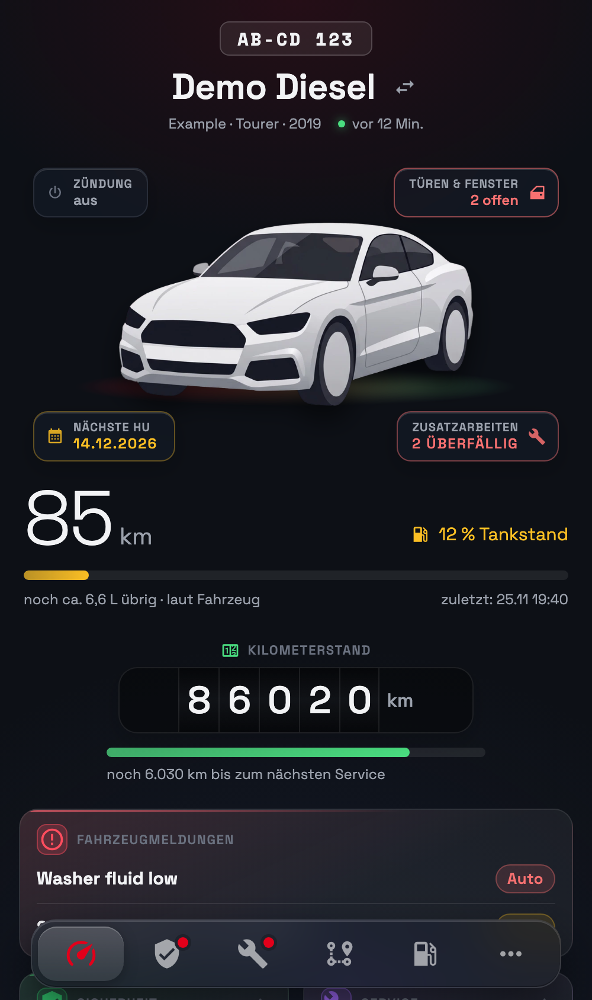
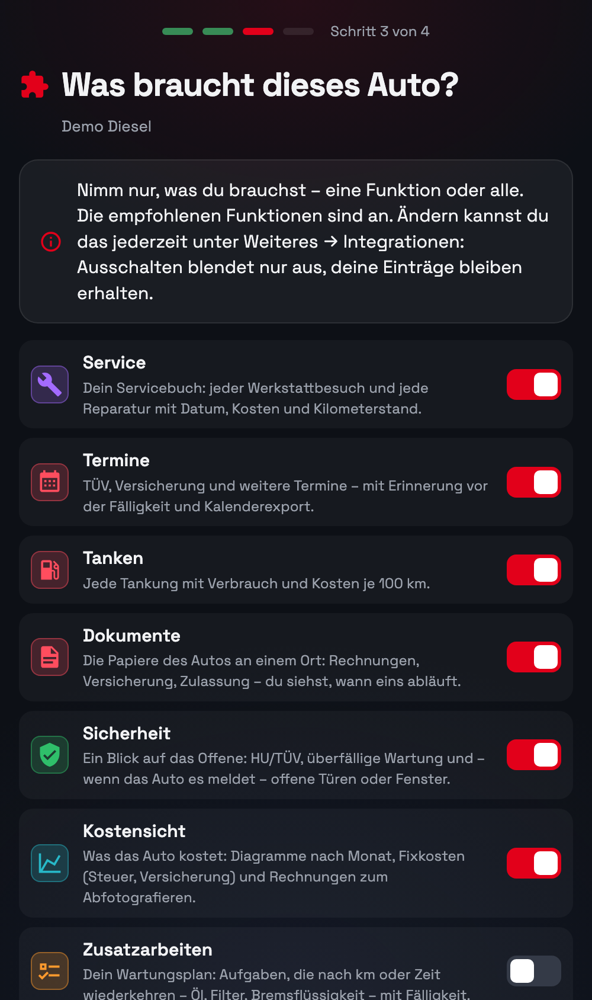
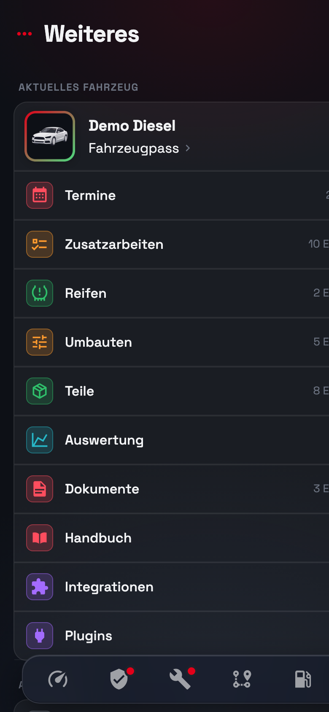

# Car Assistant


<div align="center">

[](https://github.com/Matze89x/ha-car-assistant/actions/workflows/ci.yml) [](LICENSE)

<!-- release:start -->
[](carassistant/CHANGELOG.de.md) Die öffentliche Testversion. Bitte ausprobieren und melden, was dir auffällt.
<!-- release:end -->

📷 **[Screenshots](docs/screenshots.de.md)** · 📖 **[Doku-Webseite](https://matze89x.github.io/ha-car-assistant/de/)** · 🧭 **[Architektur](docs/architecture.de.md)** · [🇬🇧 English](README.md) · 🇩🇪 Deutsch

</div>

**Das Logbuch und Dashboard für dein Auto.** Tanken und Laden, Servicebuch, Termine, Dokumente, Ersatzteile, Fahrten und Kosten – an einem Ort, für ein Auto oder für die ganze Familie, Verbrenner, Hybrid oder Elektro. Es läuft als App in Home Assistant, und deine Daten bleiben auf deinem eigenen Server.

<p align="center">
  
  
  
</p>

## Nimm so viel – oder so wenig – wie du brauchst

Car Assistant besteht aus kleinen **Funktionen**, und **jedes Auto wählt seine eigenen**. Nimm eine, ein paar oder alle:

| Du möchtest ... | Schalte ein ... |
|---|---|
| ⛽ **nur Tankungen oder Ladevorgänge festhalten** | Tanken / Laden |
| 📅 **TÜV und Versicherung nie verpassen** | Termine |
| 🔧 **das Servicebuch eines Autos, mit den Belegen** | Service · Dokumente |
| 💰 **wissen, was ein Auto wirklich kostet** | Kostensicht · Tanken / Laden · Service |
| 🗺️ **ein Fahrtenbuch mit der Route auf der Karte** | Fahrten · Km-Zähler |
| 🚗 **alles zu einem Auto an einem Ort** | alles – und Plugins für Live-Daten |

Die Einführung beim ersten Start fragt, was jedes Auto braucht, und erklärt jede Funktion in einem Satz. Ändern kannst du das jederzeit unter **Weiteres → Integrationen**: Eine ausgeschaltete Funktion wird nur ausgeblendet, deine Einträge bleiben erhalten. *Tanken / Laden* ist eine Funktion, die die Sprache des Autos spricht: Sie heißt *Tanken* beim Verbrenner und *Laden* beim Elektroauto (beim Plug-in-Hybrid wählst du selbst).

## Was drinsteckt

- ⛽ **Tanken und Laden** – jede Tankung und jeder Ladevorgang mit Verbrauch und Kosten; die günstigsten Tankstellen oder die Ladesäulen in der Nähe
- 🔧 **Service und Termine** – ein Servicebuch, ein Wartungsplan mit Erinnerungen nach km und Zeit, TÜV- und Versicherungstermine mit Kalenderexport
- 📄 **Dokumente** – Rechnungen, Versicherungs- und Zulassungspapiere, das Handbuch des Autos (PDF, EPUB); fotografiere eine Rechnung, und sie wird auf deinem eigenen Server gelesen – gebucht wird nie von selbst
- 🛞 **Teile, Reifen und Umbauten** – was du gekauft hast, welcher Satz montiert ist, was du geändert hast
- 🗺️ **Fahrten** – die Route auf einer nach Tempo eingefärbten Karte, GPX- und CSV-Import, PDF-Export, eigene Km-Zähler
- 📊 **Kosten** – was jedes Auto kostet, nach Tanken oder Laden, Service, Teilen, Umbauten und Fixkosten, und eine Auswertung deiner Fahrten
- 📘 **Fahrzeugpass** – die wichtigen Fakten, die FIN mit einem Tipp kopieren, die Ausstattungsliste
- 🔔 **Erinnerungen** aufs Handy je Auto · 📱 eine **Web-App je Auto** für den Home-Bildschirm · 🎨 hell, dunkel oder automatisch, mit eigener Farbe
- 💾 **Deins** – Sicherungen für ein Auto oder für alles, Deutsch und Englisch (weitere Sprachen als Datei), metrisch oder imperial, ein Demo-Auto zum Ansehen

## Die Außenwelt anbinden – wenn du willst

Car Assistant spricht nie von sich aus mit einem Auto. Das tun **Plugins**: ein Auto, die Cloud eines Herstellers, ein Webdienst mit Anmeldung, eine Wallbox. Was sie liefern (Kilometerstand, Tankfüllung, Position, Türen, ...), erscheint auf dem Dashboard wie Daten, die du selbst eingetippt hast. Entitäten aus **Home Assistant**, Sensoren nach draußen über **MQTT** und der **MCP-Zugriff für Claude** ([so geht's](docs/mcp.de.md)) funktionieren genauso: optional, und aus, bis du sie einschaltest.

Jeder kann ein Plugin schreiben und mit einer einzigen HTTP-Anfrage andocken – fang mit [Hier anfangen](docs/start-here.de.md) und der [Plugin-API](docs/api.de.md) an. Plugins kommen aus *Quellen* (ein Repository mit Index). Eines mit einem kleinen eigenen Dienst läuft erst, nachdem ein Administrator es freigegeben hat – es ist fremder Code, nimm also nur Quellen, denen du vertraust.

**Standardmäßig privat.** Deine Daten bleiben lokal, und nichts geht online, solange du es nicht einschaltest. Innerhalb von Home Assistant ist kein Login nötig; der Port ist aus, bis du ihn setzt, und der Direktzugriff braucht immer einen Benutzer (Passwort oder Passkey).

## Installation
[](https://my.home-assistant.io/redirect/supervisor_add_addon_repository/?repository_url=https%3A%2F%2Fgithub.com%2FMatze89x%2Fha-car-assistant)

Der Button fügt das Repository in dein Home Assistant ein; installiere dann *Car Assistant* im App Store. Im selben Store steht auch *Car Assistant Developer* (der neueste Entwicklungsstand, Version wie `0.5.1.3`, eigene Daten, zum Testen). Weitere Wege (auch ohne GitHub): [docs/install.de.md](docs/install.de.md).

## Dokumentation

Alles gibt es auf Englisch und auf Deutsch. Lies es als **[Webseite](https://matze89x.github.io/ha-car-assistant/de/)** mit Menü, Suche und Sprachumschalter, oder fang hier an:
**[Benutzerhandbuch](docs/guide.de.md)** · **[Installation](docs/install.de.md)** · **[Sicherungen](docs/backup.de.md)** · **[Hier anfangen: dein erstes Plugin](docs/start-here.de.md)** · **[Roadmap](docs/roadmap.de.md)** · **[Änderungsprotokoll](carassistant/CHANGELOG.de.md)**

<details>
<summary><b>Alle Dokumentationsseiten</b></summary>

**Benutzen**

| Seite | Worum es geht |
|---|---|
| [Benutzerhandbuch](docs/guide.de.md) | alle Seiten eines Autos Schritt für Schritt |
| [Screenshots](docs/screenshots.de.md) | die App im Einsatz |
| [Installation](docs/install.de.md) | in Home Assistant, aus dem Repository oder als lokale App |
| [Sicherungen](docs/backup.de.md) | ein Auto oder das ganze System sichern und wiederherstellen |
| [Protokolle](docs/logs.de.md) | das Protokoll der App in Home Assistant und die Seite Protokoll eines Plugins: was jedes sagt, was nie darin steht |
| [MCP-Zugriff](docs/mcp.de.md) | Claude Code Einträge lesen und korrigieren lassen (standardmäßig aus) |
| [Handbuch-Paket](docs/manual-package.de.md) | ein Handbuch mit Seitenbildern importieren |
| [Fahrzeugdatei](docs/vehicle-file.de.md) | ein Auto aus einem anderen Programm übernehmen |
| [Roadmap](docs/roadmap.de.md) | was fertig ist und was kommt |

**Eigenes anbinden (Plugins und Integrationen)**

| Seite | Worum es geht |
|---|---|
| [Architektur](docs/architecture.de.md) | wie alles zusammenhängt, als Diagramme |
| [Hier anfangen](docs/start-here.de.md) | deine erste Integration oder dein erstes Plugin, in zehn Minuten am Laufen |
| [Plugin-Anleitung](docs/plugin-guide.de.md) | der ganze Weg auf einer Seite, zum Nachschlagen |
| [Plugins](docs/plugins.de.md) | Paketformat, Einstellungsseite, Dienste, Dateien, Kacheln |
| [Home-Assistant-Plugin](docs/home-assistant.de.md) | Entitäten aus Home Assistant als Werte eines Fahrzeugs (Wallbox, Tracker, Sensoren), live, je Fahrzeug |
| [Spritpreis-Anbieter](docs/fuel-providers.de.md) | eine offene JSON-Datei pro Land für Spritpreise |
| [Ladesäulen-Anbieter](docs/charge-providers.de.md) | Ladesäulensuche in der Nähe des Autos für E-Autos: OpenStreetMap, Open Charge Map, eine eigene JSON-Datei |
| [Integrationen](docs/integrations.de.md) | Seiten ohne Code, Erinnerungen, Pläne |
| [Plugin-API](docs/api.de.md) | alle Felder und Wege, Werte an die App zu schicken |
| [Quellen und Pakete](docs/sources.de.md) | ein Repository als Quelle anbieten |
| [Beispiele](docs/examples/README.de.md) | fertige Ausgangspunkte zum Kopieren |

**An der App mitbauen**

| Seite | Worum es geht |
|---|---|
| [Design](docs/design.de.md) | Bausteine, Farben, Abstände |
| [Design-Vertrag](docs/design-contract.de.md) | die festen Regeln der Oberfläche |
| [Symbole](docs/icons.de.md) | der Symbolsatz und wie man ihn nutzt |
| [Pflege](docs/maintaining.de.md) | von der Meldung zur Version: Labels, Meilensteine, Releases |
| [Übersetzen](docs/translating.de.md) | eine neue Sprache als Datei |

**Weiteres**

| Seite | Worum es geht |
|---|---|
| [App-Seite in Home Assistant](carassistant/DOCS.de.md) | der Reiter *Dokumentation* in der App |
| [Sicherheit](docs/community/security.de.md) | wie du eine Schwachstelle meldest und wie die App dich schützt |
| [Mitmachen](docs/community/contributing.de.md) | wie du hilfst: Regeln, Tests, Pull Requests |
| [Änderungsprotokoll](carassistant/CHANGELOG.de.md) | was sich in welcher Version geändert hat |

</details>

## Entwicklung
```
pip install -r carassistant/requirements.txt pytest ruff httpx pyyaml
CARASSISTANT_DEV=1 pytest
ruff check . && ruff format --check .
```

## Warum es dieses Projekt gibt
Car Assistant ist aus einer Idee entstanden, die mich seit vielen Jahren begleitet: ein Ort, an dem alles zu den Autos einer Familie liegt und ausgewertet wird - Unterlagen, Service, Tanken und vor allem *was als Nächstes in welchem Auto fällig wird*. Jahrelang habe ich diese Daten privat gesammelt und dokumentiert, bis hin zu den Werten, die ich mit einem Diagnosewerkzeug aus den Autos gelesen habe, und mir mit HTML, PHP und einer SQLite-Datenbank eine eigene Übersicht gebaut. Was noch fehlte, war, es richtig umzusetzen. Diese App ist dieser Schritt, gemeinsam mit Claude (einem KI-Assistenten) gebaut und geteilt mit allen, die sich um ein oder mehrere Autos kümmern.

## Unterstützen
Car Assistant ist kostenlos und entsteht in der Freizeit. Wenn es dir hilft, freue ich mich über einen Kaffee:

[](https://ko-fi.com/matze89x)

## Danke
Danke an [Home Assistant](https://www.home-assistant.io/) und seine Community - das Zuhause dieser App - und an alle, die testen, melden und verbessern. Car Assistant steht auf vielen Open-Source-Projekten; die vollständige Liste steht in [NOTICE.md](NOTICE.md). Icons: [Material Design Icons](https://pictogrammers.com/library/mdi/) (Apache License 2.0), Schriften Space Grotesk und Space Mono (SIL Open Font License 1.1).

## Lizenz
[GNU General Public License v3.0](LICENSE) – © 2026 Matze89x. Du darfst Car Assistant nutzen, untersuchen, ändern und weitergeben; wenn du es weitergibst (geändert oder nicht), muss es unter derselben Lizenz bleiben und der Quelltext verfügbar sein.
