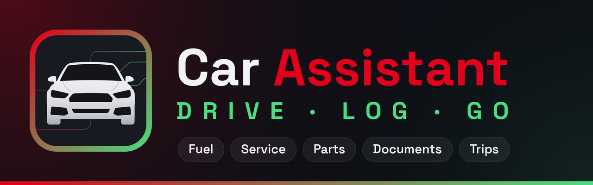

# Car Assistant



[](https://github.com/Matze89x/ha-car-assistant/actions/workflows/ci.yml) [](LICENSE)

📷 **[Screenshots](docs/screenshots.de.md)** – die App im Einsatz · 🧭 **[Architektur](docs/architecture.de.md)** – wie alles zusammenhängt, auch für Plugins und Integrationen

[🇬🇧 English](README.md) · 🇩🇪 Deutsch

<!-- release:start -->
[](carassistant/CHANGELOG.de.md) Die öffentliche Testversion. Bitte ausprobieren und melden, was dir auffällt.
<!-- release:end -->

**Das Logbuch und Dashboard für dein Auto.** Car Assistant bewahrt **alle Dokumente und Daten deiner Fahrzeuge an einem Ort** auf – Unterlagen, Rechnungen und Handbücher digital abgelegt, dazu die Daten des Autos selbst, sobald ein Plugin sie liefert (es läuft als App in Home Assistant) – ein Auto oder mehrere, Verbrenner, Hybrid oder Elektro:

- ⛽ Tankstopps und Ladevorgänge mit Verbrauchs- und Kostenstatistik, Tankstellen in der Nähe
- 🔧 Servicebuch, Zusatzarbeiten (Wartungsplan) mit Erinnerungen, Termine (TÜV, Versicherung) und Kalenderexport
- 📦 gekaufte Ersatzteile (Teilenummer, Shop, Preis, wo verbaut)
- 📄 alle Dokumente: Handbücher, Rechnungen, Versicherungs- und Zulassungspapiere
- 🛞 Reifensätze mit empfohlenem Reifendruck je Saison, Umbauten, Fahrten (GPX/CSV, PDF-Export)
- 🧮 eigene Km-Zähler, z. B. für das Steuerjahr
- 📘 der **Fahrzeugpass** mit den wichtigen Fakten, FIN-Kopierknopf und der Ausstattungsliste; das **Handbuch** des Autos (PDF / EPUB / Text importieren, Kapitel, Suche, EPUB-Export)
- 📍 Status und Standort auf Home (Zündung, Türen, Reifendruck, Position mit Karte), sobald ein Plugin die Daten liefert
- 🔌 **Plugins binden die Außenwelt an** – ein Auto, die Cloud eines Herstellers, einen Webdienst mit Anmeldung, ein Gerät: Das Plugin spricht mit der Außenwelt, Car Assistant bietet nur die [Plugin-API](docs/api.de.md)
- 🔔 Erinnerungen aufs Handy **je Auto** (Web-Push oder der Home-Assistant-Benachrichtigungsdienst), auf Wunsch Sensoren und die GPS-Position des Autos in Home Assistant per MQTT (standardmäßig aus)
- 📊 eine **Kostenseite** (was jedes Auto kostet, nach Tanken, Service, Umbauten und Teilen, mit jedem Eintrag in der Liste) und eine **Fahrten-Auswertung** (Längen, Wochentag und Tageszeit, Fahrstil)
- 🤖 **MCP-Zugriff für Claude**: lass Claude deine Einträge lesen - und, wenn du es erlaubst, vervollständigen oder korrigieren - im Web-Chat, in der Desktop-App oder auf dem Handy; standardmäßig aus, ein Schalter, ein Schlüssel ([MCP-Zugriff](docs/mcp.de.md))
- 📱 eine **Web-App je Auto** für den Home-Bildschirm: Sie öffnet direkt dieses Auto und zeigt nur dieses
- 💾 Sicherungen für ein Auto oder für alles, ein Demo-Auto zum Ansehen, Sprache und Einheiten (metrisch / imperial) nach Wunsch
- 🔐 Login für den Zugriff von außen (Passwort, Passkeys) – innerhalb von Home Assistant keiner nötig; der Port ist aus, bis du ihn setzt, und der Direktzugriff braucht immer einen Benutzer
- 🎨 ein Design in Hell, Dunkel oder Auto mit eigener Farbe - für die ganze App oder für ein Auto - und ein Icon je Auto (Logo oder Foto im farbigen Rahmen; Favicon, iPhone- und Web-App-Icons entstehen von selbst)

Alles ist modular: Module und Integrationen schaltest du unter **Integrationen** ein oder aus, wie in Home Assistant. Die Daten bleiben lokal, nichts geht online, solange du es nicht einschaltest.

**Für eine Community gebaut.** Jeder kann ein Plugin schreiben und mit einer einzigen HTTP-Anfrage andocken – fang mit der [Plugin-Anleitung](docs/plugin-guide.de.md) an. Plugins kommen aus *Quellen* (ein Repository mit Index) und können Einstellungen, Dateien, Seiten und sogar einen kleinen eigenen Dienst mitbringen. Ein Dienst läuft in der App erst, nachdem ein Administrator ihn freigegeben hat – es ist fremder Code, nimm also nur Quellen, denen du vertraust. Neues soll ohne Änderung am Kern hinzukommen.

## Installation
[](https://my.home-assistant.io/redirect/supervisor_add_addon_repository/?repository_url=https%3A%2F%2Fgithub.com%2FMatze89x%2Fha-car-assistant)

Der Button fügt das Repository in dein Home Assistant ein; installiere dann *Car Assistant* im App Store. Weitere Wege (auch ohne GitHub): [docs/install.de.md](docs/install.de.md).

## Dokumentation

Alles gibt es auf Englisch und auf Deutsch; oben in jeder Seite wechselst du die Sprache.

**Benutzen**

| Seite | Worum es geht |
|---|---|
| [Benutzerhandbuch](docs/guide.de.md) | alle Seiten eines Autos Schritt für Schritt |
| [Screenshots](docs/screenshots.de.md) | die App im Einsatz |
| [Installation](docs/install.de.md) | in Home Assistant, aus dem Repository oder als lokale App |
| [Sicherungen](docs/backup.de.md) | ein Auto oder das ganze System sichern und wiederherstellen |
| [MCP-Zugriff](docs/mcp.de.md) | Claude Code Einträge lesen und korrigieren lassen (standardmäßig aus) |
| [Handbuch-Paket](docs/manual-package.de.md) | ein Handbuch mit Seitenbildern importieren |
| [Fahrzeugdatei](docs/vehicle-file.de.md) | ein Auto aus einem anderen Programm übernehmen |
| [Roadmap](docs/roadmap.de.md) | was fertig ist und was kommt |

**Eigenes anbinden (Plugins und Integrationen)**

| Seite | Worum es geht |
|---|---|
| [Architektur](docs/architecture.de.md) | wie alles zusammenhängt, als Diagramme |
| [Plugin-Anleitung](docs/plugin-guide.de.md) | der schnellste Einstieg |
| [Plugins](docs/plugins.de.md) | Paketformat, Einstellungsseite, Dienste, Dateien, Kacheln |
| [Integrationen](docs/integrations.de.md) | Seiten ohne Code, Erinnerungen, Pläne |
| [Plugin-API](docs/api.de.md) | alle Felder und Wege, Werte an die App zu schicken |
| [Quellen und Pakete](docs/sources.de.md) | ein Repository als Quelle anbieten |
| [Beispiele](docs/examples/README.de.md) | fertige Ausgangspunkte zum Kopieren |

**An der App mitbauen**

| Seite | Worum es geht |
|---|---|
| [Design](docs/design.de.md) | Bausteine, Farben, Abstände |
| [Design-Vertrag](docs/design-contract.de.md) | die festen Regeln der Oberfläche |
| [Symbole](docs/icons.de.md) | der Symbolsatz und wie man ihn nutzt |
| [Pflege](docs/maintaining.de.md) | von der Meldung zur Version: Labels, Meilensteine, Releases |
| [Übersetzen](docs/translating.de.md) | eine neue Sprache als Datei |

**Weiteres**

| Seite | Worum es geht |
|---|---|
| [Add-on-Seite in Home Assistant](carassistant/DOCS.de.md) | der Reiter *Dokumentation* im Add-on |
| [Sicherheit](SECURITY.de.md) | wie du eine Schwachstelle meldest und wie die App dich schützt |
| [Mitmachen](CONTRIBUTING.de.md) | wie du hilfst: Regeln, Tests, Pull Requests |
| [Änderungsprotokoll](carassistant/CHANGELOG.de.md) | was sich in welcher Version geändert hat |

## Entwicklung
```
pip install -r carassistant/requirements.txt pytest ruff httpx pyyaml
CARASSISTANT_DEV=1 pytest
ruff check . && ruff format --check .
```

## Warum es dieses Projekt gibt
Car Assistant ist aus einer Idee entstanden, die mich seit vielen Jahren begleitet: ein Ort, an dem alles zu den Autos einer Familie liegt und ausgewertet wird - Unterlagen, Service, Tanken und vor allem *was als Nächstes in welchem Auto fällig wird*. Jahrelang habe ich diese Daten privat gesammelt und dokumentiert, bis hin zu den Werten, die ich mit einem Diagnosewerkzeug aus den Autos gelesen habe, und mir mit HTML, PHP und einer SQLite-Datenbank eine eigene Übersicht gebaut. Was noch fehlte, war, es richtig umzusetzen. Diese App ist dieser Schritt, gemeinsam mit Claude (einem KI-Assistenten) gebaut und geteilt mit allen, die sich um ein oder mehrere Autos kümmern.

## Unterstützen
Car Assistant ist kostenlos und entsteht in der Freizeit. Wenn es dir hilft, freue ich mich über einen Kaffee:

[](https://ko-fi.com/matze89x)

## Danke
Danke an [Home Assistant](https://www.home-assistant.io/) und seine Community - das Zuhause dieser App - und an alle, die testen, melden und verbessern. Car Assistant steht auf vielen Open-Source-Projekten; die vollständige Liste steht in [NOTICE.md](NOTICE.md). Icons: [Material Design Icons](https://pictogrammers.com/library/mdi/) (Apache License 2.0). Schriften: Space Grotesk und Space Mono (SIL Open Font License 1.1). Details in [NOTICE.md](NOTICE.md).

## Lizenz
[GNU General Public License v3.0](LICENSE) – © 2026 Matze89x. Du darfst Car Assistant nutzen, untersuchen, ändern und weitergeben; wenn du es weitergibst (geändert oder nicht), muss es unter derselben Lizenz bleiben und der Quelltext verfügbar sein.
