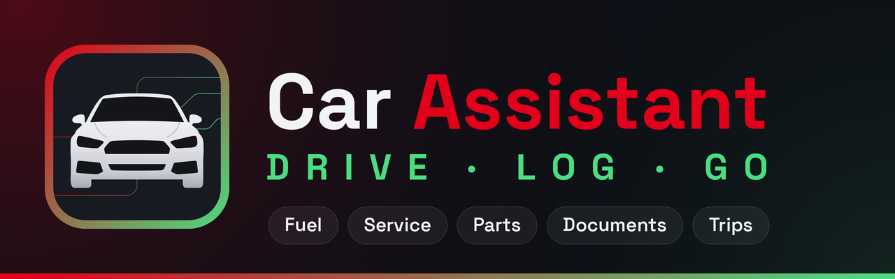
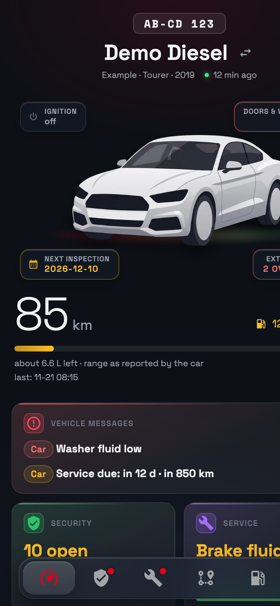
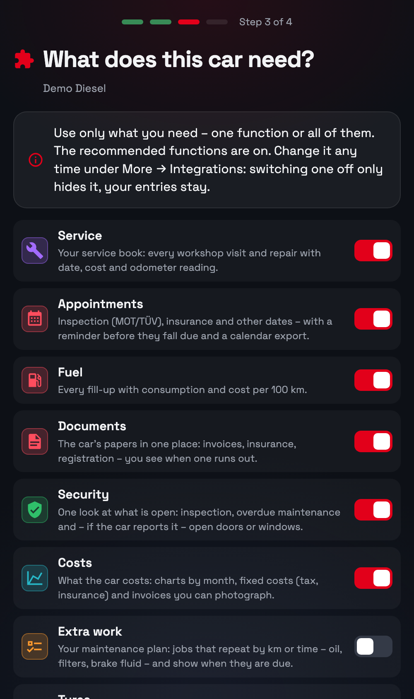
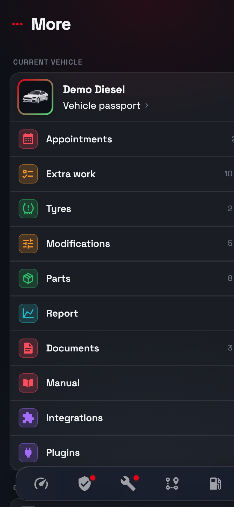

# Car Assistant



<div align="center">

[](https://github.com/Matze89x/ha-car-assistant/actions/workflows/ci.yml) [](LICENSE)

<!-- release:start -->
[](carassistant/CHANGELOG.md) The public test version. Please try it and report what you find.
<!-- release:end -->

📷 **[Screenshots](docs/screenshots.md)** · 📖 **[Documentation website](https://matze89x.github.io/ha-car-assistant/)** · 🧭 **[Architecture](docs/architecture.md)** · 🇬🇧 English · [🇩🇪 Deutsch](README.de.md)

</div>

**Your car's own logbook and dashboard.** Fuel stops, service book, appointments, documents, spare parts, trips and costs – in one place, for one car or for the whole family garage, combustion, hybrid or electric. It runs as an app inside Home Assistant, and your data stays on your own server.

<p align="center">
  
  &nbsp;
  
  &nbsp;
  
</p>

## Use as much – or as little – as you need

Car Assistant is made of small **functions**, and **every car chooses its own**. Take one, a few or all of them:

| If you want ... | Switch on ... |
|---|---|
| ⛽ **just a fuel log** | Fuel |
| 📅 **never to miss the inspection or the insurance** | Appointments |
| 🔧 **the service book of a car, with its receipts** | Service · Documents · Costs |
| 🔌 **an electric car with its charging costs** | Charging · Costs |
| 🗺️ **a logbook of your drives, on a map** | Trips · Km counters |
| 🚗 **everything about a car in one place** | everything – and plugins for live data |

The first start asks what each car needs and explains every function in one sentence. You can change it any time under **More → Integrations**: a function you switch off is only hidden, your entries stay. The pages speak the car's language – fuel for a combustion car, charging for an electric one.

## What is inside

- ⛽ **Fuel and charging** – every fill-up or charging session with consumption and cost; the cheapest fuel stations or the charging points nearby
- 🔧 **Service and dates** – a service book, a maintenance plan with reminders by km and time, inspection and insurance dates with calendar export
- 📄 **Documents** – invoices, insurance and registration papers, the car's manual (PDF, EPUB); photograph an invoice and it is read on your own server – nothing is booked by itself
- 🛞 **Parts, tyres and modifications** – what you bought, which set is mounted, what you changed
- 🗺️ **Trips** – the route on a map coloured by speed, GPX and CSV import, PDF export, your own km counters
- 📊 **Costs** – what each car costs, by fuel, service, parts, modifications and fixed costs, and an analysis of your trips
- 📘 **Vehicle passport** – the facts you need, the VIN at a tap, the list of equipment
- 🔔 **Reminders** to your phone per car · 📱 a **web app per car** for the home screen · 🎨 light, dark or automatic, with a colour of your own
- 💾 **Yours** – backups of one car or of everything, English and German (more languages as a file), metric or imperial, a demo car to just have a look

## Connect the outside world – if you want to

Car Assistant never talks to a car by itself. **Plugins** do: a car, a manufacturer's cloud, a web service you log in to, a wallbox. What they deliver (odometer, fuel level, position, doors, ...) shows up on the dashboard like data you typed in. Entities of **Home Assistant**, sensors out through **MQTT** and **MCP access for Claude** ([how](docs/mcp.md)) work the same way: optional, and off until you switch them on.

Anyone can write a plugin and dock it on with one HTTP request – start with [Start here](docs/start-here.md) and the [Plugin API](docs/api.md). Plugins come from *sources* (a repository with an index). One with a small service of its own runs only after an administrator approved it – it is foreign code, so use sources you trust.

**Private by default.** Your data stays local and nothing goes online unless you switch it on. Inside Home Assistant no login is needed; the port is off until you set it, and direct access always needs a user (password or passkey).

## Installation
[](https://my.home-assistant.io/redirect/supervisor_add_addon_repository/?repository_url=https%3A%2F%2Fgithub.com%2FMatze89x%2Fha-car-assistant)

The button adds the repository to your Home Assistant; install *Car Assistant* from the app store. The same store also lists *Car Assistant Developer* (the newest development state, version like `0.5.1.3`, own data, for testing). More ways (also without GitHub): [docs/install.md](docs/install.md).

## Documentation

Everything exists in English and in German. Read it as a **[website](https://matze89x.github.io/ha-car-assistant/)** with a menu, a search and a language switch, or start here:
**[User guide](docs/guide.md)** · **[Install](docs/install.md)** · **[Backups](docs/backup.md)** · **[Start here: your first plugin](docs/start-here.md)** · **[Roadmap](docs/roadmap.md)** · **[Changelog](carassistant/CHANGELOG.md)**

<details>
<summary><b>All documentation pages</b></summary>

**Use it**

| Page | What it is about |
|---|---|
| [User guide](docs/guide.md) | every page of a car, step by step |
| [Screenshots](docs/screenshots.md) | the app in use |
| [Install](docs/install.md) | in Home Assistant, from the repository or as a local app |
| [Backups](docs/backup.md) | back up and restore one car or everything |
| [Logs](docs/logs.md) | the log of the add-on in Home Assistant and the Logs page of a plugin: what each says, what is never in it |
| [MCP access](docs/mcp.md) | let Claude Code read and correct your records (off by default) |
| [Manual package](docs/manual-package.md) | import a manual with page images |
| [Vehicle file](docs/vehicle-file.md) | bring a car in from another program |
| [Roadmap](docs/roadmap.md) | what is done and what is next |

**Connect your own (plugins and integrations)**

| Page | What it is about |
|---|---|
| [Architecture](docs/architecture.md) | how everything fits together, as diagrams |
| [Start here](docs/start-here.md) | your first integration or plugin, running in ten minutes |
| [Plugin guide](docs/plugin-guide.md) | the whole path on one page, for reference |
| [Plugins](docs/plugins.md) | package format, settings page, services, files, tiles |
| [Home Assistant plugin](docs/home-assistant.md) | entities of Home Assistant as values of a car (wallbox, tracker, sensors), live, per car |
| [Fuel price providers](docs/fuel-providers.md) | an open JSON file per country for fuel prices |
| [Charging point providers](docs/charge-providers.md) | charging points near the car for electric cars: OpenStreetMap, Open Charge Map, your own JSON file |
| [Integrations](docs/integrations.md) | pages without code, reminders, plans |
| [Plugin API](docs/api.md) | all fields and ways to send values to the app |
| [Sources and packages](docs/sources.md) | offer a repository as a source |
| [Examples](docs/examples/README.md) | complete starting points to copy |

**Work on the app itself**

| Page | What it is about |
|---|---|
| [Design](docs/design.md) | components, colours, spacing |
| [Design contract](docs/design-contract.md) | the fixed rules of the interface |
| [Icons](docs/icons.md) | the icon set and how to use it |
| [Maintaining](docs/maintaining.md) | from a report to a version: labels, milestones, releases |
| [Translating](docs/translating.md) | a new language as a file |

**Also**

| Page | What it is about |
|---|---|
| [Add-on page in Home Assistant](carassistant/DOCS.md) | the *Documentation* tab of the add-on |
| [Security](SECURITY.md) | how to report a vulnerability and how the app protects you |
| [Contributing](CONTRIBUTING.md) | how to help: rules, tests, pull requests |
| [Changelog](carassistant/CHANGELOG.md) | what changed in which version |

</details>

## Development
```
pip install -r carassistant/requirements.txt pytest ruff httpx pyyaml
CARASSISTANT_DEV=1 pytest
ruff check . && ruff format --check .
```

## Why this project exists
Car Assistant grew out of an idea that has been with me for many years: one place where everything about the cars of a family is kept and evaluated - papers, service, fuel, and above all *what becomes due next in which car*. For years I collected and documented this data privately, down to the values read from the cars with a diagnostic tool, and built my own overview with HTML, PHP and an SQLite database. What was still missing was building it properly. This app is that step, made together with Claude (an AI assistant) and shared with everyone who looks after one or more cars.

## Support
Car Assistant is free and made in spare time. If it helps you, you can buy me a coffee:

[](https://ko-fi.com/matze89x)

## Thanks
Thanks to [Home Assistant](https://www.home-assistant.io/) and its community - the home of this app - and to everyone who tests, reports and improves. Car Assistant stands on many open-source projects; the full list is in [NOTICE.md](NOTICE.md). Icons: [Material Design Icons](https://pictogrammers.com/library/mdi/) (Apache License 2.0), fonts Space Grotesk and Space Mono (SIL Open Font License 1.1).

## License
[GNU General Public License v3.0](LICENSE) – © 2026 Matze89x. You may use, study, change and share Car Assistant; if you pass it on (changed or not), it must stay under the same license with the source code available.
