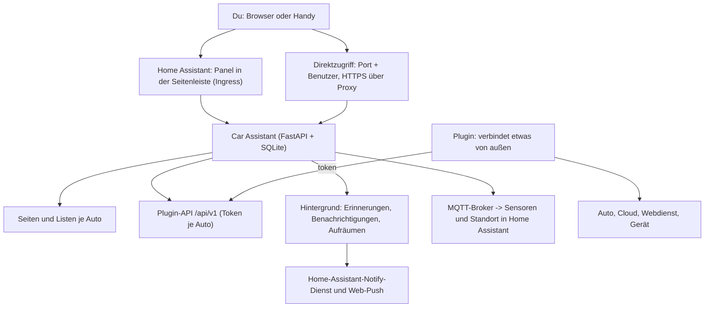
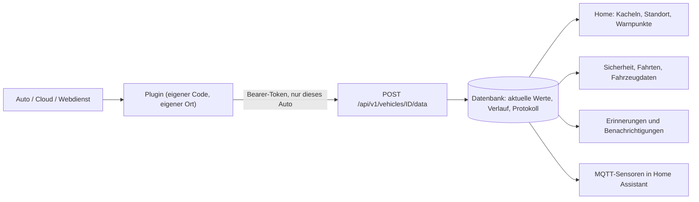
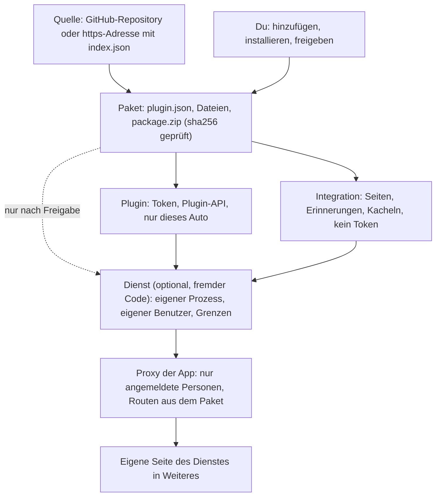

# Architektur: wie alles zusammenhängt

[🇬🇧 English](architecture.md) · 🇩🇪 Deutsch

Drei Bilder, vom Großen zum Kleinen. GitHub zeichnet sie direkt aus dem Text (Mermaid); mit dem Pfeil-Symbol oben rechts im Bild kannst du zoomen.

## 1. Das ganze System

Car Assistant ist **eine** App in Home Assistant. Alles, was nach außen spricht (ein Auto, eine Cloud, ein Webdienst), ist ein **Plugin** und redet nur über die Plugin-API mit der App.

## 2. Ein Plugin: von draußen bis auf die Seite

Ein Plugin kennt nur die Plugin-API. Es liest draußen, schickt Werte an die App, und die App zeigt nur, was ein Plugin geliefert hat - nichts wird erfunden.

Die Schnittstelle ist in der [Plugin-API](api.de.md) beschrieben, der Aufbau eines Plugins in der [Plugin-Anleitung](plugin-guide.de.md) und in [Plugins](plugins.de.md).

## 3. Quellen, Pakete und Dienste (Plugins und Integrationen)

Plugins und Integrationen sind **Pakete**: ein lesbarer Ordner mit `plugin.json`. Sie kommen aus *Quellen*, die du selbst hinzufügst. Nur ein Paket mit einem **Dienst** führt Code aus, und erst nach deiner Freigabe.

Der Dienst bekommt weder das Home-Assistant-Token noch die Datenbank; eine Integration bekommt kein Token und ruft die Plugin-API nie auf. Die Regeln stehen in [Quellen](sources.de.md), [Integrationen](integrations.de.md) und [Plugins](plugins.de.md#plugins-mit-dienst).

## Dein eigenes bauen

1. Lies die [Plugin-Anleitung](plugin-guide.de.md) und die [Plugin-API](api.de.md).
2. Schau dir die Beispiele in [docs/examples](examples/README.md) an: ein Dienst mit Seite, ein Skript, das Werte schickt, und ein Skript, das eine Fahrzeugdatei schreibt.
3. Lege dein Paket in ein Repository mit `index.json` ([Quellen](sources.de.md)), füge es als Quelle hinzu und installiere es.
