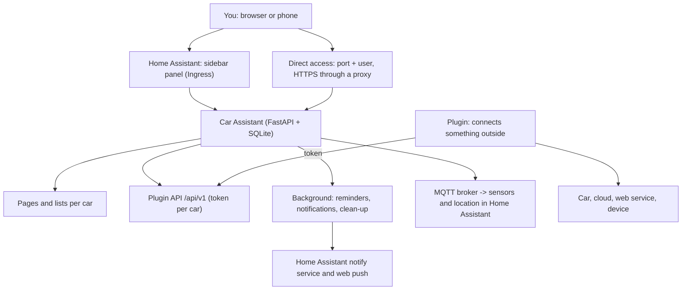
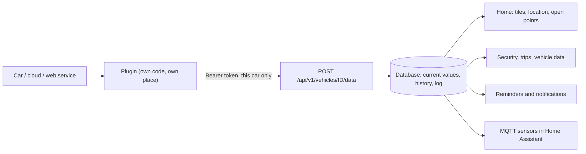
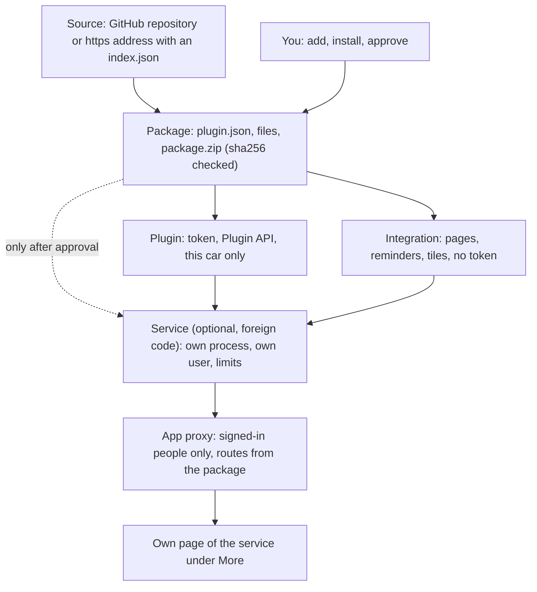

# Architecture: how everything fits together

🇬🇧 English · [🇩🇪 Deutsch](architecture.de.md)

Three pictures, from the big to the small. They are drawn straight from the text (Mermaid).

## 1. The whole system

Car Assistant is **one** app inside Home Assistant. Everything that talks to the outside (a car, a cloud, a web service) is a **plugin** and talks to the app only through the Plugin API.

## 2. A plugin: from the outside to the page

A plugin knows only the Plugin API. It reads outside, sends values to the app, and the app shows only what a plugin has delivered - nothing is invented.

The interface is described in the [Plugin API](api.md); how to build a plugin is in the [plugin guide](plugin-guide.md) and in [Plugins](plugins.md).

## 3. Sources, packages and services (plugins and integrations)

Plugins and integrations are **packages**: a readable folder with a `plugin.json`. They come from *sources* that you add yourself. Only a package with a **service** runs code, and only after your approval.

The service gets neither the Home Assistant token nor the database; an integration gets no token and never calls the Plugin API. The rules are in [Sources](sources.md), [Integrations](integrations.md) and [Plugins](plugins.md#plugins-with-a-service).

## Build your own

1. Read the [plugin guide](plugin-guide.md) and the [Plugin API](api.md).
2. Look at the examples in [docs/examples](examples/README.md): a service with a page, a script that sends values, and a script that writes a vehicle file.
3. Put your package in a repository with an `index.json` ([Sources](sources.md)), add it as a source and install it.
