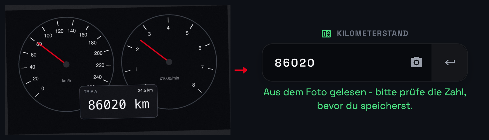
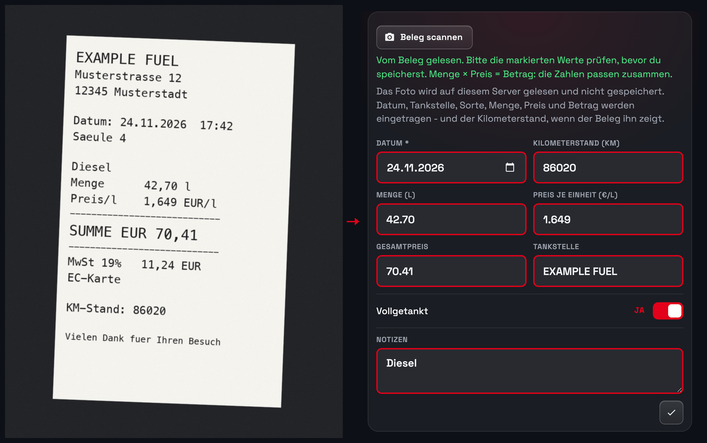

# Benutzerhandbuch

[🇬🇧 English](guide.md) · 🇩🇪 Deutsch

Car Assistant ist ein Fahrtenbuch und Dashboard für deine Autos. Das meiste erklärt sich auf der Seite selbst; hier die kurze Tour.

## Die drei Ebenen
Jede Einstellung liegt auf genau einer Ebene, du weißt also immer, wo du suchen musst. *Einstellungen* hat drei Reiter - zuerst das Auto, dann du, dann die ganze App:
- **Auto** – nur das Auto, das unter dem Titel steht (wechsle es mit dem Zeichen neben seinem Namen): Foto, Video, Design und Icon, Home-Assistant-Entitäten, Sicherung, Archivieren und Löschen.
- **Benutzer** – du: dein Login (Name, Passwort, Passcode, Passkeys), deine Geräte und alle deine Benachrichtigungen (eine Liste für jedes Auto), das Start-Auto und die Startlinks für eine [Web-App je Auto](#eine-web-app-je-auto).
- **System** – die ganze App, für jedes Auto und jede Person: eine Karte **Region**: Sprache, Datum und Uhrzeit (Reihenfolge des Datums, 12 / 24 Stunden), **Zeitzone** (automatisch = die von Home Assistant; Sommer-/Winterzeit folgt) sowie Einheiten und Währung, Design, Karte und Spritpreise, Sensoren in Home Assistant, [MCP-Zugriff](mcp.de.md), Quellen und Updates (auf Wunsch einmal am Tag ein Blick auf ein neues Car Assistant und auf Paket-Updates – der Punkt am Fuß der Seitenleiste wird gelb, wenn etwas neu ist), Protokolle, die Adresse der App, Sicherung von allem.

## Jede Seite sieht gleich aus
Jede Seite beginnt mit demselben Kopf: Symbol und Name der Seite, darunter der Name des Autos, rechts runde Symbolknöpfe (Hinzufügen, Bearbeiten, Export ...; fahre mit dem Zeiger darüber, um den Namen zu lesen). Direkt darunter, an **einer festen Stelle**, steht die *Hinweis-Kachel*: die kurze Einleitung der Seite mit einem ⓘ und – wenn nötig – die Meldungen: *Gespeichert* (grün, blendet aus), Warnungen (gelb) und Fehler (rot). Alles Weitere folgt auf jeder Seite in derselben Reihenfolge mit demselben Abstand.

## Erster Start
Eine kurze Einführung fragt nach der Sprache, dann nach deinem ersten Auto (oder einem Demo-Auto) und danach, welche Funktionen du möchtest. Alles lässt sich später ändern.

## Dashboard
*Dashboard anpassen* lässt dich Widgets verschieben, ausblenden und in der Größe ändern (der Stift eines Widgets öffnet seine Einstellungen: das Aussehen des Kilometerstands, die Spalten von *Fahrzeugmeldungen* und *Braucht Aufmerksamkeit*), *Video oder Foto bearbeiten* öffnet das Bild-Fenster. Jede Änderung wird sofort gespeichert: ein Tipp auf die Seite neben den Widgets (oder Escape) beendet das Bearbeiten - es gibt nichts zu bestätigen.

## Schnell eintragen: Kilometerstand und Tanken
Die zwei Dinge, die du am häufigsten einträgst, brauchen **kein Plugin und keine lange Tipperei**. Beides geht bei einem Auto, das mit nichts verbunden ist.

**Kilometerstand auf dem Dashboard aktualisieren - fünf Sekunden.**
1. Öffne das Dashboard des Autos und tippe auf den Kilometerstand: Er dreht sich zu einem Eingabefeld um. (Ein Link auf `…/v/<Auto>#odometer` öffnet es sofort - die Liste *Los geht's* eines neuen Autos nutzt ihn.)
2. Zahl tippen und auf den Pfeil drücken - **oder** auf den Kamera-Knopf tippen: Foto vom Tacho machen (der *untere* Teil genügt, dort sitzen Kilometerstand und Tageszähler) oder ein Foto vom Handy wählen.
3. Der Server liest das Foto, trägt die Zahl ein und sagt *Aus dem Foto gelesen - bitte prüfe die Zahl, bevor du speicherst*. Die Zahl wird mit dem letzten Stand verglichen: Eine Warnung erscheint, wenn sie niedriger oder weit höher ist. Gespeichert wird erst mit dem Pfeil.

Das Lesen schaut zuerst auf die untere Hälfte des Fotos und vertraut einer Zahl, die direkt vor *km* (oder *mi*) steht; ein Tageszähler wie *24,5 km* (er hat eine Nachkommastelle) und die Zahlen der Anzeigen (0 ... 260) werden nicht für den Kilometerstand gehalten. Ein Foto nur vom kleinen Display geht ebenso. Tipps: das Display im Bild, keine Spiegelungen, die Einheit sichtbar. Solange ein Plugin den Kilometerstand meldet, steht das Feld fest - es gibt nichts zu tippen.



**Tanken - drei Taps.**
1. *Tanken* → der Plus-Knopf (oder *Los geht's → Erste Tankung eintragen*; der Link `…/e/fuel#fuel-add` öffnet das Formular).
2. *Beleg scannen* → Foto vom Tankbeleg machen. Das Formular füllt sich: **Datum, Tankstelle, Sorte, Menge, Preis je Einheit, Betrag** und - wenn die Tankstelle ihn aufgedruckt hat (*KM-Stand*) - der **Kilometerstand**. Die ausgefüllten Felder sind markiert.
3. Markierte Felder ansehen und speichern. Menge × Preis = Betrag wird auf den Cent geprüft: Eine falsch gelesene Ziffer wird gefunden, ein fehlender Wert berechnet - und das Formular sagt es.

Das Lesen ist geduldig: Geht der erste Versuch nicht auf, probiert es noch einmal mit einem anderen Seitenlayout, einer schärferen und größeren Kopie, Schwarzweiß (verblasstes Thermopapier) und dem etwas zurückgedrehten Foto (ein schief gehaltener Beleg) - und behält das Beste. Der Kilometerstand eines Belegs wird nur angeboten, wenn er zum letzten Stand des Autos passt.



Beide Fotos werden **auf deinem eigenen Server** gelesen (Texterkennung mit Tesseract, nichts geht ins Internet) und nie gespeichert. Das Add-on hat die Texterkennung eingebaut; bei einer manuellen Installation erscheinen die Knöpfe, wenn Tesseract installiert ist.

## Fahrzeugdaten
*Weiteres → Fahrzeugdaten* zeigt alles zum Auto; der Stift öffnet das Formular. Das Formular ist in Kästen geteilt (*Dein Fahrzeug, Identifikation, Technik, Energie, Papiere*) und hat ein **Speichern** im Seitenkopf. Foto, Video, Design, Icon, Home-Assistant-Entitäten und Sicherung stehen nicht auf dieser Seite: Sie sind im Reiter **Auto** der Einstellungen.

## Einstellungen eines Autos
*Einstellungen → Auto* (das Auto unter dem Titel):
- **Icon** – das eigene Icon des Autos für Weiteres, den Browser-Tab und den Home-Bildschirm.
- **Foto und Video** – bis zu **10 Dateien pro Auto**, Fotos und Videos zusammen; beim elften Hinzufügen fällt die älteste heraus. Zwei Auswahlen, sofort gespeichert: *Für die Startseite* (ein Foto oder ein Video; ein Video läuft bei jedem Besuch einmal und bleibt dann auf seinem letzten Bild stehen - dieses Bild wird auf dem Gerät behalten, damit die Startseite auch dann ein Bild zeigt, wenn das Handy das Video nicht startet, zum Beispiel im Stromsparmodus, und ein Tipp spielt es wieder ab) und *Als Foto des Autos* (für die Autoauswahl und alle Listen). Ein Video braucht zuerst ein Foto.
- **Design** – das eigene Design des Autos mit eigenem Farbrad; *Wie das System* folgt dem Design von System.
- **Home-Assistant-Entitäten** – optionale Entitäten, die Kilometerstand, Tankstand, Reichweite und Position liefern (hier gibt es ein **Speichern**).
- **Sichern & verwalten** – dieses Auto sichern, archivieren oder löschen.

## Seiten eines Autos
**Fahrzeugpass** (*Weiteres → erste Zeile des Autos*). Der Kopf zeigt Name, Kennzeichen, *Marke Modell Variante*, die Fakten, die man ständig braucht, als Chips (Baujahr, Kraftstoff, Leistung, Getriebe, Kilometerstand) und die FIN mit Kopierknopf. Darunter: die Daten in Gruppen (nur was du eingetragen hast), die Notizen und die Liste **Ausstattungsmerkmale**. Die Ausstattung hat zwölf feste Bereiche (Komfort, Sitze, Bedienelemente, Licht, Linien & Pakete, Interieur, Räder & Reifen, Technik & Sicherheit, Exterieur, Infotainment, Assistenzsysteme, Verglasung & Dach); du kannst sie nur nach oben und unten sortieren. Jedes Merkmal hat einen Status – Serie, Sonderausstattung, nachgerüstet (blauer Haken) oder nicht verbaut (rotes Kreuz) – und einen optionalen Code wie eine PR-Nummer; der Stift bearbeitet ein Merkmal und verschiebt es auch in einen anderen Bereich.

**Fahrten** enthält oben die **Km-Zähler** (ein Zähler misst die Strecke zwischen einem Startstand und dem heutigen Kilometerstand oder einem Endstand, zum Beispiel fürs Steuerjahr) und darunter die Fahrten, nach Monaten. Tippe auf eine Fahrt für ihre Karte: Strecke, Dauer, Ø Tempo und Spitze, Verbrauchs-Chips (eine Schätzung aus dem Durchschnitt des Autos), die Route auf einer **Karte in voller Breite im Format 16:9** nach Tempo eingefärbt (blau langsam, grün und gelb dazwischen, rot ab 130 km/h; mit markiertem Start und Ziel) und der Fahrstil (braucht aufgezeichnete Positionen; von Hand eingetragene Fahrten zeigen Dauer und Ø aus den Zeiten). *Export* schreibt PDF oder CSV, *Import* liest eine GPX-Datei. Die **Fahrten-Auswertung** oben auf der Seite (30 Tage, 90 Tage, Jahr, Alle) zeigt Anzahl und Länge der Fahrten, ihren Anteil nach Art, ein Balkendiagramm der Fahrtlängen, eine Heatmap aus Wochentag und Tageszeit und den Fahrstil über alle aufgezeichneten Fahrten (starkes Bremsen je 100 km, Ø Tempo in Bewegung, Stillstand, Spitze).

**Karte** (*Weiteres → Karte*, unter *Integrationen* einzuschalten) ist eine Karte über die ganze Fläche mit dem Auto und - wenn du es im Browser erlaubst - deinem eigenen Standort, einer Suche nach Orten und Adressen und *Navigieren*, das ein Ziel an das Plugin des Autos schickt (wenn es Navigation anbietet) oder deine Navigations-App öffnet. Siehe [Integrationen](integrations.de.md#karte).

**Kostensicht** ist die Kostenseite: das ausgegebene Geld im gewählten Zeitraum (Tage, Wochen oder Monate), der Anteil von Tanken, Service, Umbauten und Teilen, ein Diagramm je Zeitraum und eine Liste jedes Eintrags mit Preis - tippe auf eine Kategorie, um zu filtern. Darunter folgen Verbrauch, Preis je Liter und Kilometer.

**Tanken** enthält oben die **Tankstellensuche** und darunter die Tankungen, nach Monaten. Die Suche ist bewusst einfach: Sie weiß, was dein Auto braucht (Diesel oder Benzin), sucht im Umkreis von 15 km und zeigt jede Tankstelle in einer Zeile – Name, Entfernung und Preis, die günstigste grün markiert; zwei Tabs wählen *rund ums Auto* oder *meine Position*. **Reifen** hat einen Tab je Jahreszeit (Sommer, Winter, Ganzjahr) mit **einem Satz je Jahreszeit**: Der Name ist die Überschrift (Pflicht), dazu Größe, empfohlener Luftdruck (normal und voll beladen), der letzte Messwert des Autos und der Lagerort; der montierte Satz trägt ein Schild-Symbol. **Zusatzarbeiten** zeigt den Kilometerstand und eine Karte je Arbeit (das Symbol passt zur Arbeit) mit Intervall, Fortschrittsbalken und *zuletzt* / *nächste*; vorgegebene Arbeiten gibt es nicht, weil jedes Auto anders ist. *Bearbeiten* (unten rechts in der Karte) öffnet *Jetzt erledigt – bei Kilometerstand* mit *Zurücksetzen* oben und darunter das Formular. **Umbauten** sind Karten, nach Jahr gruppiert mit der Summe des Jahres; der Plus-Knopf öffnet das Formular wie auf jeder anderen Seite. **Termine** stehen in einer kompakten Spalte mit je einem *Bearbeiten*-Knopf; die Gruppen *Kommende* und *Abgeschlossene Termine* erscheinen nur, wenn es solche gibt (abgeschlossen = als erledigt markiert); das Datum kann ein Monat oder ein Tag sein, geschrieben wie unter Einstellungen → System → Datum & Uhrzeit eingestellt. **Teile & Einkäufe** sehen aus wie Kassenzettel (Datum und Shop, Teil und Preis, Details). **Dokumente** sind Karten mit *Öffnen* und *Bearbeiten*: Titel, Kategorie, Datum des Dokuments, gültig bis (ein Badge zeigt, wann es abläuft) und Notiz. Das **Handbuch** importiert eine PDF (mit Textebene), eine EPUB-, eine Text- / Markdown-Datei oder ein [Paket mit Seitenbildern](manual-package.de.md), zeigt die Seiten als Bild oder Text, listet die Kapitel, durchsucht, merkt sich, wo du aufgehört hast, und exportiert eine EPUB – die Datei bleibt auf deinem Server.

**Beleg scannen.** Beim Anlegen einer Tankung nimmt *Beleg scannen* ein Foto des Tankbelegs auf (das Handy öffnet die Kamera). Das Foto wird **auf deinem eigenen Server** gelesen (Texterkennung mit Tesseract, nichts geht ins Internet) und sofort verworfen; es füllt nur das Formular: Datum, Menge, Preis je Einheit, Betrag, Name der Tankstelle, das Produkt (zum Beispiel *Super E10*) und - wenn die Tankstelle ihn aufgedruckt hat - den Kilometerstand. Die ausgefüllten Felder sind markiert; prüfe sie und speichere. Die App prüft, dass *Menge x Preis = Betrag* ergibt, findet so eine falsch gelesene Ziffer und rechnet einen fehlenden Wert aus (und sagt dir das). Ohne die Texterkennung auf dem Server gibt es den Knopf einfach nicht. Mehr unter *Schnell eintragen* weiter oben.

**Kilometerstand: ein Zählwerk zum Umdrehen.** Der Kilometerstand auf dem Dashboard ist ein dunkler Kasten wie ein Zählwerk, mit seiner Beschriftung darüber: Die Ziffern laufen wie bei einem mechanischen Zähler von oben nach unten durch. Tippe irgendwo darauf, und er dreht sich zur Eingabe um, die den letzten Stand als Hinweis zeigt: Zahl tippen, oder ein Foto des Tachos aufnehmen (Kamera-Knopf) oder eins auswählen (Hochladen-Knopf). Das Foto wird wie ein Beleg auf deinem eigenen Server gelesen und nie gespeichert. Die gefundene Zahl ist nur ein Vorschlag: Sie wird mit dem letzten Stand verglichen, und es erscheint eine Warnung, wenn sie niedriger oder viel höher ist. Gespeichert wird erst mit dem Haken; ein Tipp irgendwo anders dreht den Kasten zurück. Solange ein Plugin den Kilometerstand meldet, gibt es nichts zu tippen: Das Zählwerk steht dann nicht im Dashboard, das Widget *Kilometerstand* (für so ein Auto standardmäßig an) zeigt die Zahl stattdessen. Das gilt nur, solange das Plugin existiert: Entfernst du es (oder löschst den Home-Assistant-Sensor des Autos), gehört der Kilometerstand wieder dir - der letzte Stand bleibt, und das Zählwerk ist zurück im Dashboard. Bei einem Auto ohne Stand bietet das Dashboard dieselbe Eingabe für den ersten an. Das Zählwerk sitzt unter dem Auto - auch unter einer Reichweite - und ist die eine Stelle, um den Kilometerstand zu ändern. Das Widget *Kilometerstand* (standardmäßig aus, einschalten unter *Dashboard anpassen*) **zeigt** den Stand nur - es hat keine eigene Eingabe - in drei Darstellungen zur Auswahl, in seinen Einstellungen: *Walzen*, *Kachel* und *Zählwerk* (derselbe Kasten ohne Umdrehen, der sich der Breite seines Platzes anpasst). In den Darstellungen *Walzen* und *Kachel* zeigt die Kachel außerdem die Kilometer der letzten sechs Monate als kleine Balken (der aktuelle Monat markiert), den Schnitt pro Tag, die Kilometer dieses Monats und den Weg bis zum nächsten Service.

**Ein Kilometerstand, der rückwärts läuft.** Eine Zahl unter dem letzten Stand oder weit darüber (mehr als 100.000 km) wird nicht gespeichert, bevor du sie bestätigst - die Seite sagt warum und bietet *Trotzdem speichern* an. Die *Kilometerstände* im Fahrzeugpass (der Link *Alle Stände* auf der Rückseite des Kastens führt dorthin) listen jeden Kilometerstand des Autos - Stände, Tankungen, Service-Einträge, Umbauten und Fahrten - und markieren die, die nicht zu den anderen passen (zum Beispiel markiert 52.000, 520.000, 52.500 die 520.000). Ein einfacher Stand lässt sich dort löschen; bei den anderen öffnet der Stift den Eintrag. Die Liste scrollt nach etwa zehn Zeilen und klappt von selbst auf, wenn etwas nicht passt. Passt etwas nicht, sagt das Dashboard es, denn ein falscher Stand bringt Verbrauch, Termine und Fahrten durcheinander - auch die, die davor eingetragen wurden.

**Autos mit Benzin und Gas.** Wähle in den Fahrzeugdaten einen *zweiten Kraftstoff* (Autogas oder Erdgas). Jede Tankung sagt dann, welcher von beiden es war (ein Beleg, der Gas nennt, wird erkannt), die Liste markiert Gas-Tankungen mit einem Zeichen und ihrer eigenen Einheit, und jeder Kraftstoff bekommt seinen eigenen Durchschnittsverbrauch und seine Kosten je 100 km aus seinen eigenen Tankungen - genau, wenn das Auto zwischen zwei vollen Tanks nur damit gefahren ist. Der Verbrauch des ersten Kraftstoffs bleibt von Gas-Tankungen unberührt. Der CSV- und PDF-Export der Tankungen bekommt hinter der Menge eine Spalte *Kraftstoff* (das Gas in seiner eigenen Einheit). Home Assistant bekommt *Ø Verbrauch Gas* und, wenn die Gruppe Statistik eingeschaltet ist, *Letzter Verbrauch Gas*, *Kosten je 100 km Gas* und *Tankkosten Gas gesamt*; die Sensoren *Letzte Tankung* und *Menge der letzten Tankung* meinen immer den ersten Kraftstoff.

**Widgets.** Jedes Widget sieht gleich aus: Symbol und Titel links, rechts eine kleine Notiz (das letzte Signal des Autos) oder der Pfeil, dann der Wert und höchstens eine Zeile; Status-Chips stehen rechts, der Text links. *Fahrzeugdaten live* zeigt eine schlanke Zeile je Wert; *Standort* zeigt den Ort, ob das Auto hier steht oder fährt, die Karte und drei Navigations-Links.

**Protokolle** gehören zu jedem Plugin und jeder Integration: *Info* auf ihrer Karte zeigt ihr Protokoll (der Schalter für mehr Details, ihre Zeilen, die Aufrufe).

**Widgets der Startseite.** *Aufmerksamkeit*, *Fahrzeugdaten* und *Standort* sind immer eine ganze Zeile; alle anderen können klein oder eine ganze Zeile sein.

**Knöpfe.** Nebenaktionen sind leichte, umrandete Knöpfe, eine Knopfreihe bleibt einzeilig; nur die eine Hauptaktion einer Seite ist ein gefüllter Knopf.

## Navigation
Die Seitenleiste zeigt Name und Slogan als eine Einheit (gleich breit, die Größe folgt der Leiste). Der Punkt am Fuß ist grün, wenn alles aktuell ist, und gelb, wenn Car Assistant oder ein Paket ein Update hat (beim Darüberfahren steht der Grund; auf breiten Bildschirmen erscheinen darüber die Zeilen *System vX* / *Plugins n Updates*).

*Weiteres → Integrationen → Navigation verwalten*: Die ersten vier Seiten stehen in der Leiste, der Rest unter *Weiteres*, in derselben Reihenfolge. Integrationen und Plugins stehen immer am Ende. Schaltest du eine feste Integration aus, verschwindet ihre Seite aus der Navigation; die Listen bleiben synchron.

## Benachrichtigungen
Benachrichtigungen sind **ein System pro Person** unter *Einstellungen → Benutzer* – unter *Auto* oder *System* wird dazu nichts eingestellt. Dort schaltest du sie auf dem iPhone, iPad oder Computer ein, den du gerade benutzt (oder trägst den Namen deines Home-Assistant-Benachrichtigungsdienstes ein, wenn kein Port gesetzt ist) und siehst deine Geräte. Darunter **wählst du ein Auto** und schaltest jede Art von Meldung mit runden Schaltern ein oder aus (*Ja* / *Nein*); die Auswahl *Neue Autos* ist das, womit ein später hinzugefügtes Auto startet. Ein neues Auto erscheint von selbst in der Liste, ein entferntes verschwindet. *Allgemein* enthält Meldungen, die nicht zu einem Auto gehören (zum Beispiel eine neue Version eines installierten Plugins). Dieselben Worte gehen an eine Person nur einmal, und gleiche Meldungen ersetzen sich auf einem Gerät.

**Ohne Push, über Home Assistant.** Sind die MQTT-Sensoren an, hat jedes Auto in Home Assistant auch den Sensor **Letzte Benachrichtigung** (*Einstellungen → System*, standardmäßig an). Er zeigt, was die App für das Auto meldet - immer, ohne dass jemand Benachrichtigungen eingerichtet haben muss - und eine Automation dort kann es weitergeben, zum Beispiel:

```yaml
triggers:
  - trigger: state
    entity_id: sensor.mein_auto_letzte_benachrichtigung
actions:
  - action: notify.mobile_app_mein_handy
    data:
      title: Mein Auto
      message: "{{ state_attr('sensor.mein_auto_letzte_benachrichtigung', 'message') }}"
```

Der Name der Entität hängt vom Namen deines Autos ab (suche unter Entwicklerwerkzeuge → Zustände nach *Letzte Benachrichtigung*).

## Eine Web-App je Auto
*Einstellungen → Benutzer → Web-App für ein Auto* listet je Auto einen Startlink. Öffne den Link eines Autos in Safari, tippe auf *Teilen* und *Zum Home-Bildschirm*: Die App öffnet direkt dieses Auto und zeigt nur dieses - ohne Fahrzeugwechsel und ohne Liste der anderen. Sie braucht deine eigene https-Adresse (*Einstellungen → System*).

## Claude und MCP
Mit dem **MCP-Zugriff** unter *Einstellungen → System* lässt du Claude von überall deine Einträge lesen - und, wenn du es erlaubst, korrigieren: siehe [MCP-Zugriff](mcp.de.md).

## Archivieren und löschen
*Einstellungen → Auto → Sichern & verwalten*. **Archivieren** blendet das Auto aus der Autoauswahl und vom Dashboard aus; es steht ausgegraut ganz unten auf der Seite *Fahrzeuge*, wo **Wieder aktivieren** es zurückholt. **Löschen** entfernt das Auto samt aller Daten endgültig.

## Optionale Dienste (standardmäßig aus)
Nichts verlässt deinen Server, wenn du es nicht unter *Einstellungen* einschaltest:
- **Karteninfos** (*System*): zeigt die Standort-Karte mit OpenStreetMap-Kacheln, über die App geladen, **und** benennt Start und Ziel jeder Fahrt (aus einer Offline-Liste der Städte der Welt; mit eingetragener Adresse für Ortsnamen: von diesem Nominatim-kompatiblen Server), sodass das Fahrtenbuch Namen statt Koordinaten zeigt. Die Karte ist standardmäßig aus. Die Ortsnamen brauchen kein Internet; eine Adresse für Ortsnamen (ein Nominatim-kompatibler Server, nur https) ist optional, wird dann nur bei eingeschalteten Karteninfos gefragt und liefert auch die Straße des Autos.
- **Spritpreise**: werden auf der Tanken-Seite mit dem Zahnrad oben eingestellt (Preisquellen je Land, deine eigenen Keys, Startwerte) – für Deutschland brauchst du **deinen eigenen** kostenlosen Key von tankerkoenig.de, es gibt keinen eingebauten Key. **Tanken** wird am Tankstand erkannt: springt er um 15 Punkte oder mehr, erscheint ein unfertiger Tank-Eintrag mit einem Knopf *Ergänzen* (nur Menge und Preis vom Beleg fehlen), und du kannst unter *Einstellungen → Benutzer* darüber benachrichtigt werden. Bei Autos mit Batterie geht dasselbe für das **Laden**: Beginnt das Auto zu laden, eröffnet die App einen Ladevorgang (Zeit, Batteriestand, höchste Leistung) und legt am Ende einen unfertigen Eintrag an (Energie und Preis von der Rechnung fehlen; eine ungefähre Energie schätzt sie aus der Batteriegröße) und listet die Ladevorgänge auf der Seite. Ergänzt du den Eintrag von der Rechnung, zeigt der Ladevorgang die echte Energie, die Kosten, den Preis je kWh und den **Ladeverlust** (abgerechnet gegenüber dem, was in der Batterie ankam), und eine Zusammenfassung der letzten 90 Tage addiert Ladevorgänge, Energie, Kosten, Durchschnittspreis und Spitzenleistung sowie schnelles gegenüber langsamem Laden.

## Backup
*Einstellungen → System* lädt ein Backup von allem herunter und spielt es zurück; *Einstellungen → Auto → Sichern & verwalten* sichert ein einzelnes Auto (siehe [Sicherungen](backup.de.md)).
