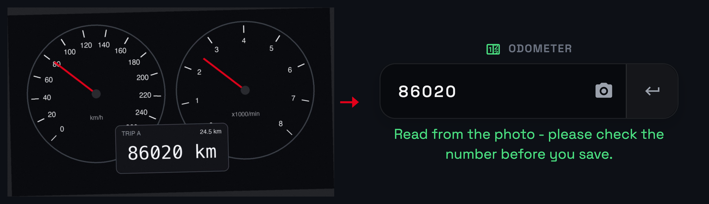
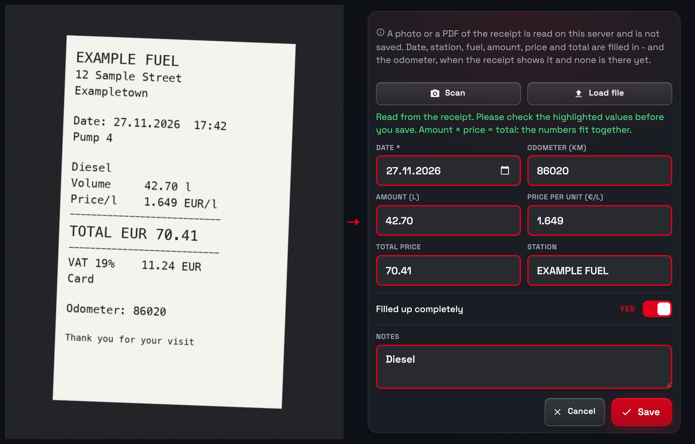

# User guide

🇬🇧 English · [🇩🇪 Deutsch](guide.de.md)

Car Assistant is a logbook and dashboard for your cars. Everything is explained on the page itself; this is the short tour.

## The three levels
Every setting lives on exactly one level, so you always know where to look. *Settings* has three tabs - the car first, then you, then the whole app:
- **Car** – only the car shown under the title (switch it with the sign next to its name): its photo, video, design and icon, Home Assistant entities, backup, archive and delete.
- **User** – you: your login (name, password, passcode, passkeys), your devices and all your notifications (one list for every car), the start car, and the start links for a [web app per car](#a-web-app-per-car).
- **System** – the whole app, for every car and every person: one **Region** card: language, date and time (order of the date, 12 / 24 hours), **time zone** (automatic = the one of Home Assistant; summer / winter time follows) and units and currency, design, map and fuel prices, sensors in Home Assistant, [MCP access](mcp.md), sources and updates (optionally a daily look for a new Car Assistant and for package updates - the dot at the foot of the side bar turns amber when something is new), logs, the address of the app, backup of everything.

## Every page looks the same
Each page starts with the same header: the page's symbol and name, the car's name below it, and at the right round icon buttons (add, edit, export ...; hold the pointer over one to read its name). Directly under it, in **one fixed place**, sits the *notice tile*: the short introduction of the page with an ⓘ, and - when needed - the messages: *Saved* (green, fades away), warnings (yellow) and errors (red). Everything else follows in the same order on every page, with the same spacing.

## First start
A short guide asks for a language, then your first car (or a demo car), then which functions you want. You can change all of it later.

## Dashboard
*Customise dashboard* lets you move, hide and resize the widgets, and *Edit video or photo* opens the picture window.

## Quick entry: the odometer and fill-ups
The two things you enter most need **no plugin and no typing marathon**. Both work on a car that is connected to nothing.

**Update the odometer on the dashboard - five seconds.**
1. Open the dashboard of the car and tap the odometer: it turns over to a box. (A link to `…/v/<car>#odometer` opens it at once - the *Get started* list of a new car uses it.)
2. Type the number and press the arrow - **or** tap the camera button: take a photo of the instrument cluster (the *lower* part is enough, where the odometer and the trip counter sit) or pick a photo from your phone.
3. The server reads the photo, puts the number in the box and says *Read from the photo - please check the number before you save*. The number is compared with the last reading: a warning appears when it is lower or far higher. Nothing is saved until you press the arrow.

The reading looks at the lower half of the photo first and trusts a number that stands right before *km* (or *mi*); a trip counter such as *24.5 km* (it has a decimal) and the numbers of the dials (0 ... 260) are not taken for the odometer. A photo of only the little display works as well. Tips: the display in the picture, no reflections, the unit visible. While a plugin reports the odometer the box is fixed - there is nothing to type.



**Fill up - three taps.**
1. *Fuel* → the plus button (or *Get started → Add your first fill-up*; the link `…/e/fuel#fuel-add` opens the form).
2. *Scan receipt* → take a photo of the fuel receipt. The form fills in: **date, station, fuel, amount, price per unit, total** and - when the station printed it (*KM-Stand*, *Odometer*) - the **odometer**. The filled fields are marked.
3. Look at the marked fields and save. Amount × price = total is checked to the cent: a misread digit is found, a missing value is calculated and the form says so.

The reading is patient: when the first try does not add up, it tries again with another page layout, a sharper and bigger copy, black and white (faded thermal paper) and the photo turned back a little (a crooked receipt) - and keeps the best. The odometer of a receipt is only offered when it fits the last reading of the car.



Both photos are read **on your own server** (text recognition with Tesseract, nothing goes online) and are never stored. The add-on has the text recognition built in; on a manual install the buttons appear when Tesseract is installed.

## Vehicle data
*More → Vehicle data* shows everything about the car; the pencil opens the form. The form is split into boxes (*Your vehicle, Identification, Technical, Energy, Papers*) and has one **Save** in the page header. Photo, video, design, icon, Home Assistant entities and backup are not on this page: they sit on the **Car** tab of the settings.

## Settings of a car
*Settings → Car* (the car shown under the title):
- **Icon** – the car's own icon for More, the browser tab and the home screen.
- **Photo and video** – up to **10 files per car**, photos and videos together; the oldest drops out when you add an eleventh. Two choices, saved at once: *For the Dashboard* (a photo or a video) and *As the car's photo* (for the car choice and every list). A video needs a photo first.
- **Design** – the car's own design with its own colour wheel; *Like the system* follows the design of System.
- **Home Assistant entities** – optional entities that deliver odometer, fuel level, range and position (this one has a **Save**).
- **Backup and manage** – back up this car, archive it or delete it.

## Pages of a car
**Vehicle passport** (*More → first line of the car*). The head shows name, plate, *make model variant*, the facts you need all the time as chips (year, fuel, power, gearbox, odometer) and the VIN with a copy button. Below: the data in groups (only what you filled in shows), the notes, and the **Equipment** list. Equipment has twelve fixed areas (Comfort, Seats, Controls, Lights, Lines & packages, Interior, Wheels & tyres, Technology & safety, Exterior, Infotainment, Driver assistance, Glazing & roof); you can only move them up and down. Every feature gets a status - standard, special, retrofitted (blue tick) or not fitted (red cross) - and an optional code such as a PR number; the pencil edits one feature, also moving it to another area.

**Trips** holds the **km counters** on top (a counter measures the distance between a start reading and today's odometer or an end reading, for example for the tax year) and the trips below, by month. Tap a trip for its card: distance, duration, average and top speed, consumption chips (an estimate from the car's average), the route on a **full-width 16:9 map** coloured by speed (blue slow, green and yellow between, red from 130 km/h; with the start and end marked) and the driving style (needs recorded positions; trips typed by hand show duration and average from the times). *Export* writes PDF or CSV, *Import* reads a GPX file. The **trip analysis** on top of the page (30 days, 90 days, year, all) shows the number and length of the trips, their share by kind, a bar chart of the trip lengths, a heat map of weekday and time of day, and the driving style over all recorded drives (hard brakings per 100 km, average speed while moving, standing, top speed).

**Map** (*More → Map*, switched on under *Integrations*) is one full-area map with the car and - if you allow it in the browser - your own position, a search for places and addresses, and *Navigate*, which sends a destination to the plugin of the car (if it offers navigation) or opens your navigation app. See [Integrations](integrations.md#map).

**Costs** is the cost page: the money spent in the chosen period (days, weeks or months), the share of fuel, service, modifications and parts, a chart per period and a list of every priced entry - tap a category to filter it. Below it come consumption, price per litre and kilometres.

**Fuel** holds the **fuel station search** on top and the fill-ups below, by month. The search is deliberately simple: it knows what your car needs (diesel or petrol), looks within 15 km and lists each station in one line - name, distance and price, the cheapest one marked in green; two tabs choose *around the car* or *my position*. **Tyres** has a tab per season (summer, winter, all-season) with **one set per season**: the name is the heading (a must), then size, the recommended pressures (normal and fully loaded), what the car last measured and where the set is stored; the set that is mounted carries a shield symbol. **Extra work** shows the odometer and a card per job (the icon follows the job) with interval, progress bar and *last* / *next*; there are no ready-made jobs because every car is different. *Edit* (bottom right of the card) opens *Done now - at odometer* with *Reset* on top and the form below. **Modifications** are cards grouped by year with the sum of the year; the plus button opens the form like on every other page. **Appointments** are one compact column with an *Edit* button each; the groups *Upcoming* and *Completed* show only when there is such an appointment (completed = marked done); the date can be a month or a day, written as set under Settings → System → Date & time. **Parts & purchases** look like till receipts (date and shop, item and price, details). **Documents** are cards with *Open* and *Edit*: title, category, document date, valid until (a badge shows when it runs out) and a note. **Manual** imports a PDF (with a text layer), an EPUB, a text / Markdown file or a [package with page images](manual-package.md), shows the pages as image or text, lists the chapters, searches, remembers where you stopped and exports an EPUB - the file stays on your server.

**Scan a receipt.** When you add a fill-up, *Scan receipt* takes a photo of the fuel receipt (the phone opens its camera). The photo is read **on your own server** (text recognition with Tesseract, nothing goes online) and is thrown away at once; it only fills in the form: date, amount, price per unit, total, station name, the product (for example *Super E10*) and - when the station printed it - the odometer. The fields it filled are marked; check them and save. The app checks that *amount x price = total*, finds a misread digit that way and calculates one missing value (and tells you when it did). Without the text recognition on the server the button is simply not there. More in *Quick entry* above.

**Odometer: a counter box you can turn over.** The odometer on the dashboard is a dark counter box with its label above it: the digits roll down through it like a mechanical counter. Tap anywhere on it and it turns over to the entry, which shows the last reading as a hint: type the number, or take a photo of the cluster (camera button) or pick one (upload button). The photo is read on your own server, like a receipt, and never stored. The number it finds is only a suggestion: it is compared with the last reading and a warning appears when it is lower or far higher. Nothing is saved until you press the check mark; a tap anywhere else turns the box back. While a plugin reports the odometer there is nothing to type: the counter box is not shown on the dashboard, the odometer widget (switched on by default for such a car) shows the figure instead. On a car without any reading yet the dashboard offers the same entry for the first one. The plate sits under the car - also under a range - and is the one place to change the odometer. The *Odometer* widget (off by default, switch it on under *Customise dashboard*) only **shows** the figure - it has no entry of its own - in three looks to choose from in its settings: *Drums*, *Tile* and *Counter box* (the same box without turning over, following the width of its slot). In the *Drums* and *Tile* looks the tile also shows the kilometres of the last six months as small bars (this month marked), the average a day, the kilometres of this month and how far it is to the next service.

**An odometer that runs backwards.** A number below the last reading, or far above it (more than 100,000 km), is not saved before you confirm it - the page says why and offers *Save anyway*. *Odometer readings* in the vehicle passport (the *All readings* link on the back of the counter box leads there) lists every odometer value of the car - readings, fill-ups, service entries, modifications and trips - and marks the ones that do not fit the others (for example 52,000, 520,000, 52,500 marks the 520,000). A plain reading can be deleted there; for the others the pencil opens the entry. The list scrolls after about ten rows and opens by itself when something does not fit. When something does not fit, the dashboard says so, because a wrong reading throws off consumption, due dates and trips - also the ones entered before it.

**Bi-fuel cars (petrol and gas).** In the vehicle data choose a *second fuel* (LPG or CNG). Every fill-up then says which of the two it was (a receipt that names the gas is recognised), the list marks the gas fill-ups with a badge and its own unit, and each fuel gets its own average consumption and cost per 100 km from its own fill-ups - exact when the car ran on that fuel between two full tanks. The consumption of the first fuel is not touched by gas fill-ups. The CSV and PDF export of the fill-ups get a *Fuel* column after the amount (the gas in its own unit). Home Assistant gets *Average consumption gas* and, with the statistics group switched on, *Last consumption gas*, *Cost per 100 km gas* and *Fuel cost total gas*; the sensors *Last fill-up* and *Last fill-up amount* always mean the first fuel.

**Logs** belong to each plugin and integration: *Info* on its card shows its log (the switch for more detail, its lines, the calls it made).

**Home widgets.** *Attention*, *Vehicle data* and *Position* are always one full row; all others can be small or a full row.

**Widgets.** Every widget has the same look: icon and title on the left, a small note (the car's last signal) or the arrow on the right, then the figure and at most one line; status chips sit on the right, the text on the left. *Car data live* shows one slim line per value; *Position* shows the place, whether the car stands or drives here, the map and three navigation links.

**Buttons.** Secondary actions are light, outlined buttons and a row of buttons stays on one line; only the one main action of a page is a filled button.

## Navigation
The side bar shows the name and slogan as one unit (same width, size follows the bar). The dot at its foot is green when everything is current and amber when Car Assistant or a package has an update (hover for the reason; on wide screens the lines *System vX* / *Plugins n updates* appear above it).

*More → Integrations → Manage navigation*: the first four pages sit in the bar, the rest in *More*, in the same order. Integrations and Plugins are always last. Switching a fixed integration off removes its page from the navigation; the lists stay in sync.

## Notifications
Notifications are **one system per person**, under *Settings → User* – nothing about them is set under *Car* or *System*. There you switch them on for the iPhone, iPad or computer you are using (or give the name of your Home Assistant notify service when no port is set) and see your devices. Below, **choose a car** and switch every kind of message on or off with round switches (*Yes* / *No*); the choice *New cars* is what a car you add later starts with. A car you add appears in the list by itself, a removed one disappears. *General* holds messages that are not about one car (for example a new version of an installed plugin). The same words go to a person only once, and identical messages replace each other on a device.

**Without a push, through Home Assistant.** With the MQTT sensors on, every car also has the sensor **Last notification** in Home Assistant (*Settings → System*, on by default). It shows what the app announces for the car - always, without anybody having set up notifications - so an automation there can pass it on, for example:

```yaml
triggers:
  - trigger: state
    entity_id: sensor.my_car_last_notification
actions:
  - action: notify.mobile_app_my_phone
    data:
      title: My car
      message: "{{ state_attr('sensor.my_car_last_notification', 'message') }}"
```

The entity name depends on the name of your car (look for *last notification* under Developer tools → States).

## A web app per car
*Settings → User → Web app for one car* lists a start link per car. Open the link of a car in Safari, tap *Share* and *Add to Home Screen*: the app opens straight on that car and shows only that car - no car switch, no list of the others. It needs your own https address (*Settings → System*).

## Claude and MCP
With the **MCP access** of *Settings → System* you can let Claude read - and, if you allow it, correct - your records from anywhere: see [MCP access](mcp.md).

## Archive and delete
*Settings → Car → Backup and manage*. **Archive** hides the car from the car choice and the Dashboard; it stays greyed out at the bottom of the *Vehicles* page, where **Reactivate** brings it back. **Delete** removes the car and all its data for good.

## Optional services (off by default)
Nothing leaves your server unless you switch it on under *Settings*:
- **Map info** (*System*): shows the location map with OpenStreetMap tiles, fetched through the app, **and** names the start and the end of each trip (from an offline list of the world's cities; with an address set for place names: from that Nominatim-compatible server), so the log book shows names instead of coordinates. The map is off by default. The place names need no internet; an address for place names (a Nominatim-compatible server, https only) is optional and then asked only while the map info is on, and also gives the street of the car.
- **Fuel prices**: set on the fuel page with the cog at the top (price sources per country, your own keys, start values) - for Germany you need **your own** free key from tankerkoenig.de, there is no built-in key. **Refuels** are noticed from the tank level: when it jumps by 15 points or more, an unfinished fuel entry appears with a *Complete* button (only amount and price from the receipt are missing), and you can be told about it in *Settings → User*. For cars with a battery the same works for **charging**: when the car starts charging the app opens a session (time, battery level, strongest power) and, when it stops, adds an unfinished entry (energy and price from the bill are missing; a rough energy estimate comes from the battery size) and lists the sessions on the page. Once you complete the entry from the bill, the session shows the real energy, the cost, the price per kWh and the **charging loss** (billed against what reached the battery), and a summary of the last 90 days adds up sessions, energy, cost, average price and peak power, and fast against slow charging.

## Backup
*Settings → System* downloads a backup of everything and restores it; *Settings → Car → Backup and manage* backs up one car (see [Backups](backup.md)).
