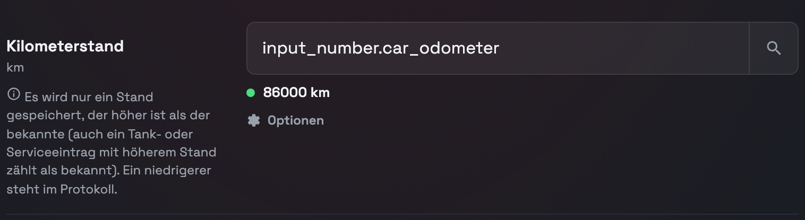
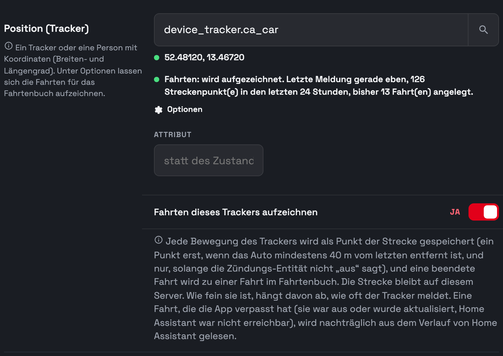
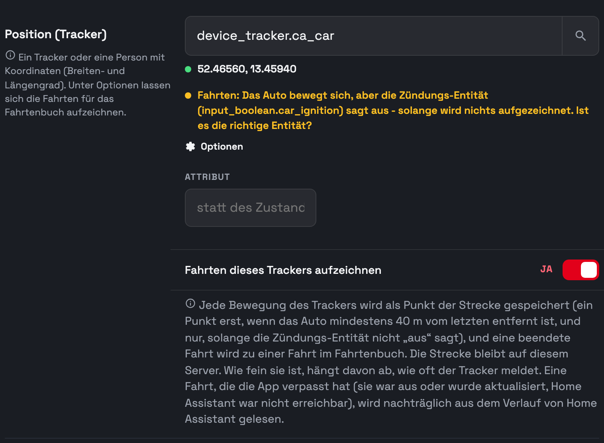

# Das Home-Assistant-Plugin

[🇬🇧 English](home-assistant.md) · 🇩🇪 Deutsch

Dein Home Assistant weiß wahrscheinlich schon viel über dein Auto: die Integration des Herstellers, einen Tracker, einen Reifensensor, **eine Wallbox**, die es lädt. Das Home-Assistant-Plugin bringt diese Entitäten in Car Assistant - **für jedes Fahrzeug einzeln**. Für jede Schnittstelle der [Plugin-API](api.de.md) (Kilometerstand, Tank, Batterie, Ladeleistung, Türen, Reifen, Position ...) wählst du die Entität aus Home Assistant, die sie liefert; die App liest sie, rechnet die Einheit um und behält sie wie jeden anderen Wert des Fahrzeugs.

- **Je Fahrzeug.** Jedes Fahrzeug hat seine eigene Installation des Plugins und seine eigene Auswahl. Die Wallbox in der Garage gehört zu dem Auto, das dort lädt - du entscheidest für jedes Fahrzeug, welche Schnittstelle woher kommt.
- **Live.** Änderungen kommen sofort an, ohne dass jemand immer wieder nachfragt (siehe [Live und Nachfragen](#live-und-nachfragen)).
- **Sauber.** Einheiten werden umgerechnet, ein Ja / Nein wird nach der Art der Entität verstanden, jeder Wert trägt die Zeit, die Home Assistant nennt, und eine Schnittstelle kann bei einem Fahrzeug nur von **einem** Plugin kommen ([Eine Schnittstelle, ein Plugin](#eine-schnittstelle-ein-plugin)).
- **Für alle.** Das Paket ist eine einfache `plugin.json` mit einem Schlüssel, `bridge`; sie führt keinen Code aus. Siehe [Für Paket-Autoren](#für-paket-autoren).

Es arbeitet im **Home-Assistant-Add-on** (die App spricht über den Supervisor mit Home Assistant). Nur Administratoren wählen die Entitäten: Die Entitäten von Home Assistant gehören dem System, nicht dem Fahrzeug.

## Einrichten

1. *Fahrzeug → Weiteres → Plugins → Hinzufügen* und **Home Assistant** aus deiner Quelle nehmen (oder das Beispiel [`examples/home-assistant/plugin.json`](https://github.com/Matze89x/ha-car-assistant/blob/main/docs/examples/home-assistant/plugin.json) hochladen).
2. Die Einstellungen öffnen. Die Seite listet die Schnittstellen in Gruppen: *Fahrzeug*, *Kraftstoff und Reichweite*, *Batterie und Laden*, *Wallbox*, *Türen, Fenster und Schloss*, *Position*, *Reifen*, *Temperaturen und Klima*, *Service und Warnungen*.
3. In das Feld einer Schnittstelle klicken: Es öffnet sich eine Liste **wahrscheinlicher Entitäten**. Zum Eingrenzen tippen, eine anklicken.
4. Die Zeile unter dem Feld sagt, **was die Entität jetzt liefert** (`64 %`, `7,4 kW aus 7400 W`, `Verriegelt`). Speichern.

Ab dann fließen die Werte; die Kachel des Plugins und seine Seite *Protokoll* sagen, was es tut.

## Eine Entität wählen

Die Liste ist auf die Schnittstelle zugeschnitten, in die du klickst: Entitäten der passenden Art stehen vorn (ein Schloss für *Verriegelt*, ein Sensor mit der Geräteklasse *Entfernung* oder einer Längeneinheit für *Reichweite*), danach der Rest. Was du tippst, wird in **Name, ID, Gerät und Bereich** gesucht - *Garage* findet also alles von der Wallbox in der Garage, wie in Home Assistant selbst. *Alle Entitäten zeigen* hebt den Filter nach Art auf. Jede Zeile zeigt Name, ID, Gerät und Bereich und den aktuellen Zustand.

Die Zeile unter einem gewählten Feld wird live geprüft: *Diese Entität gibt es in Home Assistant nicht*, *Die Einheit „l“ passt nicht*, *Gerade nicht verfügbar* sagen sofort, was nicht stimmt.

## Live und Nachfragen

Car Assistant hält eine **Live-Verbindung** zu Home Assistant (dessen WebSocket-Schnittstelle, über den Supervisor, wie der REST-Zugang). Sie verfolgt **genau die Entitäten, die du gewählt hast** - sonst nichts aus deinem Home Assistant - und eine Änderung kommt sofort an; ein Schwall von Änderungen wird höchstens einmal pro Sekunde zu einer Lesung. Solange sie steht, sagt die Seite: *Live-Verbindung zu Home Assistant: Änderungen kommen sofort an.*

Fällt die Verbindung aus (Home Assistant startet neu, das Netz hakt), baut die App sie mit wachsenden Pausen (1 bis 60 Sekunden) wieder auf, schaut danach noch einmal alles an (damit nichts verpasst wird, was inzwischen geschah) und **fragt Home Assistant in der Zwischenzeit**, alle *Mindestens nachsehen alle* Sekunden (die Einstellung des Plugins, Standard 30). Ohne die Bibliothek oder außerhalb des Add-ons gibt es einfach keine Live-Verbindung, und das Plugin fragt. Steht die Verbindung, setzt die Einstellung nur ein Sicherheitsnetz: Home Assistant wird alle fünf Minuten noch einmal angesehen (oder seltener, wenn du eine längere Zeit einstellst), damit nichts lange falsch bleibt.

## Was unterwegs geschieht

- **Einheiten.** Eine Zahl wird in die Einheit umgerechnet, die die Plugin-API führt: Meilen, Fuß, Meter - km/h, mph, m/s, Knoten - W, kW, MW - psi, kPa, hPa, mbar, mmHg, inHg - Gallonen, Milliliter, kWh - °F, K - mV - Stunden, Sekunden, Tage - km/l, mpg, Wh/km, mi/kWh. Eine Einheit, die nicht passt (Liter für einen Prozentwert), wird **nicht geraten**: Die Zeile sagt es, und du kannst in den Optionen die Einheit oder *Unverändert* wählen.
- **Datum und Uhrzeit.** Für *Restzeit Laden* und *Tage bis zum Service* geht auch eine Entität, die eine Zeit oder ein Datum enthält: Genommen werden die Minuten oder Tage bis dahin.
- **Die Zeit der Messung.** Jeder Wert trägt die Zeit, die Home Assistant nennt (`last_reported` / `last_updated`), als `measured_at`. Liefern zwei Quellen dasselbe Feld, gewinnt die **neuere Messung**; eine ältere ersetzt nie eine neuere.
- **Nur, was sich geändert hat**, wird gesendet. Eine Entität, die *nicht verfügbar* oder *unbekannt* ist, wird übersprungen (der letzte Wert bleibt, mit seinem Alter) - ein schlafendes Auto ist kein Fehler. Einen Wert, den die Plugin-API ablehnen würde (ein Tankstand von 250 %), lehnt sie nur für diese Zeile ab; die anderen laufen weiter.
- **Der Kilometerstand** wächst nur, wie überall in Car Assistant: Ein Stand, der niedriger ist als der höchste bekannte (auch ein Tank- oder Serviceeintrag mit höherem Stand zählt als bekannt), wird nicht genommen und einmal im Protokoll des Plugins vermerkt; er zählt wieder, sobald er höher ist - oder sobald der Eintrag mit dem höheren Stand korrigiert ist. Es muss nichts ausgelöst werden: Sobald eine Entität für den Kilometerstand gewählt ist, kommt jede Änderung von selbst, und das Dashboard zeigt den Stand an, statt ihn zur Eingabe anzubieten. **Ein Helfer für den Kilometerstand** (ein `input_number`) braucht ein ausreichend hohes *Maximum* - Home Assistant legt ihn mit 100 an, wenn du nichts einstellst, und lehnt jeden höheren Wert ab, sodass der Helfer nie einen echten Kilometerstand hält - und die Einheit `km` (oder `mi`; ohne Einheit zählt die Zahl als Kilometer).

### Ja und Nein

Ein Ja / Nein wird danach gelesen, was die Entität ist: ein **Schloss** (`locked`), ein **Binärsensor** nach seiner Geräteklasse (*Tür*, *Fenster* oder *Öffnung* heißt offen; *Stecker* heißt eingesteckt; *Batterie lädt* heißt lädt; bei der Klasse *Schloss* meint Home Assistant `an` = entriegelt - das wird für dich umgedreht), eine **Abdeckung** (`open`, `opening`, `closing` = offen), eine **Klima**-Entität (alles außer `off` = an), ein **Schalter** oder **Licht** oder ein Status-**Text** (`locked`, `plugged_in`, `Charging` ...). Eine Entität, die von etwas anderem handelt als die Schnittstelle (ein Türsensor für *Verriegelt*), wird mit einem Hinweis abgelehnt.

Wo die Entität es nicht in Worten sagt, die Car Assistant kennt, helfen die Optionen der Zeile: **Zustände, die Ja bedeuten** (bei einem Wallbox-Statussensor: `Preparing, Charging, SuspendedEV` für *Eingesteckt*, `Charging` für *Lädt* - jeder andere Zustand ist Nein), **Ja über** (eine Ladeleistung über 0 heißt lädt) und **Umkehren**.

### Position, Reifen, Türen, Warnungen

- **Position.** Wähle einen *Tracker* oder eine *Person* (oder irgendeine Entität mit `latitude` und `longitude`) oder - weiter unten in der Gruppe - zwei Sensoren, einen für jede Hälfte. Eine Position von 0, 0 (kein Fix) wird nicht genommen.
- **Fahrten aus einem Tracker.** Unter *Optionen* der Positions-Zeile hält *Fahrten dieses Trackers aufzeichnen* jede Bewegung des Trackers als Punkt der Strecke fest, und eine beendete Fahrt wird zu einer Fahrt im Fahrtenbuch - mit Strecke, Entfernung und Zeiten, genau wie eine Fahrt, die ein Plugin als Track schickt. Es ist aus, bis du es einschaltest (eine Strecke ist mehr als die letzte Position). Ein Punkt wird nur gehalten, wenn das Auto mindestens 40 m vom letzten entfernt ist (ein parkender Tracker zittert um ein paar Meter), nicht, solange eine Zündungs-Entität gewählt ist und „aus“ sagt, und nicht bei einem Fix, den der Tracker selbst als ungenau meldet (`gps_accuracy` über 100 m). Eine Fahrt beginnt dort, wo das Auto bei der letzten Meldung vor der Bewegung stand. Eine Meldung nach mehr als zehn Minuten Stille (die Nacht, ein Neustart der App) beginnt nur dann eine Fahrt von diesem Ort aus, wenn sie höchstens 3 km davon entfernt ist - ein Tracker, der nur meldet, wenn er sich bewegt, sagt nichts, solange das Auto steht, und die Zeit des Anfangs ist dann aus der Entfernung geschätzt; eine weiter entfernte ist kein Anfang, die nächste wird mit ihr verglichen. Eine Fahrt endet, wenn zehn Minuten nichts Neues kam oder die Zündung ausgeht (wähle die Schnittstelle *Zündung*, einen `input_boolean` oder einen `binary_sensor`, der an ist, solange das Auto fährt, und die Fahrt ist sofort zu Ende); eine unter 300 m oder mit weniger als drei Punkten fällt weg. **Wie fein die Strecke ist, hängt davon ab, wie oft der Tracker meldet:** Eine Handy-App, die jede oder jede zweite Minute meldet, gibt gute Fahrten, eine Auto-Integration, die alle zehn Minuten meldet, gibt keine. Die Strecke bleibt auf diesem Server. Was die App verpasst, während sie aus ist, wird danach aus dem Verlauf von Home Assistant gelesen, und die Seite und das Protokoll sagen, was nicht stimmt, wenn nichts aufgezeichnet wird - siehe [Kilometerstand und Fahrten richtig einrichten](#kilometerstand-und-fahrten-richtig-einrichten).
- **Reifen.** Vier Schnittstellen, eine je Rad; der Druck wird in bar umgerechnet.
- **Türen, Fenster, Lichter, Warnungen** sind Listen: eine Zeile je Tür (`front_left`, `trunk` ...), mit einem Namen, den du wählst, und der Entität. Eine Warnung zeigt ihren Text (den Namen der Entität oder den Text, den du eintippst), solange ihre Entität an ist, und verschwindet, wenn sie aus ist.

### Optionen einer Zeile

Selten nötig, eingeklappt, bis du eine Entität gewählt hast: **Attribut** (dieses Attribut der Entität statt ihres Zustands lesen - die Temperatur einer Klima-Entität, den Kurs eines Trackers), **Einheit**, **Faktor** und **Versatz** (`Wert × Faktor + Versatz`, zuletzt angewendet), **Zustände, die Ja bedeuten**, **Ja über**, **Umkehren** und bei einer Warnung der **Angezeigte Text**.

### Eine Wallbox

Die Gruppe **Wallbox** bringt, was eine Wallbox außer ihrer Leistung weiß. Alles darin ist freiwillig - binde, was dein Home Assistant hat:

| Schnittstelle | Eine Entität aus ... | Wofür |
|---|---|---|
| *Zustand der Wallbox* | ein Statussensor oder ein Helfer, der das Wort hält (`sensor`, `select`, `input_select`, `text`, `input_text`) | ein Wort für das, was die Wallbox tut: **Kein Auto, Angesteckt, Wartet, Lädt, Fertig, Störung** |
| *Energie dieser Ladung*, *Zähler der Wallbox* | `sensor`, `number`, `input_number` (Wh, kWh, MWh) | die genaue Energie: eine fertige Ladung kann damit gebucht werden |
| *Dauer dieser Ladung*, *Spannung*, *Strom*, *Genutzte Phasen*, *Temperatur der Wallbox* | `sensor`, `number`, `input_number` | die Zahlen der Wallbox-Karte |
| *Eingestellter Maximalstrom* | `sensor`, `number`, `input_number`, `select`, `input_select` | das Limit an der Wallbox (6, 10, 16 A ...) |
| *Modus*, *Störung* | `sensor`, `select`, `input_select`, `text`, `input_text`; eine Störung auch `binary_sensor`, `switch`, `input_boolean` | der Modus im eigenen Wort der Wallbox; was los ist (ein Text - `none` heißt nichts - oder ein Ja / Nein der Klasse *Problem*) |

**Die Wörter.** Die üblichen Wörter gängiger Wallboxen werden ohne jede Einrichtung verstanden: OCPP (`Available`, `Preparing`, `Charging`, `SuspendedEV`, `SuspendedEVSE`, `Finishing`, `Faulted`), go-e (`Idle`, `Charging`, `WaitCar`, `Complete`, `Error`), Easee (`disconnected`, `awaiting_start`, `charging`, `completed`, `error`), die Zustände A bis F der IEC 61851 und einfache Wörter (`plugged in`, `paused`, `charge complete`, `fault` ...), einige davon deutsch. Groß- und Kleinschreibung, Leerzeichen, Striche und Punkte spielen keine Rolle. Ein unbekanntes Wort steht an der Zeile (*„Zapfen“ ist kein bekanntes Wort einer Wallbox - nenne es in den Optionen*); unter **Optionen** nennst du die Wörter DEINER Wallbox für jeden Zustand, durch Komma getrennt - sie gelten zuerst, auch vor einem üblichen Wort.

**Ein Wort, drei Schnittstellen.** *Zustand der Wallbox* macht auch *Lädt* und *Angesteckt* des Autos (eine Störung sagt nichts über das Kabel) - es sei denn, du bindest diese beiden an eigene Entitäten. Das Plugin nimmt dem Auto dann beide Schnittstellen, wie jede Schnittstelle, die es füllt.

Helfer und Vorlagen sind Entitäten wie alle anderen: ein `input_select` für den Modus, ein `input_number` für das Limit, ein Vorlagen-Sensor oder ein `utility_meter` für die Energie. Car Assistant liest, was Home Assistant als Zustand nennt (oder das Attribut, das du wählst); es wertet selbst nichts aus. Ein Sensor, der *nicht verfügbar* oder *unbekannt* ist, lässt den letzten Wert stehen.

### Die Wallbox steuern

Die Karte der Wallbox kann auch etwas **tun** - wenn ein Mensch einen Knopf darauf drückt, nie von selbst. Dafür sind die letzten vier Zeilen der Gruppe da; binde, was dein Home Assistant hat, und die Karte bietet genau das an, was er kann:

| Schnittstelle | Eine Entität aus ... | Die Karte bietet |
|---|---|---|
| *Laden erlaubt (Schalter)* | `switch`, `input_boolean` | **Pausieren** und **Fortsetzen**: Der Schalter wird aus- oder eingeschaltet |
| *Laden starten (Knopf)* | `button`, `input_button`, `script`, `switch`, `input_boolean` | **Jetzt laden**, solange ein Auto angesteckt ist und wartet |
| *Laden pausieren (Knopf)* | dasselbe | **Pausieren**, solange geladen wird (ohne sie wird der Schalter oben benutzt) |
| *Störung quittieren (Knopf)* | `button`, `input_button`, `script` | **Störung quittieren**, solange die Wallbox eine meldet |

Der **Maximalstrom** und der **Modus** brauchen keine eigene Zeile: Ist *Eingestellter Maximalstrom* ein `number`, `input_number`, `select` oder `input_select`, zeigt die Karte **− 16 A +** und ändert ihn um einen Schritt (`min`, `max` und `step` der Entität oder die nächste ihrer Optionen); ist *Modus* ein `select` oder `input_select`, zeigt die Karte eine Liste seiner Optionen.

- **Eine feste Tabelle, keine freie Wahl.** Eine Anfrage nennt nie eine Entität oder einen Dienst: Sie sagt *pausieren*, *Strom* oder *Modus*, mit einer Zahl oder einem Wort. Car Assistant nimmt die Entität aus den Zeilen, die du für **dieses Auto** gebunden hast, und den Dienst aus einer festen Tabelle (`switch.turn_on` / `turn_off`, `button.press`, `input_button.press`, `script.turn_on`, `number.set_value`, `select.select_option`); ein Wert, den die Entität nicht annimmt - ein Strom außerhalb von `min` und `max`, ein Modus, der nicht unter ihren Optionen ist -, wird abgelehnt.
- **Nur für Administratoren**, wie alles, was etwas verändert.
- **Jeder Befehl hinterlässt eine Zeile** im Protokoll des Plugins (der Dienst, die Entität, der Wert), und ein Auto nimmt höchstens 12 Befehle pro Minute an.
- **Nicht gezeigt, wenn es nicht gehen kann.** Ist Home Assistant nicht erreichbar oder die Entität nicht da, bietet die Karte dafür keinen Knopf an.

## Sonderfälle: Home Assistant das Denken überlassen

Jedes Auto, jede Wallbox und jede Integration ist ein wenig anders. Die Optionen einer Zeile decken ab, was eine einzelne Entität anders sagen kann (Einheit, Faktor, Attribut, Ja-Wörter); alles, was **Logik** braucht, gehört dorthin, wo es zu Hause ist: in Home Assistant selbst. Ein Template-Sensor oder ein Helfer ist eine Entität mehr, und das Plugin liest sie wie jede andere. Vier Rezepte, die immer wieder vorkommen:

- **Der Tank in Litern, die Schnittstelle will Prozent.** Kein Template nötig: wähle bei der **Einheit** der Zeile *Unverändert* und trage als **Faktor** `100 ÷ Tankgröße` ein (`1,818` bei 55 Litern). Dasselbe gilt für eine Batterie in kWh (`100 ÷ Kapazität`).
- **Eine Wallbox, zwei Autos.** Ein Helfer (*Einstellungen → Geräte & Dienste → Helfer → Auswahlliste*, etwa `input_select.wallbox_car`) sagt, welches Auto angesteckt ist; jedes Auto bekommt ein eigenes Paar Template-Entitäten, und das Plugin dieses Autos liest diese statt der Wallbox selbst:

  ```yaml
  template:
    - binary_sensor:
        - name: "Auto A lädt"
          device_class: battery_charging
          state: "{{ is_state('sensor.wallbox_status', 'charging') and is_state('input_select.wallbox_car', 'Auto A') }}"
        - name: "Auto A angesteckt"
          device_class: plug
          state: "{{ states('sensor.wallbox_status') in ['preparing', 'charging', 'suspended_ev'] and is_state('input_select.wallbox_car', 'Auto A') }}"
  ```

- **Zwei Quellen für einen Wert** (die Integration des Herstellers schläft, ein Tracker nie): ein Template-Sensor nimmt die erste, die da ist.

  ```yaml
  template:
    - sensor:
        - name: "Reichweite beste"
          device_class: distance
          unit_of_measurement: "km"
          state: >
            
            {{ a if a not in ['unknown', 'unavailable'] else states('sensor.auto_reichweite_schaetzung') }}
  ```

- **Eine Zahl mit Einheit im Text** (`"12,5 km"`): das Plugin will eine Zahl, also schneidet ein Template die Einheit ab: `{{ states('sensor.fahrt_text').split(' ')[0] | replace(',', '.') | float(0) }}`.

Das Plugin liest nur, was Home Assistant als Wert meldet; es wertet selbst nie Templates aus, ein Template kann also nichts in Car Assistant ausführen.

## Kilometerstand und Fahrten richtig einrichten

Die beiden Fragen, die am häufigsten kommen: *Warum kommt mein Kilometerstand nicht an?* und *Warum werden meine Fahrten nicht aufgezeichnet?* Beides läuft auf dasselbe hinaus: **Welche Entität muss was sagen, und wie oft.** Alles Folgende wurde gegen ein echtes Home Assistant (2026.11) mit echten Helfern ausprobiert; die Tests dafür sind `tests/test_real_ha.py` (siehe [Mitmachen](community/contributing.de.md)).

### Der Kilometerstand

**Eine Entität, die den Gesamtstand des Autos als Zahl hält.** Das kann sein

- ein **Sensor** der Integration des Autos - am besten einer mit der Geräteklasse *distance* und der Zustandsklasse *total_increasing* (so sagt Home Assistant „das wächst nur“; eine Geräteklasse „Kilometerstand“ gibt es nicht). Die Liste der Entitäten setzt solche Sensoren nach vorn und einen Tageskilometerzähler oder die „Entfernung bis zum nächsten Service“ dahinter;
- ein **Helfer** (*Einstellungen → Geräte & Dienste → Helfer → Zahl*), den du selbst pflegst oder den eine Automatisierung füllt - das **Maximum** hoch setzen (`1000000`; Home Assistant legt 100 an, wenn du nichts einstellst, und lehnt dann jeden höheren Wert ab) und die Einheit auf `km` (oder `mi`);
- ein **Template-Sensor**, der die Zahl aus einem Attribut nimmt oder aus einem Text schneidet;
- ein **Text-Helfer** (`input_text`) geht auch, und ein Tausendertrennzeichen, das jemand getippt hat (`86.010`, `86,010`, `86 010`), wird als 86 010 gelesen - nur hier: Eine Zahl-Entität sagt es nie so. Ein Zahl-Helfer ist sauberer.

Die Einheit darf `km`, `mi` oder `m` sein; eine Zahl ohne Einheit zählt als Kilometer. Car Assistant speichert ganze Kilometer.



**So läuft es.** Du wählst die Entität und speicherst → das Plugin liest sie sofort → jede Änderung kommt innerhalb etwa einer Sekunde an (Live-Verbindung) → ein Stand wird **nur genommen, wenn er höher ist** als alles, was Car Assistant kennt (der höchste aller Stände, Tankungen, Services und Fahrten) → das Dashboard zeigt den Stand an, statt ihn zur Eingabe anzubieten.

| Was du siehst | Der Grund | Was zu tun ist |
|---|---|---|
| *Gerade nicht verfügbar* | das Auto schläft, oder die Integration sagt `unavailable` / `unknown`: der letzte Stand bleibt, das ist kein Fehler | nichts - er kommt, sobald das Auto aufwacht |
| Der Stand ändert sich nicht | die Entität selbst ändert sich nicht (siehe *Zuletzt aktualisiert* in Home Assistant, *Entwicklerwerkzeuge → Zustände*) | dort beheben: Car Assistant kann nur zeigen, was Home Assistant sagt |
| Das Protokoll sagt *Home Assistant meldet weniger als den Kilometerstand, den Car Assistant schon kennt* | eine Tankung, ein Service oder eine Fahrt wurde mit einem **höheren** Stand eingetragen (eine Ziffer zu viel ist typisch) | den Eintrag korrigieren - der Stand von Home Assistant zählt bei der nächsten Lesung (innerhalb der Zeit von *Mindestens nachsehen alle*), in Home Assistant muss sich nichts ändern |
| Home Assistant lehnt den Wert ab, den du in den Helfer tippst | das Maximum des Helfers ist 100 | in den Einstellungen des Helfers das *Maximum* auf `1000000` setzen |
| Der Stand ist 1,6-mal zu groß oder zu klein | Meilen ohne Einheit | dem Helfer oder Sensor die Einheit `mi` geben, oder in den *Optionen* der Zeile die Einheit wählen |
| *Belegt durch ...* an der Zeile | ein anderes Plugin dieses Autos liefert den Kilometerstand schon | eine Quelle je Schnittstelle - siehe [Eine Schnittstelle, ein Plugin](#eine-schnittstelle-ein-plugin) |
| *Diese Entität gibt es in Home Assistant nicht* | ein Tippfehler, oder die Entität wurde entfernt | aus der Liste wählen |

### Die Fahrten

**Was jede Entität sagen muss.**

| Schnittstelle | Nötig? | Was sie liefern muss |
|---|---|---|
| **Position** (ein Tracker oder eine Person) mit *Fahrten aufzeichnen* | ja | `latitude` und `longitude` als Attribute (der `device_tracker` einer Handy-App oder der Integration des Herstellers, oder eine `person`) und eine neue Meldung **mindestens jede oder jede zweite Minute, solange das Auto fährt**; am besten auch `gps_accuracy` |
| **Zündung** | nein, aber empfohlen | `on`, solange das Auto fährt, `off`, wenn es steht: ein `binary_sensor` (Geräteklasse *running* oder *power*), ein `input_boolean`, alles, was an / aus sagt. Sie beendet eine Fahrt **sofort** und hält nichts fest, solange sie „aus“ sagt |
| Das Modul **Fahrten** | ja | für dieses Fahrzeug eingeschaltet (*Integrationen & Module*) - die Fahrten werden auch vorher aufgezeichnet, aber nichts zeigt sie |

Ein Tracker, der nur weiß, ob das Handy in der Nähe des Routers ist (`source_type` `router` oder `bluetooth`), hat keine Position und ist dafür kein Tracker.

**Was die App mit jeder Meldung tut**, in dieser Reihenfolge: Ein Fix, den der Tracker ungenau nennt (`gps_accuracy` über 100 m), wird weggelassen → die erste Meldung nach einem Start ist nur der Ort zum Vergleichen → eine Meldung, die mehr als zehn Minuten nach der davor kommt, beginnt nur dann eine Fahrt von diesem Ort aus, wenn sie höchstens 3 km davon entfernt ist (das Auto stand dort und fuhr kurz vor dieser Meldung los); eine weiter entfernte ist *kein Anfang einer Fahrt* (nichts sagt, wie das Auto dorthin kam) → ein Ort, der mehr als 540 km/h vom letzten entfernt ist, ist ein Sprung (ein falscher Fix): die Strecke wird dort unterbrochen, statt eine Linie zu ziehen → solange die Zündungs-Entität „aus“ sagt, wird nichts festgehalten → ein Punkt wird gehalten, wenn das Auto mindestens 40 m vom letzten entfernt ist (der Ort, an dem es *stand*, kommt zuerst) → eine Fahrt endet, wenn zehn Minuten nichts Neues kam oder die Zündung ausgeht → unter 300 m oder mit weniger als drei Punkten fällt sie weg, alles andere ist eine Fahrt im Fahrtenbuch mit Strecke, Entfernung und Zeiten.

**Fahrten, die die App verpasst hat.** Die App kann aus sein (ein Update, ein Neustart), Home Assistant nicht erreichbar oder die Live-Verbindung weg, während das Auto fährt. Kommt die nächste Meldung mehr als zehn Minuten nach der letzten, die die App sah, liest sie, was der **Recorder** von Home Assistant dazwischen vom Tracker (und von der Zündungs-Entität) festgehalten hat - bis zu 48 Stunden zurück - und schickt es durch dieselben Regeln; was schon gespeichert ist, wird nicht noch einmal gespeichert, und das Protokoll sagt, dass *aus dem Verlauf von Home Assistant nachgeholt* wurde. Kann der Recorder noch nicht gefragt werden (Home Assistant ist gerade gestartet), wird zehn Minuten lang erneut gefragt. Das gilt für ein Fahrzeug, dessen Fahrten schon einmal aufgezeichnet wurden (wer zum ersten Mal einen Tracker wählt, holt nie die Vergangenheit herein) und nur so weit, wie der Recorder die Entität behält: Home Assistant hebt standardmäßig zehn Tage Zustände auf, und eine Entität, die du vom Recorder ausgenommen hast, hat keinen Verlauf. Eine Position aus zwei Sensoren (Breite, Länge) hat keinen, den man lesen könnte.

**Wo es schiefgeht - und was die Seite und das Protokoll sagen.** Eine Zeile unter der Positions-Zeile sagt, ob die Fahrten aufgezeichnet werden; das Protokoll des Plugins nennt die üblichen Störungen (einmal, nachdem dasselbe mehrmals hintereinander geschehen ist):

| Was du siehst | Der Grund | Was zu tun ist |
|---|---|---|
| Die Zeile sagt *werden nicht aufgezeichnet* | die Option *Fahrten dieses Trackers aufzeichnen* ist aus - sie ist es, bis du sie einschaltest | unter *Optionen* der Positions-Zeile einschalten |
| Die Zeile sagt *das Modul „Fahrten“ ist aus* | das Modul ist für dieses Fahrzeug aus | unter *Integrationen & Module* einschalten |
| *das Auto bewegt sich, aber die Zündungs-Entität sagt aus* | die als Zündung gewählte Entität folgt dem Auto nicht (ein Türsensor, ein Ladegerät, ein Handy, das nicht im Auto ist) | die richtige wählen - oder die Zeile leeren |
| *der Tracker meldet seltener als alle 10 Min* | eine Auto-Integration, die alle 15 Minuten abfragt, oder ein iPhone (siehe unten) | ein Tracker, der alle 1-2 Minuten meldet, solange das Auto fährt |
| *der Tracker nennt seine Positionen ungenau* | eine Garage, oder eine App, die nur den ungefähren Standort nutzen darf | der App den genauen Standort erlauben |
| Die Fahrten werden grob | die Meldungen kommen alle 3-5 Minuten: jede ist im Rahmen der Regeln, aber die Punkte liegen weit auseinander | die Strecke ist so fein wie die Meldungen - ein schnellerer Tracker |

Die Zeile, während die Fahrten aufgezeichnet werden, und wenn das Auto sich bewegt, die Zündungs-Entität aber „aus“ sagt:





**Ein Handy als Tracker.** *Android:* Die Companion-App meldet im Hintergrund etwa jede bis jede dritte Minute (bei Navigation alle 30 Sekunden). Für eine feine Strecke schalte den **High-Accuracy-Modus** der App ein (*Companion-App → Sensoren verwalten*) und beschränke ihn auf die Bluetooth-Verbindung des Autos: Dann meldet sie alle paar Sekunden, nur solange sie mit dem Auto verbunden ist, und kostet sonst keinen Akku. *iPhone:* iOS meldet bei *wesentlicher Standortänderung* - wenn es den Funkmast wechselt, im schlechtesten Fall alle paar Stunden - und das ist für Fahrten viel zu selten. Nimm den Tracker des Herstellers, oder frage das Handy nach seinem Standort, solange das Auto läuft (das letzte Rezept unten).

**Rezepte** (für deine `configuration.yaml`, oder lege dasselbe in der Oberfläche an; die Namen der Entitäten des Handys sind verschieden - schau sie unter *Entwicklerwerkzeuge → Zustände* nach):

- **Ein Kilometerstand-Helfer** für ein Auto, das Home Assistant nichts mitteilt (du tippst den Stand ein, oder eine Automatisierung tut es):

  ```yaml
  input_number:
    car_odometer:
      name: "Kilometerstand"
      min: 0
      max: 1000000
      step: 1
      mode: box
      unit_of_measurement: "km"
  ```

- **Die Zündung aus der Bluetooth-Verbindung des Handys** (Android). Der Zustand des Sensors *Bluetooth-Verbindung* der App ist eine Zahl; die Namen der verbundenen Geräte stehen in seinen Attributen:

  ```yaml
  template:
    - binary_sensor:
        - name: "Auto Zündung"
          unique_id: car_ignition
          device_class: running
          state: "{{ 'Mein Auto' in (state_attr('sensor.mein_handy_bluetooth_connection', 'connected_paired_devices') | default([], true)) }}"
  ```

  (`Mein Auto` ist der Name des Bluetooth-Geräts des Autos.) Ohne Bluetooth tut der **Aktivitäts**-Sensor der App fast dasselbe, eine Minute später: `state: "{{ is_state('sensor.mein_handy_activity', 'in_vehicle') }}"` bei Android, `'Automotive'` bei einem iPhone.

- **Das Handy jede Minute nach seinem Standort fragen, solange das Auto läuft** (ein iPhone - oder ein Android-Handy im Hintergrund; der Befehl gehört zur Companion-App):

  ```yaml
  automation:
    - alias: "Handy nach dem Standort fragen, solange das Auto läuft"
      triggers:
        - trigger: time_pattern
          minutes: "/1"
      conditions:
        - condition: state
          entity_id: binary_sensor.auto_zundung
          state: "on"
      actions:
        - action: notify.mobile_app_mein_handy
          data:
            message: request_location_update
  ```

**Was nicht abgedeckt ist.** Keine Fahrten aus der Zeit, bevor ein Tracker gewählt wurde; keine Strecke von einem Tracker, der nicht meldet, solange das Auto fährt (der Recorder kann nicht aufheben, was nie geschrieben wurde); eine `person`, die zwischen zwei Handys wechselt, zeigt Sprünge - wähle stattdessen den Tracker des Autos oder eines Handys; eine Zündungs-Entität, die flackert (eine Bluetooth-Verbindung, die kurz abreißt), beendet jedes Mal die Fahrt und schneidet sie in mehrere Fahrten - wähle eine Entität, die an bleibt, solange das Auto läuft; die Position eines parkenden Autos ist nur so genau wie sein Tracker.

**Home Assistant 2026.11.** Die Entitäts-IDs ändern sich mit den neuen Namensregeln dieser Version nicht - nur die angezeigten Namen (ein Name, der mit dem Gerätenamen beginnt, verliert diesen Teil, andere bekommen das Gerät als Zusammenhang dazu); deine in Car Assistant gespeicherte Auswahl funktioniert weiter, die Liste kann ein wenig anders aussehen. Tracker der Art Netzwerk-Scanner (Router, FRITZ!Box ...) sind jetzt standardmäßig aus und haben ohnehin keine Position. Das Attribut `battery_level` eines Trackers ist veraltet; der *Batteriestand* von Car Assistant liest wie bisher einen Sensor mit der Geräteklasse *battery*.

## Eine Schnittstelle, ein Plugin

Eine Schnittstelle, die du hier wählst, **gehört diesem Plugin** für dieses Fahrzeug: Solange es an ist, füllt keine andere Quelle des Fahrzeugs sie - weder ein anderes Plugin noch ein Connector noch die älteren Home-Assistant-Felder des Fahrzeugformulars. Was eine solche Quelle sendet, wird mit `ignored (taken by Home Assistant)` beantwortet und nicht gespeichert; ein Wert des Fahrzeugs hat also immer genau **einen Ursprung**.

- Die Schnittstelle wird beim **Speichern** belegt. Belegt ein anderes Plugin des Fahrzeugs eine der gewählten Schnittstellen, wird nichts gespeichert und die Seite nennt es; in der Zeile steht *Belegt durch ...*.
- Das Plugin **auszuschalten** gibt alles frei, was es belegt (mit dem Einschalten kommt es zurück); ein Plugin, dessen Schnittstellen ein anderes belegt, lässt sich nicht einschalten, bis das geklärt ist. Entfernen gibt sie endgültig zurück.
- Auch andere Plugins können Schnittstellen für sich beanspruchen (`claims` in ihrer `plugin.json`); die Seite *Schnittstellen* eines Pakets listet sie.

Die Regel berührt nie die anderen Fahrzeuge und zwingt kein Plugin, das nicht darum bittet: Ein Plugin, das ein Feld sendet, das niemand belegt hat, ist einfach eine der Quellen, und die neuere Messung gewinnt.

## Mehrere Fahrzeuge, eine Wallbox

Installiere das Plugin bei jedem Fahrzeug und wähle, was dieses Fahrzeug bekommt: die Wallbox, die das Familienauto lädt, als *Lädt*, *Eingesteckt* und *Ladeleistung* dieses Autos, die eigene Integration des Herstellers für Kilometerstand und Reifen. Ein anderes Fahrzeug behält seine eigenen Entitäten. Eine Wallbox, die schon in Home Assistant ist, braucht nichts weiter.

## Sicherung

Die Auswahl gehört zum Fahrzeug: Sie steckt in der [Sicherung des Fahrzeugs](backup.de.md) (und in der Sicherung des ganzen Systems). Nach dem Wiederherstellen ist das Plugin aus, wie jedes wiederhergestellte Plugin; Einschalten belegt seine Schnittstellen wieder. Eine Datei, die nicht von Car Assistant stammt, wird Zeile für Zeile geprüft - eine Entität oder Option, die nicht gültig ist, bleibt weg.

## Für Paket-Autoren

Ein Paket, das dies anbietet, ist eine `plugin.json` ohne Dienst und ohne Connector, mit dem Schlüssel `bridge`:

```json
{ "id": "home-assistant", "kind": "plugin", "name": "Home Assistant", "version": "1.0.0",
  "bridge": { "type": "home_assistant" },
  "settings": [ { "key": "every", "type": "select", "label": "Mindestens nachsehen alle", "default": "30",
                  "options": [ { "value": "10", "label": "10 s" }, { "value": "30", "label": "30 s" }, { "value": "300", "label": "5 min" } ] } ] }
```

| Schlüssel | Bedeutung |
|---|---|
| `type` | `home_assistant` (bisher der einzige) |
| `slots` | optional: nur diese Schnittstellen werden angeboten, nach Schlüssel - zum Beispiel `["charging", "plugged", "charge_power_kw"]` für ein *Wallbox*-Paket |
| `groups` | optional: nur diese Gruppen (`vehicle`, `fuel`, `battery`, `wallbox`, `access`, `position`, `tyres`, `climate`, `service`); `slots` gewinnt, wenn beides steht |
| `every` | optional: der Standard von *Mindestens nachsehen alle*, 10 bis 3600 Sekunden (Standard 30) |
| Einstellung `every` | optional: Deklariert das Paket eine Einstellung mit dem Schlüssel `every`, zeigt die Seite sie, und die Wahl der Person zählt |

Das Paket **nennt nie eine Entität** und sieht nie das Home-Assistant-Token: Der Administrator wählt die Entitäten, die App liest sie. Ein Paket mit `bridge` hat kein Token (niemand ruft die Plugin-API auf; die App tut es). `bridge` und ein `service` oder `connector` schließen sich aus. Prüfen mit `python tools/check_plugin.py <Ordner>`.

Jedes andere Plugin kann mit `"claims": ["fuel_level_pct", "range_km"]` Schnittstellen für sich beanspruchen (Felder der [Plugin-API](api.de.md); nicht `measured_at`; nicht für ein Paket mit `bridge`, das nimmt, was gewählt wird). Ein Plugin, dessen Schnittstellen ein anderes belegt, wird installiert, bleibt aber aus, bis das geklärt ist.

## Grenzen

- Es **liest** - und sendet nur, was ein Mensch auf der Karte der Wallbox drückt (siehe *Die Wallbox steuern*). Befehle an das Auto selbst (verriegeln, Klima) über Dienste von Home Assistant sind ein späterer Schritt.
- Es braucht das Home-Assistant-Add-on; in einer Entwicklungsumgebung antwortet Car Assistant *Home Assistant ist nicht erreichbar*, und nichts wird gelesen.
- Ein Wert des Fahrzeugs kann nur aus Entitäten eines einzigen Home Assistant kommen.

## Zusehen

Die Seite **Protokoll** des Plugins (das Protokoll für einen Tag einschalten) sagt, was es liest und was nicht stimmt - einmal für jede Störung, nicht bei jedem Versuch: *die Einheit „l“ passt nicht*, *die Entität gibt es nicht*, *Home Assistant ist nicht erreichbar; neuer Versuch*, *Home Assistant ist wieder erreichbar*, *Home Assistant meldet weniger als den Kilometerstand, den Car Assistant schon kennt*, und bei den Fahrten *das Auto bewegt sich, aber die Zündungs-Entität sagt aus*, *der Tracker meldet seltener als alle 10 Min*, *aus dem Verlauf von Home Assistant nachgeholt*. Die Seite seiner Einstellungen zeigt live, ob die Verbindung steht und was jede Entität liefert. Dieselben Zeilen stehen auch im Protokoll des Add-ons in Home Assistant (siehe [die Protokolle](logs.de.md)).
