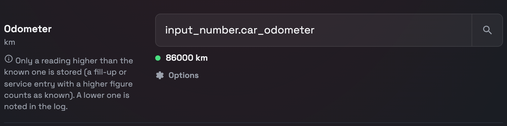
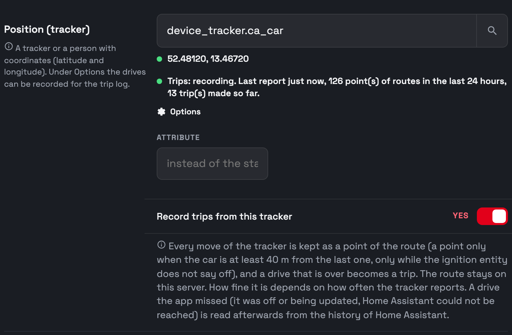
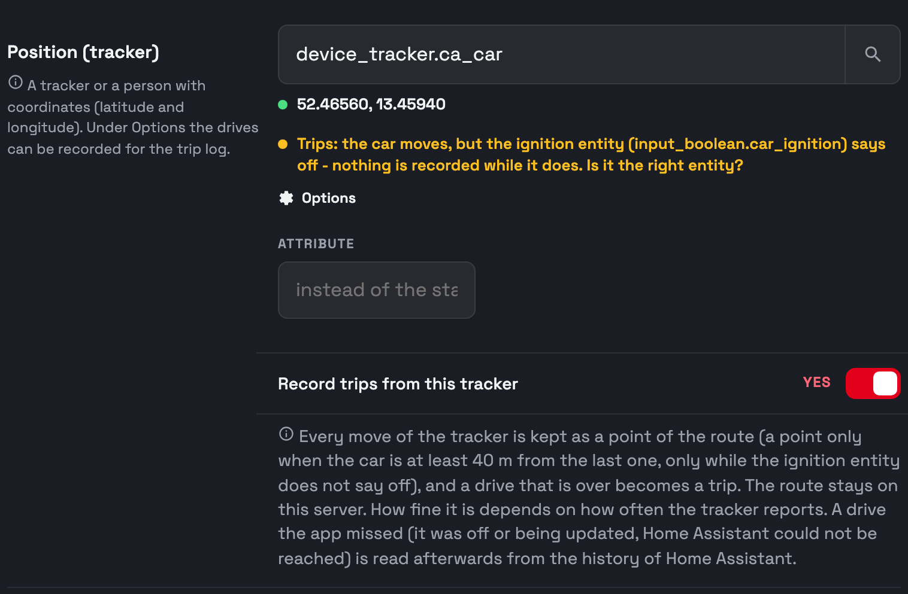

# The Home Assistant plugin

🇬🇧 English · [🇩🇪 Deutsch](home-assistant.de.md)

Your Home Assistant probably knows a lot about your car already: the integration of the car maker, a tracker, a tyre sensor, **a wallbox** that charges it. The Home Assistant plugin brings those entities into Car Assistant - **for every car on its own**. For each interface of the [Plugin API](api.md) (mileage, tank, battery, charging power, doors, tyres, position ...) you choose the entity of Home Assistant that delivers it; the app reads it, converts the unit and keeps it like any other value of the car.

- **Per car.** Each car has its own install of the plugin and its own choice. The wallbox in the garage belongs to the car that charges at it - you decide, for each car, which interfaces come from where.
- **Live.** Changes arrive at once, without anyone asking again and again (see [Live and asking](#live-and-asking)).
- **Clean.** Units are converted, a yes / no is understood by the kind of entity, a value carries the time Home Assistant gives, and one interface can only come from **one** plugin of a car ([One interface, one plugin](#one-interface-one-plugin)).
- **For everyone.** The package is a plain `plugin.json` with one key, `bridge`; it runs no code. See [For package authors](#for-package-authors).

It works in the **Home Assistant add-on** (the app talks to Home Assistant through the Supervisor). Only administrators choose the entities: the entities of Home Assistant are the system's, not the car's.

## Set up

1. *Car → More → Plugins → Add* and take **Home Assistant** from your source (or upload the example [`examples/home-assistant/plugin.json`](https://github.com/Matze89x/ha-car-assistant/blob/main/docs/examples/home-assistant/plugin.json)).
2. Open its settings. The page lists the interfaces in groups - *Vehicle*, *Fuel and range*, *Battery and charging*, *Wallbox*, *Doors, windows and lock*, *Position*, *Tyres*, *Temperatures and climate*, *Service and warnings*.
3. Click into the field of an interface: a list of **likely entities** opens. Type to narrow it down, click one.
4. The line under the field says **what it delivers right now** (`64 %`, `7.4 kW from 7400 W`, `Locked`). Save.

From then on the values flow in; the plugin's tile and its *Logs* page say what it does.

## Choosing an entity

The list is made for the interface you click into: entities of the right kind come first (a lock for *Locked*, a sensor with the device class *distance* or a unit of length for *Range*), then the rest. What you type is looked for in the **name, the id, the device and the area** - so *garage* finds everything of the wallbox in the garage, as in Home Assistant itself. *Show all entities* lifts the filter by kind. Each line shows the name, the id, the device and area and the current state.

The line under a chosen field is checked live: *This entity does not exist*, *The unit "l" does not fit*, *Not available right now* tell you at once what is wrong.

## Live and asking

Car Assistant keeps a **live connection** to Home Assistant (its WebSocket API, through the Supervisor, like the REST access). It follows **exactly the entities you chose** - nothing else of your Home Assistant - and a change arrives at once; a burst of changes becomes one reading a second at most. The page says *Live connection to Home Assistant: changes arrive at once.* while it stands.

If the connection fails (Home Assistant restarts, the network blinks) the app builds it up again with growing waits (1 to 60 seconds), looks at everything once more when it is back (so nothing that happened meanwhile is missed) and **asks Home Assistant in the meantime**, every *Look at least every* seconds (the setting of the plugin, default 30). Without the library or outside the add-on there is simply no live connection and the plugin asks. While the connection stands, the setting only sets a safety net: Home Assistant is looked at once more every five minutes (or less often, if you set a longer time), so that nothing stays wrong for long.

## What is done on the way

- **Units.** A number is converted into the unit the Plugin API keeps: miles, feet, metres - km/h, mph, m/s, knots - W, kW, MW - psi, kPa, hPa, mbar, mmHg, inHg - gallons, millilitres, kWh - °F, K - mV - hours, seconds, days - km/l, mpg, Wh/km, mi/kWh. A unit that does not fit (litres for a percentage) is **not guessed**: the row says so, and you can choose the unit or *As it is* in the options.
- **Dates and times.** For *Charging time left* and *Days to service* an entity that holds a time or a date works too: the minutes or days until then are used.
- **The time of the measurement.** Each value carries the time Home Assistant gives (`last_reported` / `last_updated`) as `measured_at`. When two sources deliver the same field, the **newer measurement wins**; an older one never replaces a newer one.
- **Only what changed** is sent. An entity that is *unavailable* or *unknown* is skipped (the last value stays, with its age) - a car that sleeps is no error. A value the Plugin API would refuse (a tank level of 250 %) is refused for that row only; the others go on.
- **The odometer** only ever grows, as everywhere in Car Assistant: a reading that is lower than the highest known one (a fill-up or service entry typed with a higher figure counts as known) is not taken and is noted once in the log of the plugin; it counts again as soon as it is higher - or as soon as the entry with the higher figure is corrected. Nothing has to be triggered: as soon as an entity is chosen for the odometer, every change arrives by itself, and the dashboard shows the figure instead of asking for it. **A helper for the odometer** (an `input_number`) needs a high enough *maximum* - Home Assistant makes one with 100 unless you set it, and refuses every higher value, so the helper never holds a real odometer - and the unit `km` (or `mi`; without a unit the figure counts as kilometres).

### Yes and no

A yes / no is read by what the entity is: a **lock** (`locked`), a **binary sensor** by its device class (a *door*, *window* or *opening* says open; a *plug* says plugged in; *battery charging* says charging; for the class *lock* Home Assistant means `on` = unlocked - that is turned round for you), a **cover** (`open`, `opening`, `closing` = open), a **climate** entity (anything but `off` = on), a **switch** or **light**, or a status **text** (`locked`, `plugged_in`, `Charging` ...). An entity that is about something else than the interface (a door sensor for *Locked*) is refused with a hint.

Where the entity does not say it in words Car Assistant knows, the options of the row help: **States that mean yes** (for a wallbox status sensor: `Preparing, Charging, SuspendedEV` for *Plugged in*, `Charging` for *Charging* - every other state is no), **Yes above** (a charging power above 0 means charging) and **Turn round**.

### Position, tyres, doors, warnings

- **Position.** Choose a *tracker* or a *person* (or any entity with `latitude` and `longitude`), or - lower in the group - two sensors, one for each half. A position of 0, 0 (no fix) is not taken.
- **Trips from a tracker.** Under *Options* of the position row, *Record trips from this tracker* keeps every move of the tracker as a point of the route, and a drive that is over becomes a trip in the trip log - with the route, the distance and the times, exactly like a drive that a plugin sends as a track. It is off until you switch it on (a route is more than the last position). A point is kept only when the car is at least 40 m from the last one (a parked tracker jitters by a few metres), not while an ignition entity is chosen and says off, and not for a fix that the tracker itself calls inexact (`gps_accuracy` above 100 m). A drive begins where the car stood at the last report before it moved. A report that comes after more than ten minutes of silence (the night, a restart of the app) starts a drive from that place only when it is within 3 km of it - a tracker that reports only when it moves says nothing while the car stands, and the time of the start is then a guess from the distance; a farther one is no start, the next one is compared with it. A drive ends when nothing new has come for ten minutes or the ignition goes off (choose the interface *Ignition*, an `input_boolean` or a `binary_sensor` that is on while the car drives, and the trip is over at once); one that is shorter than 300 m or has fewer than three points is dropped. **How fine the route is depends on how often the tracker reports:** a phone app that reports every minute or two makes good trips, a car integration that reports every ten minutes makes none. The route stays on this server. What the app misses while it is off is read from the history of Home Assistant afterwards, and the page and the log say what is wrong when nothing is recorded - see [Getting the odometer and the trips right](#getting-the-odometer-and-the-trips-right).
- **Tyres.** Four interfaces, one for each wheel; the pressure is converted to bar.
- **Doors, windows, lights, warnings** are lists: one row for each door (`front_left`, `trunk` ...), with a name you choose and the entity. A warning shows its text (the name of the entity, or the text you type) while its entity is on, and goes away when it is off.

### Options of a row

Rarely needed, folded away until you have chosen an entity: **Attribute** (read this attribute of the entity instead of its state - the temperature of a climate entity, the course of a tracker), **Unit**, **Factor** and **Offset** (`value × factor + offset`, applied last), **States that mean yes**, **Yes above**, **Turn round**, and for a warning the **Text shown**.

### A wallbox

The group **Wallbox** brings what a wallbox knows beyond its power. Everything in it is optional - bind what your Home Assistant has:

| Interface | An entity of ... | What it is for |
|---|---|---|
| *State of the wallbox* | a status sensor, or a helper that holds the word (`sensor`, `select`, `input_select`, `text`, `input_text`) | one word for what the wallbox does: **No car, Plugged in, Waiting, Charging, Finished, Fault** |
| *Energy of this charge*, *Counter of the wallbox* | `sensor`, `number`, `input_number` (Wh, kWh, MWh) | the exact energy: a finished charge can be booked with it |
| *Duration of this charge*, *Voltage*, *Current*, *Phases in use*, *Temperature of the wallbox* | `sensor`, `number`, `input_number` | the figures of the wallbox card |
| *Current limit that is set* | `sensor`, `number`, `input_number`, `select`, `input_select` | the limit on the wallbox (6, 10, 16 A ...) |
| *Mode*, *Fault* | `sensor`, `select`, `input_select`, `text`, `input_text`; a fault also `binary_sensor`, `switch`, `input_boolean` | the mode in the wallbox's own word; what is wrong (a text - `none` means nothing - or a yes / no of the class *problem*) |

**The words.** The usual words of common wallboxes are understood without any setup: OCPP (`Available`, `Preparing`, `Charging`, `SuspendedEV`, `SuspendedEVSE`, `Finishing`, `Faulted`), go-e (`Idle`, `Charging`, `WaitCar`, `Complete`, `Error`), Easee (`disconnected`, `awaiting_start`, `charging`, `completed`, `error`), the states A to F of IEC 61851 and plain words (`plugged in`, `paused`, `charge complete`, `fault` ...), a few of them German. Upper and lower case, blanks, dashes and dots do not matter. A word that is not known is shown on the row (*"Zapfen" is not a known word of a wallbox - name it in the options*); under **Options** you name the words of YOUR wallbox for each state, separated by commas - they come first, even over a usual word.

**One word, three interfaces.** *State of the wallbox* also makes *Charging* and *Plugged in* of the car (a fault says nothing about the cable) - unless you bind those two to entities of your own. The plugin takes both interfaces for the car then, like every interface it fills.

Helpers and templates are entities like any other: an `input_select` for the mode, an `input_number` for the limit, a template sensor or a `utility_meter` for the energy. Car Assistant reads what Home Assistant says is the state (or the attribute you choose); it evaluates nothing itself. A sensor that is *unavailable* or *unknown* leaves the last value in place.

### Controlling the wallbox

The card of the wallbox can also **do** something - when a person presses a button on it, never by itself. The last four rows of the group are for that; bind what your Home Assistant has, and the card offers exactly what it can do:

| Interface | An entity of ... | The card offers |
|---|---|---|
| *Charging allowed (switch)* | `switch`, `input_boolean` | **Pause** and **Resume**: the switch is turned off or on |
| *Start charging (button)* | `button`, `input_button`, `script`, `switch`, `input_boolean` | **Charge now**, while a car is plugged in and waits |
| *Pause charging (button)* | the same | **Pause**, while it charges (without it the switch above is used) |
| *Acknowledge a fault (button)* | `button`, `input_button`, `script` | **Acknowledge the fault**, while the wallbox reports one |

The **current limit** and the **mode** need no row of their own: when *Current limit that is set* is a `number`, `input_number`, `select` or `input_select`, the card shows **− 16 A +** and changes it by one step (the `min`, `max` and `step` of the entity, or the next of its options); when *Mode* is a `select` or `input_select`, the card shows a list of its options.

- **A fixed table, no free choice.** A request never names an entity or a service: it says *pause*, *limit* or *mode*, with a number or a word. Car Assistant takes the entity from the rows you bound for **this car** and the service from a fixed table (`switch.turn_on` / `turn_off`, `button.press`, `input_button.press`, `script.turn_on`, `number.set_value`, `select.select_option`); a value the entity does not take - a limit outside `min` and `max`, a mode that is not among its options - is refused.
- **Only for administrators**, like everything that changes something.
- **Every command leaves a line** in the log of the plugin (the service, the entity, the value), and a car takes at most 12 commands a minute.
- **Not shown when it cannot work.** While Home Assistant cannot be reached, or the entity is not there, the card offers no button for it.

## Special cases: let Home Assistant do the thinking

Every car, wallbox and integration is a little different. The options of a row cover what a single entity can say differently (unit, factor, attribute, yes-words); everything that needs **logic** is best done where it belongs, in Home Assistant itself: a template sensor or a helper is one entity more, and the plugin reads it like any other. Four recipes that come up again and again:

- **The tank in litres, the interface wants a percentage.** No template needed: choose *As it is* for the *Unit* of the row and enter the **Factor** `100 ÷ tank size` (`1.818` for a 55 litre tank). The same works for a battery in kWh (`100 ÷ capacity`).
- **One wallbox, two cars.** A helper (*Settings → Devices & services → Helpers → Dropdown*, called `input_select.wallbox_car`) says which car is plugged in; every car gets its own pair of template entities, and the plugin of that car reads those instead of the wallbox itself:

  ```yaml
  template:
    - binary_sensor:
        - name: "Car A charging"
          device_class: battery_charging
          state: "{{ is_state('sensor.wallbox_status', 'charging') and is_state('input_select.wallbox_car', 'Car A') }}"
        - name: "Car A plugged in"
          device_class: plug
          state: "{{ states('sensor.wallbox_status') in ['preparing', 'charging', 'suspended_ev'] and is_state('input_select.wallbox_car', 'Car A') }}"
  ```

- **Two sources for one value** (the car maker's integration sleeps, a tracker never does): one template sensor takes the first that is there.

  ```yaml
  template:
    - sensor:
        - name: "Car range best"
          device_class: distance
          unit_of_measurement: "km"
          state: >
            
            {{ a if a not in ['unknown', 'unavailable'] else states('sensor.car_range_estimate') }}
  ```

- **A number with its unit in the text** (`"12.5 km"`): the plugin wants a number, so a template cuts the unit off: `{{ states('sensor.trip_text').split(' ')[0] | float(0) }}`.

The plugin reads only what Home Assistant says is a value; it never evaluates templates itself, so a template can never run anything inside Car Assistant.

## Getting the odometer and the trips right

The two questions that come up most: *why does my mileage not arrive?* and *why are my drives not recorded?* Both come down to the same thing: **which entity has to say what, and how often.** Everything below was tried against a real Home Assistant (2026.11) with real helpers; the tests that do it are `tests/test_real_ha.py` (see [Contributing](https://github.com/Matze89x/ha-car-assistant/blob/main/CONTRIBUTING.md)).

### The odometer

**One entity that holds the total distance of the car as a number.** It can be

- a **sensor** of the car's integration - best one with the device class *distance* and the state class *total_increasing* (Home Assistant's way of saying "this only goes up"; there is no device class called odometer). The list of entities puts such sensors first, and a trip meter or the "distance to the next service" after them;
- a **helper** (*Settings → Devices & services → Helpers → Number*) that you keep up to date yourself or that an automation fills - set the **maximum** high (`1000000`; Home Assistant makes it 100 unless you set it and then refuses every higher value) and the unit to `km` (or `mi`);
- a **template sensor** that takes the number from an attribute or cuts it out of a text;
- a **text helper** (`input_text`) works too, and a thousands separator somebody typed (`86.010`, `86,010`, `86 010`) is read as 86 010 - only here: a number entity never says it that way. A number helper is cleaner.

The unit may be `km`, `mi` or `m`; a figure without a unit counts as kilometres. Car Assistant keeps whole kilometres.



**How it goes.** You choose the entity and save → the plugin reads it at once → every change arrives within about a second (live connection) → a figure is **taken only if it is higher** than everything Car Assistant knows (the highest of all readings, fill-ups, services and trips) → the dashboard shows the figure instead of asking for it.

| What you see | The reason | What to do |
|---|---|---|
| *Not available right now* | the car sleeps, or the integration says `unavailable` / `unknown`: the last figure stays, that is no error | nothing - it arrives when the car wakes up |
| The figure does not change | the entity itself does not change (look at *last updated* in Home Assistant, *Developer tools → States*) | fix it there: Car Assistant can only show what Home Assistant says |
| The log says *Home Assistant reports less than the odometer Car Assistant already knows* | a fill-up, service or trip was typed with a **higher** figure (one digit too many is typical) | correct that entry - Home Assistant's figure counts at the next reading (within the time of *Look at least every*), nothing has to change in Home Assistant |
| Home Assistant refuses the value you type into the helper | the maximum of the helper is 100 | set *Maximum* to `1000000` in the settings of the helper |
| The figure is 1.6 times too big or too small | miles without a unit | give the helper or sensor the unit `mi`, or choose the unit in the *Options* of the row |
| *Taken by ...* on the row | another plugin of this car already delivers the odometer | one source for each interface - see [One interface, one plugin](#one-interface-one-plugin) |
| *This entity does not exist in Home Assistant* | a typo, or the entity was removed | choose it from the list |

### The trips

**What each entity has to say.**

| Interface | Needed? | What it has to deliver |
|---|---|---|
| **Position** (a tracker or a person) with *Record trips* | yes | `latitude` and `longitude` as attributes (the `device_tracker` of a phone app or of the car maker's integration, or a `person`), and a new report **at least every one or two minutes while the car drives**; best also `gps_accuracy` |
| **Ignition** | no, but recommended | `on` while the car drives, `off` when it stands: a `binary_sensor` (device class *running* or *power*), an `input_boolean`, anything that says on / off. It ends a drive **at once** and keeps nothing while it says off |
| The module **Trips** | yes | switched on for this car (*Integrations & modules*) - the drives are recorded even before, but nothing shows them |

A tracker that only knows whether the phone is near the router (`source_type` `router` or `bluetooth`) has no position and is no tracker for this.

**What the app does with every report**, in this order: a fix the tracker calls inexact (`gps_accuracy` above 100 m) is left out → the first report after a start is only the place to compare with → a report that comes more than ten minutes after the one before starts a drive from that place only when it is within 3 km of it (the car stood there and set off shortly before this report); a farther one is *no start of a drive* (nothing says how the car got there) → a place more than 540 km/h away from the last is a jump (a bad fix): the route is broken there instead of a line being drawn → while the ignition entity says off nothing is kept → a point is kept when the car is at least 40 m from the last one (the place where it *stood* comes first) → a drive ends when nothing new came for ten minutes or the ignition goes off → shorter than 300 m or fewer than three points is dropped, anything else is a trip in the trip log with its route, distance and times.

**Drives the app missed.** The app can be off (an update, a restart), Home Assistant unreachable or the live connection away while the car drives. When the next report comes more than ten minutes after the last one the app saw, it reads what the **recorder** of Home Assistant kept of the tracker (and of the ignition entity) in between - up to 48 hours back - and puts it through the same rules; what is stored already is not stored twice, and the log says *caught up from the history of Home Assistant*. If the recorder cannot be asked yet (Home Assistant has just started) it is asked again for ten minutes. This works for a car whose drives were recorded before (binding a tracker for the first time never imports the past) and only as far as the recorder keeps the entity: Home Assistant keeps ten days of states by default, and an entity you excluded from the recorder has no history. A position given as two sensors (latitude, longitude) has none to read.

**Where it goes wrong - and what the page and the log say.** A line under the position row says whether the drives are recorded; the log of the plugin names the usual troubles (once, after the same thing has happened several times in a row):

| What you see | The reason | What to do |
|---|---|---|
| The line says *not recorded* | the option *Record trips from this tracker* is off - it is, until you switch it on | switch it on under *Options* of the position row |
| The line says *the Trips module is off* | the module is off for this car | switch it on under *Integrations & modules* |
| *the car moves, but the ignition entity says off* | the entity chosen as ignition does not follow the car (a door sensor, a charger, a phone that is not in the car) | choose the right one - or clear the row |
| *the tracker reports less often than every 10 min* | a car integration that polls every 15 minutes, or an iPhone (see below) | a tracker that reports every 1-2 minutes while the car drives |
| *the tracker calls its fixes inexact* | a garage, or an app that may only use the approximate location | allow the exact location for the app |
| Trips come out coarse | the reports come every 3-5 minutes: each is within the rules, but the points are far apart | the route is as fine as the reports - a faster tracker |

The line while the drives are recorded, and when the car moves but the ignition entity says off:





**A phone as the tracker.** *Android:* the Companion app reports in the background about every one to three minutes (every 30 seconds while navigating). For a fine route switch on **High accuracy mode** (*Companion app → Manage sensors*) and limit it to the Bluetooth connection of the car: then it reports every few seconds, only while it is connected to the car, and costs no battery otherwise. *iPhone:* iOS reports on *significant location change* - when it changes cell towers, in the worst case every few hours - which is far too rare for drives. Use the car maker's tracker, or ask the phone for its location while the car runs (the last recipe below).

**Recipes** (for your `configuration.yaml`, or create the same in the interface; the names of the phone's entities differ - look them up in *Developer tools → States*):

- **An odometer helper** for a car that tells Home Assistant nothing (you type the figure in, or an automation does):

  ```yaml
  input_number:
    car_odometer:
      name: "Car odometer"
      min: 0
      max: 1000000
      step: 1
      mode: box
      unit_of_measurement: "km"
  ```

- **The ignition from the Bluetooth connection of the phone** (Android). The state of the app's *Bluetooth connection* sensor is a count; the names of the connected devices are in its attributes:

  ```yaml
  template:
    - binary_sensor:
        - name: "Car ignition"
          unique_id: car_ignition
          device_class: running
          state: "{{ 'My Car' in (state_attr('sensor.my_phone_bluetooth_connection', 'connected_paired_devices') | default([], true)) }}"
  ```

  (`My Car` is the name of the car's Bluetooth device.) Without Bluetooth the **activity** sensor of the app does nearly the same, a minute later: `state: "{{ is_state('sensor.my_phone_activity', 'in_vehicle') }}"` on Android, `'Automotive'` on an iPhone.

- **Ask the phone where it is every minute while the car runs** (an iPhone - or an Android phone in the background; the command is part of the Companion app):

  ```yaml
  automation:
    - alias: "Ask the phone where the car is while it runs"
      triggers:
        - trigger: time_pattern
          minutes: "/1"
      conditions:
        - condition: state
          entity_id: binary_sensor.car_ignition
          state: "on"
      actions:
        - action: notify.mobile_app_my_phone
          data:
            message: request_location_update
  ```

**What is not covered.** No trips from the time before a tracker was bound; no route from a tracker that does not report while the car drives (the recorder cannot keep what was never written); a `person` that switches between two phones shows jumps - choose the tracker of the car or of one phone instead; an ignition entity that flickers (a Bluetooth connection that drops for a moment) ends a drive each time and cuts it into several trips - choose an entity that stays on as long as the car runs; the position of a parked car is only as exact as its tracker.

**Home Assistant 2026.11.** Entity ids do not change with the new naming rules of this release - only the names shown (a name that starts with the device name loses that part, others gain the device as context); the choices you saved in Car Assistant keep working, the list may read a little differently. Trackers of the network scanner kind (router, FRITZ!Box ...) are now off by default and have no position anyway. The attribute `battery_level` of a tracker is deprecated; the *Battery level* of Car Assistant reads a sensor with the device class *battery*, as before.

## One interface, one plugin

An interface you choose here **belongs to this plugin** for that car: while it is on, no other source of the car fills it - another plugin, a connector, the older Home Assistant fields of the vehicle form. Whatever such a source sends is answered with `ignored (taken by Home Assistant)` and not stored, so a value of the car always has exactly **one origin**.

- The interface is taken when you **save**. If another plugin of the car holds one of the interfaces you chose, nothing is saved and the page names it; on the row it says *Taken by ...*.
- Switching the plugin **off** frees everything it holds (it comes back with it); a plugin whose interfaces another one holds cannot be switched on until that is settled. Removing it gives them back for good.
- Other plugins may take interfaces for themselves too (`claims` in their `plugin.json`); the *Interfaces* page of a package lists them.

The rule never touches the other cars, and never forces a plugin that does not ask for it: a plugin that sends a field nobody has taken is simply one of the sources, and the newer measurement wins.

## Several cars, one wallbox

Install the plugin on each car and choose what that car gets: the wallbox that charges the family car as *Charging*, *Plugged in* and *Charging power* of that car, the car maker's own integration for its mileage and tyres. Another car keeps its own entities. A wallbox that is already in Home Assistant needs nothing else.

## Backup

The choices belong to the car: they are in the [backup of the car](backup.md) (and in the backup of the whole system). After a restore the plugin is off, like every restored plugin; switching it on takes its interfaces again. A file that was not made by Car Assistant is checked row by row - an entity or an option that is not valid is left out.

## For package authors

A package that offers this is a `plugin.json` without a service and without a connector, with the key `bridge`:

```json
{ "id": "home-assistant", "kind": "plugin", "name": "Home Assistant", "version": "1.0.0",
  "bridge": { "type": "home_assistant" },
  "settings": [ { "key": "every", "type": "select", "label": "Look at least every", "default": "30",
                  "options": [ { "value": "10", "label": "10 s" }, { "value": "30", "label": "30 s" }, { "value": "300", "label": "5 min" } ] } ] }
```

| Key | Meaning |
|---|---|
| `type` | `home_assistant` (the only one so far) |
| `slots` | optional: only these interfaces are offered, by key - for example `["charging", "plugged", "charge_power_kw"]` for a *wallbox* package |
| `groups` | optional: only these groups (`vehicle`, `fuel`, `battery`, `wallbox`, `access`, `position`, `tyres`, `climate`, `service`); `slots` wins when both are given |
| `every` | optional: the default of *Look at least every*, 10 to 3600 seconds (default 30) |
| setting `every` | optional: when the package declares a setting with the key `every`, the page shows it and the person's choice counts |

The package **never names an entity** and never sees the Home Assistant token: the administrator chooses the entities, the app reads them. A package with a `bridge` has no token (nobody calls the Plugin API; the app does). `bridge` and a `service` or `connector` exclude each other. Check it with `python tools/check_plugin.py <folder>`.

Any other plugin may take interfaces for itself with `"claims": ["fuel_level_pct", "range_km"]` (fields of the [Plugin API](api.md); not `measured_at`; not for a package with `bridge`, which takes what is chosen). A plugin whose interfaces another one holds is installed but stays off until that is settled.

## Limits

- It **reads** - and sends only what a person presses on the card of the wallbox (see *Controlling the wallbox*). Commands to the car itself (lock, climate) through Home Assistant services are a later step.
- It needs the Home Assistant add-on; in a development setup Car Assistant answers *Home Assistant cannot be reached* and nothing is read.
- A value of the car can come from entities of one Home Assistant only.

## Watching it

The plugin's **Logs** page (switch the log on for a day) says what it reads and what is wrong - once for each trouble, not at every try: *the unit "l" does not fit*, *the entity does not exist*, *Home Assistant cannot be reached; trying again*, *Home Assistant can be reached again*, *Home Assistant reports less than the odometer Car Assistant already knows*, and for the trips *the car moves, but the ignition entity says off*, *the tracker reports less often than every 10 min*, *caught up from the history of Home Assistant*. The page of its settings shows live whether the connection stands and what every entity delivers. The same lines are in the log of the add-on in Home Assistant (see [the logs](logs.md)).
