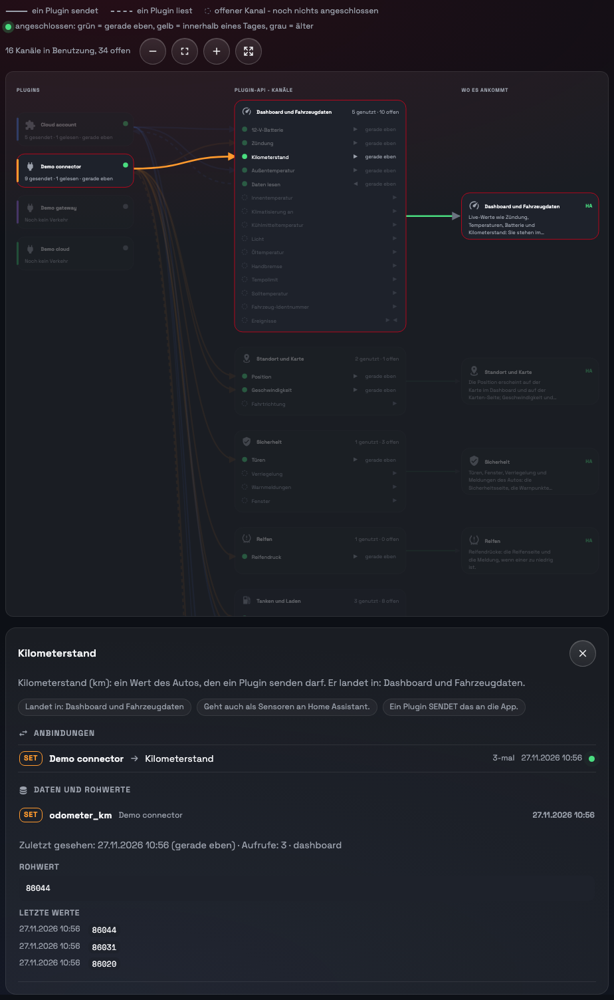

# Plugins und Integrationen

[🇬🇧 English](plugins.md) · 🇩🇪 Deutsch

> **Neu hier?** Beginne mit [start-here.de.md](start-here.de.md) - eine erste Integration oder ein erstes Plugin läuft in zehn Minuten auf deinem Computer. Die Anleitung zum Nachschlagen: [plugin-guide.de.md](plugin-guide.de.md).

Alles hier gehört zu **einem Auto**: Jedes Auto kann anders angebunden sein, und welche Integrationen möglich sind, kann vom Plugin abhängen. Du verwaltest es unter *Auto → Weiteres → Integrationen*.

- Ein **Plugin** ist die Verbindung zu einem Auto (etwas im oder neben dem Auto). Beim Einrichten entsteht sein Token für die [Plugin API](api.de.md); damit tauscht das Plugin Daten zwischen Auto und Car Assistant aus.
- Eine **Integration** ist ein optionales Extra für dieses Auto (zum Beispiel ein Webradio). Sie hat Einstellungen, aber kein Token, wenn sie keins braucht.

## Was ein Plugin ist - eine Verbindung nach außen
Car Assistant spricht nie selbst mit einem Auto - und auch mit keinem anderen System draußen. **Jede Verbindung nach außen ist ein Plugin**: zu einem Auto, zu einem Webdienst, bei dem du dich anmeldest, zu einem Cloud-Konto, zu einem Gerät oder Programm. Ein Plugin spricht mit der App **nur über die [Plugin-API](api.de.md)** - dieselbe Schnittstelle für alle - und darf tun, was seine Seite braucht: sich irgendwo anmelden (die Zugangsdaten sind Einstellungen des Plugins, ein `password`-Feld), Informationen holen, einem Gerät Seiten oder Daten liefern, weitergeben, was die App braucht. Was dahinter steckt, ist egal:

- ein Gerät **im Auto** oder daneben (ein kleiner Rechner, ein OBD-Adapter, ...),
- ein **Hersteller-App- oder Cloud-Konto** (eine Brücke, die die App / den Online-Dienst der Marke liest),
- **irgendein Webdienst** mit oder ohne Anmeldung (Wetter, Nachrichten, Verkehr, Spritpreise, ...),
- **Home Assistant selbst**: ein Plugin, das Entitäten sucht, die diese Information schon liefern (aus einer installierten Integration), und sie weitergibt,
- oder alles, was eine HTTP-Anfrage senden kann.

Eine *Integration* ruft die Plugin-API nie auf und hat kein Token. Sie darf ein Plugin um Informationen bitten (das Plugin bietet die Schnittstelle an); das Plugin fragt dann das Auto, das Web oder woran es angebunden ist.

Lesen kommt zuerst (Position, Türen, Tank- / Batteriestand, Laden, Reifen, Meldungen, …). Zum Auto hin gibt es bisher nur einen Schalter: **Debug** (siehe API-Seite). Alles, was die Seiten von einem Auto zeigen können, muss über diese Schnittstelle kommen – deshalb spielen auch die Demo-Autos ihr ganzes Leben darüber.

## Ablauf, wie bei Home Assistant
1. **Hochladen** eines Pakets (oder ein optionales auswählen, das auf der Seite angeboten wird). Es steht als *hochgeladen* in der Liste.
2. **Einrichten** – Einstellungen ausfüllen. Ein Plugin bekommt dabei sein Token (wird einmal angezeigt).
3. Ist es *eingerichtet*, kannst du die **Einstellungen ändern**, das **Token ersetzen** oder es **entfernen** (das Token wird ungültig). Entfernen geht auch vor dem Einrichten.

**Bevor etwas installiert wird**, sagt die Seite des Pakets (*Plugins → Hinzufügen*, dann seine Kachel), was das Paket tut - gelesen aus seiner Beschreibung, nichts davon läuft: was es an die App **sendet**, was es von der App **liest**, was es **anbietet** (Routen seines Dienstes, Seiten, Aktionen, ein Ziel für die Karte) und was es **mitbringt** (Dateien, Datenpakete, eine Verbindungsdatei, ein Token, Einstellungen, die es selbst ändern darf). Ein Paket, das nichts angibt, sagt das. Unten stehen zwei Knöpfe: **Verbieten** (links) und **Erlauben** (unten rechts); bei einem Paket mit eigenem Code oder eigenen Dateien gibt *Erlauben* genau das Aufgelistete auch frei. Gib deshalb `interfaces` vollständig an (Richtung, Name, Pfad und die Namen der Felder): Das liest ein Mensch, bevor er Ja sagt.

## Das Paket
Eine `plugin.json` oder eine `.zip` mit `plugin.json` im Hauptordner (max. 100 kB). Nur diese Beschreibung wird gelesen und gespeichert. **Nichts im Paket wird ausgeführt** – das Plugin selbst läuft woanders und spricht mit der API. Die eine Ausnahme ist ein Plugin mit [Dienst](#plugins-mit-dienst), das aus einer Quelle kommen und von einem Administrator freigegeben werden muss.

```json
{
  "id": "mein-plugin",
  "kind": "plugin",
  "name": "Mein Plugin",
  "version": "1.0.0",
  "description": "Was es aus dem Auto liest.",
  "author": "Dein Name",
  "homepage": "https://github.com/du/mein-plugin",
  "settings": [
    {"key": "host", "label": "Adresse des Auto-Moduls", "type": "text", "help": "optionaler Hilfetext"},
    {"key": "account_key", "label": "Schlüssel", "type": "password"},
    {"key": "verbose", "label": "Ausführliches Protokoll", "type": "bool"}
  ]
}
```
| Feld | Regel |
|---|---|
| `id` | Pflicht; 2–41 Zeichen: Kleinbuchstaben, Ziffern, `-`, `_` |
| `kind` | `plugin` (Standard) oder `integration` |
| `name`, `description`, `author`, `version` | Text, bei Überlänge gekürzt |
| `homepage` | nur `https://`-Links bleiben erhalten |
| `settings` | bis zu 12 Felder: `key` (`a-z0-9_`), `label`, `type` `text` / `password` / `bool`, optional `help` |

Ein Paket lässt sich pro Auto einmal hinzufügen. Passwörter werden gespeichert, aber nie wieder angezeigt; ein leeres Passwortfeld behält das gespeicherte. Die Einstellungen gibt Car Assistant nicht über die API heraus.

## Ein Plugin schreiben
1. Lies die Werte deines Autos im Plugin (dieser Teil ist autospezifisch und bleibt im Plugin).
2. Bilde sie auf die Standardfelder der [Plugin API](api.de.md) ab und sende sie mit dem Token des Plugins.
3. Beschreibe es mit einer `plugin.json` und teile es.

### Welcher Weg für welche Daten
| Du hast | Sende es als | Wo es landet |
|---|---|---|
| Standardwerte (Kilometerstand, Tank, Position, Türen, Reifen, AdBlue, Öl, Tempolimit, Meldungen, …) | `POST …/data` | Home, Sicherheit, Widgets, Benachrichtigungen |
| Positionen einer Fahrt, viele auf einmal (gzip) | `POST …/track` | aktuelle Position und Geschwindigkeit; Verlauf über die API lesbar |
| Alles ohne Standardfeld (Flags, Diagnose) | `POST …/signals` | gespeichert und auf der *Protokolle*-Seite des Plugins gezeigt, über die API lesbar |
| Einträge einer Integrationsseite (zum Beispiel Steuergeräte für *Coding*) | `POST …/modules/<Integration>/<Seite>` | die Seite der Integration, mit denselben Prüfungen wie im Formular |
| Debug-Zeilen | `POST …/logs` (nur bei eingeschaltetem Debug, siehe `control`) | eigene *Protokolle*-Seite des Plugins |
| Was das Dashboard vom Plugin will | `control` in jeder Antwort lesen oder `GET …/control` | erster Schalter: Debug |
| Einträge, die ein Mensch in einer Integration pflegt (zum Beispiel die Senderliste) | `GET …/modules/<Integration>/<Seite>` | für das Plugin nur lesbar |

Was die App bewusst **nicht** tut: Sie holt keine Nachrichten, keinen Verkehr und kein Wetter für das Auto, sie spricht nie selbst mit einem Auto, und ein Plugin legt keine Fahrtenbuch-Einträge an (Tankungen, Service) - es liefert Messwerte, das Buch führen die Menschen.

## Szenarien (Demo-Plugins)

Ein Plugin, das **aus einer Quelle** installiert ist, darf in seiner `plugin.json` ein `simulation`-Objekt tragen. Car Assistant spielt es dann ab, solange das Plugin eingeschaltet ist (*Start / Stop* auf seiner Karte), und schickt je `interval_s` Sekunden einen Bericht durch die normale Schnittstelle (`POST /api/v1/vehicles/<id>/data` mit dem Token des Plugins) – so wie es ein echtes Plugin täte. Ein hochgeladenes Paket wird nie abgespielt.

```json
"simulation": {
  "interval_s": 5, "timelapse": 12,
  "places": [ { "name": "Home", "lat": 52.52, "lon": 13.405 }, { "name": "Office", "lat": 52.50, "lon": 13.438 } ],
  "cycle": [["parked", 3], ["enter", 1], ["start", 1], ["drive", 8], ["stop", 1], ["leave", 1]],
  "fuel": { "pct_per_km": 0.1, "km_per_pct": 10 },
  "electric": { "pct_per_km": 0.27, "km_per_pct": 5.2, "charge_below_pct": 40, "charge_step_pct": 9, "charge_limit_pct": 80, "charge_kw": 11 },
  "warnings": [ { "code": "washer_fluid", "text": "Washer fluid low" } ]
}
```

Mindestens zwei `places`; alles ist begrenzt, unbekannte Schlüssel werden verworfen. Siehe den *Demo connector* in der [Quellen-Repo](https://github.com/Matze89x/ha-car-assistant-sources).

## Dateien eines Pakets (Downloads ohne Dienst)
Ein Paket darf geprüfte **Binärdateien** mitbringen, die die App selbst ausliefert - zum Beispiel das Programm für das Gerät im Auto oder ein fertiges Datenpaket. Dafür muss kein Dienst laufen. Das Paket bleibt lesbar; die Binärdateien sind nur Material zum Herunterladen und werden **nie ausgeführt**. Lade nur aus Quellen, denen du vertraust.

```
"files": [{"name": "carassistant.jar", "path": "assets/carassistant.jar", "label": "Programm für das Auto", "note": "...",
           "sha256": "<Prüfsumme>", "size": 125840}],
"bundles": [{"name": "install.zip", "label": "Datenpaket",
             "entries": [{"from": "scripts/custom.sh", "to": "mod/custom.sh"},
                         {"from": "assets/carassistant.jar", "to": "mod/carassistant/carassistant.jar"}]}],
"docs": "Hol dir {file:carassistant.jar} und lege es auf die Karte."
```
- **`files`** (höchstens 10): erlaubte Endungen `.jar .zip .bin .json .txt .md .pdf` (eine feste Liste, nichts Ausführbares), höchstens 8 MB je Datei und 20 MB zusammen. `sha256` und `size` sind Pflicht, und dieselbe Prüfsumme und Größe stehen im Index (`plugins/index.json`, `"files": [{"name", "sha256", "size"}]`) neben der Prüfsumme der `package.zip`. Passt eine Datei nicht, wird **nichts** entpackt oder angeboten.
- **Ablage:** Beim Installieren landen die Dateien schreibgeschützt in einem Ordner der App (`plugin-files`) - getrennt vom Code-Ordner und für den Dienst gesperrt. Sie werden nicht entpackt und nicht geöffnet.
- **Auslieferung:** `GET /plugins/<id>/files/<Name>` nur für **angemeldete Personen**, mit `Content-Disposition: attachment`, dem `Content-Type` der Endung und `Cache-Control: no-store`. Es geht auch bei gestopptem Dienst. Beim Entfernen des Plugins werden die Dateien gelöscht.
- **Freigabe:** Die Dateien stehen mit ihren Prüfsummen auf der Freigabe-Seite (derselben wie beim Dienst) und auf der Paketseite vor dem Installieren; es wird nichts ausgeliefert, bevor ein **Administrator** genau diese Liste freigegeben hat. Eine neue Version mit anderen Dateien (oder anderer Dienst-Beschreibung) wird mit dem *Aktualisieren* freigegeben, das du drückst, wenn du das Paket vorher freigegeben hattest.
- **`bundles`** (höchstens 5, bis zu 40 Einträge): ein Zip, das die App **auf Abruf baut** aus Dateien des Pakets - seinen Textdateien (auch `.sh`, als Text; sie werden nie ausgeführt) und seinen `files`. Reihenfolge, Pfade und Zeiten sind fest, dasselbe Paket gibt also immer dieselben Bytes. Die Quelle eines Eintrags ist immer eine Datei des Pakets, nie etwas aus dem Netz; Pfade ohne `..`. Ein Bundle wird wie eine Datei angeboten. **Ausnahme: `connection_file_to`** (ein Pfad im Zip, nur mit `connection_file` im Manifest): die App legt dort die Anbindungsdatei ab, gefüllt mit dem Token dieses Durchlaufs. Ein solches Bundle gibt es nie als normalen Download; es wird nur in Schritt 3 der Einrichtungsanleitung (`setup`-Schritt `files`, in dessen `bundles`) für einen Administrator gebaut, nachdem das Token mit dem gespeicherten Fingerabdruck verglichen wurde, mit `Cache-Control: no-store`; nichts davon wird gespeichert. Die Seite warnt, dass das Zip das Token wie ein Passwort enthält. Bundles ohne den Schlüssel enthalten nie das Token. Ein Bundle darf `l10n` (`label`, `note` je Sprache) tragen wie die Einstellungen; die Anleitung zeigt nur Label und Notiz des Bundles, die Liste der Einträge nur auf der Info-Seite, und ein gemeinsames Token-Feld für alle solchen Bundles (die einzelne Anbindungsdatei steckt zugeklappt hinter *Datei einzeln laden*).
- **Wo es erscheint:** die Gruppe *Dateien* auf der Seite *Info* und auf der Einstellungsseite des Plugins: Knopf, Name, Größe, kurze Prüfsumme, der Hinweis, und bei einem Bundle, was hineinkommt. In `docs` wird `{file:carassistant.jar}` zum Link auf die Datei.
- **Bauen und prüfen:** `tools/build_plugin_package.py` nimmt die Dateien aus `assets/`, trägt `sha256` und `size` in die `plugin.json` ein und schreibt die Dateien in den Index; `tools/check_plugin.py` prüft sie (Größen, Prüfsummen, Index, Bundle-Quellen, `{file:...}`).
- **`hidden: true`** an einer Datei: sie wird nicht zum Download angeboten (`GET /plugins/<id>/files/<name>` antwortet 404), steht nicht einzeln unter *Dateien fürs Auto* und auf der Seite *Info*, und `{file:<name>}` in `docs` bleibt Text. Auf der Freigabeseite bleibt sie mit Name, Größe und Prüfsumme (als *nur für den Dienst* gekennzeichnet), gilt wie jede Datei als freigegeben (ein geändertes `hidden` braucht eine neue Freigabe), darf Eintrag eines `bundles` sein und ist für einen Dienst mit `"files": "read"` lesbar (siehe unten). Alles außer ja / nein weist das Paket ab.
- **Ein Dienst, der die Dateien seines Pakets liest.** `"service": {"entry": "svc.py", "files": "read"}` gibt dem Dienst die Umgebungsvariable **`CA_FILES_DIR`**: ein Ordner mit genau den `files` des Pakets unter ihrem `name`, **schreibgeschützt** (der Dienst kann sie weder schreiben noch ändern; jede Datei wird beim Kopieren gegen Prüfsumme und Größe geprüft). Typisch: ein Dienst, der aus eigenen Binärdateien (`hidden: true`) und den Wünschen der Person EIN Zip baut. Der Schlüssel gehört zur Freigabe - die Freigabeseite sagt *Liest die Paket-Dateien* mit Liste und Prüfsummen, und eine neue Version, die den Schlüssel hinzufügt oder entfernt, wird mit dem *Update* freigegeben, das du drückst (wenn du das Paket vorher freigegeben hattest), sonst braucht sie eine neue Freigabe. Ohne den Schlüssel sieht der Dienst die Dateien nicht (sie liegen in einem für ihn geschlossenen Ordner); jeder andere Wert als `"read"` weist das Paket ab.
- Die Regel „Ein Paket ist lesbar (nur Text und einfache Bilder)“ gilt für alles außer `files`.

## Werte-Kacheln auf Home
Ein Plugin oder eine Integration kann kleine **Werte-Kacheln** auf die Home-Seite des Autos legen, solange sie läuft:
```
"tiles": [
  {"id": "cabin", "label": "Innenraum", "icon": "weather-cloudy", "signal": "climate.temp", "unit": "°C", "decimals": 1},
  {"id": "speed", "label": "Tempo", "data": "speed_kmh", "unit": "km/h", "l10n": {"en": {"label": "Speed"}}},
  {"id": "service_days", "label": "Service in", "data": "service_due_days", "unit": "Tage", "l10n": {"en": {"label": "Service in", "unit": "days"}}}
]
```
Eine Kachel nimmt ihren Wert aus einem Rohsignal, das das Plugin geliefert hat (`signal`, siehe `POST …/signals`), **oder** aus einer Standardzahl der Plugin-API (`data`, zum Beispiel `speed_kmh`). Höchstens 8 Kacheln; `icon` stammt aus [icons.de.md](icons.de.md); `unit` und `decimals` (0-3) sind freiwillig. `l10n` übersetzt das `label` **und die `unit`** je Sprache (die Einheit aus der eigenen Übersetzung des Plugins gewinnt); ohne übersetzte Einheit übersetzt die App die Zeitwörter, die sie kennt - `days`, `hours`, `minutes`, `weeks`, `months`, `years` (auch im Singular) - selbst in die Sprache der App (*Tage*, *Std.* ...), jede andere Einheit steht so, wie sie geschrieben wurde. Eine Kachel erscheint nur, **solange das Plugin läuft und ein Wert da ist**; die Person kann sie wie jedes Widget verschieben, in der Größe ändern und ausblenden.

## Die Schnittstellen-Seite eines Pakets
Jede Kachel unter *Verwaltung* hat den Knopf **Info**, und deren Abschnitt **Schnittstellen** ist eine Seite, die alles zeigt, was das Paket anbietet oder nutzt - so sieht jeder, wo eine Schnittstelle erreicht wird und was ein anderes Paket nutzen könnte. Sie hat drei Gruppen (*Sendet an Car Assistant*, *Liest von Car Assistant*, *Bietet selbst an*) und die Einstellungen, die es liest. Jede Zeile ist entweder vom Paket **angegeben** oder **gesehen** (das Paket hat sie wirklich genutzt: Adresse, die **Namen** der Felder, wie oft, wann zuletzt - nie ein Wert; das wird immer vermerkt, nicht nur bei Debug, und verschwindet mit dem Paket).

Ein Paket beschreibt sich in seiner `plugin.json` (beide Schlüssel freiwillig):
```
"docs": "Ein längerer Text für die Seite (bis 3000 Zeichen).",
"interfaces": [
  {"direction": "sends", "name": "Fahrzeugdaten", "path": "/api/v1/vehicles/<id>/data", "fields": ["odometer_km", "position"], "note": "alle 2 Minuten"},
  {"direction": "reads", "name": "Steuerung", "path": "/api/v1/vehicles/<id>/control", "note": "Debug-Schalter und Takt"},
  {"direction": "offers", "name": "Nachrichten für das Fahrzeug-Display", "path": "/car/news/", "note": "vom Auto abgerufen, ohne Anmeldung"}
]
```
`direction` ist `sends` (an die App), `reads` (von der App) oder `offers` (eine Adresse, Seite oder Datei, die das Paket bereitstellt). Höchstens 40 Einträge. Die Seite ergänzt von selbst: die Adressen des Dienstes (mit der vollen Adresse), die Seiten einer Integration (mit ihrer API-Adresse), die Anbindungsdatei und alles, was das Paket wirklich genutzt, aber nicht angegeben hat (markiert *nicht vom Paket angegeben*).

**Wer darf die Schnittstellen nutzen?** Heute spricht nur ein **Plugin** mit der Plugin-API (es hat ein Token). Eine *Integration* beschreibt Seiten, Erinnerungen und Widgets und hat kein Token; sie kann die API nicht aufrufen. Andere Pakete können nutzen, was ein Paket **anbietet** (seine Adressen, seine Seiten über `GET /api/v1/vehicles/<id>/modules/<Integration>/<Seite>`) - die Schnittstellen-Seite zeigt, wo.

## Zugangsdaten eines Plugins
Ein Plugin, das sich bei einem Webdienst anmeldet, hält die Zugangsdaten in seinen Einstellungen (ein `password`-Feld: auf der Seite verdeckt, leer = behalten). Die Werte liegen in der Datenbank der App, werden dem Dienst des Plugins in `settings.json` übergeben und gehören **nur zu einer Sicherung, die mit einer Passphrase gemacht wurde** ([Sicherungen](backup.de.md)): dann liegen sie in ihrem verschlüsselten Block und kommen nach einer Wiederherstellung zurück, auch auf einem anderen System. Sie werden nie angezeigt, protokolliert oder in die Verkehrsansicht geschrieben, und sie liegen **verschlüsselt** in der Datenbank (der Schlüssel liegt in `secret.key` im Datenordner und ist nie Teil einer Sicherungsdatei). Der Zugangsschlüssel einer Quelle wird genauso gespeichert.

## Einstellungsseite

*Verwaltung* zeigt jedes Plugin als Kachel mit EINER Zeile Knöpfen unten: *Start / Stopp*, *Info* (Überblick, Schnittstellen, das Protokoll und der Debug-Schalter auf einer Seite) und *Einstellungen*, und rechts die eine Hauptaktion: *Aktualisieren*, wenn eine neuere Version angeboten wird (die Version steht als Marke im Kopf), sonst *Öffnen* bei einem Plugin mit Seite. Die Einrichtungsanleitung (wenn das Plugin eine mitbringt), *In der Leiste zeigen* und *Deinstallieren* stehen auf der Einstellungsseite. *Einstellungen* öffnet eine **eigene Seite** (Zurück führt zur *Verwaltung*) mit allem, was der Benutzer ändern kann: die Felder aus `settings` in der `plugin.json` und das Verbindungs-Token (*Neues Token*). Erst *Speichern* speichert; falsche Eingaben werden benannt, und es wird nichts gespeichert, bis sie korrigiert sind. Es funktioniert wie die Einstellungen von Home Assistant: Du beschreibst die Optionen als JSON, die App macht daraus Schalter, Auswahlfelder, Schieberegler und so weiter.

| `type` | was der Benutzer sieht | weitere Schlüssel |
|---|---|---|
| `text` (Standard) | eine Zeile | `placeholder`, `unit`, `required` |
| `textarea` | mehrere Zeilen | `rows` (2-12), `placeholder`, `required` |
| `password` | verdeckt; leer = gespeichertes Geheimnis behalten | `required` |
| `number` | eine Zahl, gegen die Grenzen geprüft | `min`, `max`, `step`, `unit`, `required` |
| `slider` | ein Schieberegler mit angezeigtem Wert | `min` (0), `max` (100), `step`, `unit` |
| `bool` | ein Schalter, von der App am rechten Ende seiner Zeile gezeichnet (wie beim iPhone; ein Plugin kann ihn nicht anders setzen) | `default`: `true` / `false` (oder der Text `"1"` / `"0"`; ohne Angabe startet er aus) |
| `select` | ein Auswahlfeld | `options`: `[{"value": "eco", "label": "Sparsam"}]` (höchstens 30; ein Wert hat kein Komma) |
| `radio` | eines von wenigen, alle sichtbar | `options` |
| `multiselect` | beliebig viele ankreuzen (Kontrollkästchen) | `options`; gespeichert als `a,b` |
| `list` | Zeilen aus Name und Wert (zum Beispiel Nachrichten-Feeds und ihre Adressen), hinzufügen / entfernen und mit dem **Griff links in jeder Zeile** in die Reihenfolge bringen (mit Maus oder Finger ziehen, oder die Pfeiltasten auf ihm), höchstens 30; der Dienst bekommt sie in der angezeigten Reihenfolge als `[{"name", "value"}]` | `name_label`, `value_label`, `value_max`, `columns`, `min_rows`, `templates`, `default` (siehe unten) |
| `url` | eine Webadresse (http / https), geprüft | `required` |
| `email` | eine E-Mail-Adresse, geprüft | `required` |
| `time` | eine Uhrzeit `HH:MM` | |
| `date` | ein Datum `JJJJ-MM-TT` | |
| `color` | eine Farbauswahl; gespeichert als `#rrggbb` | |

**Mehr zu `list`.** `columns` (höchstens 3): mehr Zellen in einer Zeile als Name und Wert - `[{"key": "second", "label": "Second line", "max": 80, "l10n": {"de": {"label": "Zweite Zeile"}}}, {"key": "logo", "label": "Logo address"}]`. `key` ist ein kleingeschriebener Name (`a-z`, Ziffern, `_`, höchstens 20 Zeichen; nicht `name`, `value`, `label`, `l10n` und nicht doppelt), `max` die Länge der Zelle (1 bis 500, Standard 120). `value_max` (1 bis 500, Standard 200) legt dasselbe für den `value` der Zeile fest (eine lange Stream-Adresse); der Name bleibt bei 80. Ein Text, der länger als seine Grenze ist, wird **mit einer Meldung abgelehnt, es wird nichts gespeichert** - nie still gekürzt, denn eine mittendrin abgeschnittene Adresse führt ins Leere; die Seite selbst hört bei der Grenze mit dem Tippen auf. Eine Spalte, die sich nicht verwenden lässt, wird weggelassen; mehr als drei werden nicht gelesen. Die Seite zeigt die zusätzlichen Zellen unter Name und Wert, paarweise. Der Dienst bekommt jede Zeile als `{"name", "value", "second", "logo"}` - jede Spalte ein eigener Schlüssel, eine leere Zelle ist `""`. Gespeichert (und an `{key}` in `env` übergeben) ist die Zeile eine Textzeile `name | value | second | logo`; ein `|` in einer Zelle wird durch ein Leerzeichen ersetzt. Eine Liste ohne `columns` bleibt wie bisher (Name und ein Wert, der den Rest der Zeile nimmt). `default`-Zeilen und `templates` dürfen dieselben Schlüssel tragen (`{"name": "Radio A", "value": "https://...", "second": "News"}`). `min_rows` zählt eine Zeile, sobald eine ihrer Zellen gefüllt ist. `min_rows` (1 bis 30): Speichern mit weniger Zeilen wird mit einer einfachen Meldung verweigert, und die letzten Zeilen lassen sich nicht entfernen. `templates` (höchstens 30): `[{"label": "Comfort <-> Dynamic", "name": "ADS Comfort Dynamic", "value": "comfort_dynamic", "l10n": {"de": {"label": "..."}}}]` - die Seite zeigt eine Auswahl der vorbereiteten Zeilen und einen Knopf *Hinzufügen*, der die gewählte Zeile anhängt; danach ist es eine gewöhnliche Zeile, die man ändern, entfernen und sortieren kann. `default` einer `list` darf die Zeilen sein, mit denen eine Neuinstallation startet: `[{"name": "...", "value": "..."}]` (höchstens 30; ein `|` in einem Text wird zu einem Leerzeichen). Apps, die diese Schlüssel nicht kennen, ignorieren sie: die Liste bleibt eine gewöhnliche Liste. **Typisierte Spalten:** Eine Spalte darf `"type": "number"` sagen (ein Zahlenfeld; der Dienst bekommt eine Zahl, eine leere Zelle ist `null`, `3,5` wird als `3.5` gespeichert), `"date"` (ein Datumsfeld; gespeichert und übergeben als `JJJJ-MM-TT`) oder `"select"` (eine Auswahl mit `"options": [{"value": "pro", "label": "Professional"}]`, wie bei einer Auswahl-Einstellung, bis zu 12; ohne Optionen ist es ein Text). Eine Zelle, die nicht zu ihrem Typ passt, wird mit einer Meldung abgelehnt, es wird nichts gespeichert. Ohne `type` ist eine Spalte ein Text, wie bisher. **`value_options`** (höchstens 30, optional): die Zelle `value` der Zeile wird eine Auswahl - `[{"value": "comfort_dynamic", "label": "Comfort / Dynamic", "l10n": {"de": {"label": "Komfort / Dynamisch"}}}]` (der Wert hat kein Komma und höchstens 40 Zeichen). Die gespeicherte Zeile bleibt `name | value | ...`, der Dienst bekommt `value` als Text, genau wie bisher; eine App, die den Schlüssel nicht kennt, zeigt ein gewöhnliches Textfeld. **Alte Werte bleiben erhalten.** Eine gespeicherte Zelle, die nicht mehr zu ihrer Spalte passt (ein alter Text in einer `select`-Spalte oder in einer Auswahl aus `value_options`, ein alter Text in einer `date`- oder `number`-Spalte), wird so gezeigt, wie sie ist, mit der Marke *alter Wert* und einem kurzen Hinweis, und bleibt gespeichert, wenn die Einstellungen unverändert gespeichert werden; sie wird nie still geleert oder verworfen. Ein **neuer** Eintrag, der nicht passt, wird wie bisher abgelehnt.

**`docs` und seine Übersetzung.** `docs` (3000 Zeichen) behält seine Absätze: Zeilen werden aufgeräumt, höchstens eine Leerzeile hintereinander, Zeilenumbrüche bleiben und werden angezeigt. `l10n.<Sprache>.docs` ist derselbe Text in einer anderen Sprache und wird statt `docs` gezeigt, wenn die Seite diese Sprache hat.

**Längen von Texten - längere werden in der App ohne Meldung abgeschnitten.** `label` 60 Zeichen (die Beschriftung eines Reiters 40), `help` 300 (in den Feldern einer Seite, `pages[].fields`: 200), alle auch in `l10n.<Sprache>`; Zeilenumbrüche werden zu Leerzeichen. `tools/check_plugin.py` warnt vor einem Text, der abgeschnitten würde - ein Hilfetext, der mitten im Satz endet, wurde abgeschnitten.
| `section` | eine Überschrift (mit `help` als Text), die die Felder darunter gruppiert | |
| `tab` | ein Reiter der Einstellungsseite: `id` (Kleinbuchstaben, `_`), `label`, optional `icon` (ein Icon der App) und `l10n`. Jede Einstellung danach gehört zu diesem Reiter, bis zum nächsten `tab`; Einstellungen vor dem ersten `tab` bilden den Reiter *Allgemein*. Ohne `tab` (oder mit nur einem) bleibt die Seite eine Liste. Alles um die Einstellungen herum (Einrichtungsanleitung, Dateien, Token und Anbindungsdatei, Deinstallieren) steht unter dem ersten Reiter. Ein Reiter hat keinen Wert; `show_if`, `advanced` und der Schlüssel jeder Einstellung gelten wie bisher Der erste Reiter heißt auf der Seite immer *Allgemein*, egal was sein `label` sagt (siehe [Der Reiter Allgemein](#wann-etwas-erscheint-und-der-reiter-allgemein)). | `id`, `label`, `icon` |
| `info` | nur ein Text (`label` fett, `help` als Text), nichts gespeichert | |

Jedes Feld hat `key` (Kleinbuchstaben, `_`), `label` und optional einen `help`-Text (unter dem Feld), `default` und `l10n` (übersetzte `label` / `help`). `section`, `info` und `tab` brauchen keinen `key`. Höchstens 40 Felder und 12 Reiter (Reiter zählen nicht als Felder).

**Bedingungen:** `"show_if": {"key": "mode", "equals": "custom"}` zeigt ein Feld nur, solange eine andere Einstellung diesen Wert hat (bei einem Schalter: `"equals": true`). Ein verstecktes Feld wird weder geprüft noch verlangt. Beispiel:
```
{"key": "mode", "type": "radio", "label": "Modus", "options": [{"value": "auto", "label": "Automatisch"}, {"value": "custom", "label": "Eigene"}], "default": "auto"},
{"key": "address", "type": "url", "label": "Adresse", "required": true, "show_if": {"key": "mode", "equals": "custom"}}
```
Mehrere Einstellungen und mehr als „ist gleich": Ein einzelner Test ist `{"key": ..., <eines davon>}` -

| Test | Das Feld ist sichtbar, solange ... |
|---|---|
| `"equals": "x"` | die Einstellung genau `x` ist (bei einem Schalter: `true` / `false`) |
| `"not": "x"` | die Einstellung alles außer `x` ist (eine leere Auswahl zählt mit) |
| `"in": ["a", "b"]` | die Einstellung einer dieser Werte ist (bis zu 12) |
| `"not_in": ["a", "b"]` | die Einstellung keiner davon ist |
| `"has": "x"` | das Kästchen `x` einer `multiselect` angekreuzt ist |

Tests werden mit `{"any": [...]}` (einer genügt) und `{"all": [...]}` (jeder) zusammengesetzt; eine einfache Liste bedeutet `all`. Sie lassen sich verschachteln (drei Ebenen, höchstens acht Tests):
```
"show_if": {"any": [{"key": "advanced", "equals": true},
                    {"all": [{"key": "mode", "in": ["custom", "expert"]}, {"key": "features", "has": "map"}]}]}
```
Eine Bedingung, die sich nicht verwenden lässt (falscher Schlüssel, leere Liste, zu viele Tests), wird verworfen: Die Einstellung ist dann einfach immer sichtbar, und `tools/check_plugin.py` sagt es dir. Ein Test auf eine Einstellung, die es nicht gibt, gilt als erfüllt, ein Tippfehler versteckt also nie ein Feld. Pakete, die nur `equals` benutzen, brauchen keine Änderung.

**Was ein Dienst bekommt** in `settings.json` (siehe unten): Zahlen und Schieberegler als Zahlen, Schalter als `true` / `false`, eine `multiselect` als Liste der angekreuzten Werte, eine `list` als `[{"name": ..., "value": ...}]`, alles andere als Text. In der Verbindungsdatei sind alle Werte Text (ein Schalter ist `1` / `0`).

## Anbindungsdatei

Auf der Einstellungsseite eines Plugins mit Anbindungsdatei gibt es zwei Wege zur Datei: **Neues Token** (erzeugt ein neues Token und gibt die Datei) und **Ich habe das Token schon** (trage das früher erhaltene Token ein; die App vergleicht es mit dem gespeicherten Fingerabdruck und gibt bei Übereinstimmung die Datei noch einmal mit diesem Token aus - kein neues Token, das Gerät läuft weiter). Das Token wird nie angezeigt oder protokolliert, nur ein Administrator darf es, und fünf falsche Versuche in 15 Minuten stoppen weiteres Raten.

Ein Gerät im Auto braucht oft eine kleine Datei mit Adresse, Fahrzeug und Token. Die Beschreibung kann sie festlegen, und Car Assistant bietet sie **beim Anzeigen des Tokens** zum Download an (Einrichten oder *Neues Token*; das Token wird nur als Fingerabdruck gespeichert, dies ist also der einzige Moment, in dem es in eine Datei kann):

```json
"connection_file": { "name": "link.cfg", "template": "server={server}\nvehicle={vehicle}\ntoken={token}\ninterval={interval}\n" }
```
`{token}`, `{vehicle}` (die Kennung aus `/api/v1/vehicles/<id>`), `{url}` (die externe Adresse, falls gesetzt) und jede Einstellung des Plugins mit ihrem `key`. Eine Zeile mit leerem Wert entfällt, eine optionale Einstellung schreibt also nie `key=`. Trage vorher die Einstellungen ein: sie kommen in die Datei. Der Dateiname darf Buchstaben, Ziffern, `.`, `_`, `-` enthalten; die Vorlage höchstens 2000 Zeichen. Nichts wird ausgeführt oder gespeichert.

`{vin}` ist die FIN, die in den Fahrzeugdaten des Autos eingetragen ist (eine Einstellung gleichen Namens verliert dagegen); eine Zeile ohne Wert entfällt. Ein **Dienst** findet dieselben zwei Werte in `settings.json` als feste Schlüssel: `external_url` (die externe Adresse oder `""`) und `vehicle_vin` (oder `""`), gelesen beim Start des Dienstes - das Plugin muss sie also nie mehr abfragen.

### Einrichtungsanleitung (`setup`)

**Ihr Name (optional):** `"setup": {"title": "Am Auto installieren & deinstallieren", "l10n": {"en": {"title": "Install & uninstall on the car"}}}` benennt die Anleitung für ihren Knopf auf der Kachel, die Karte auf der Einstellungsseite und die Überschrift der Anleitung. Ohne `title` bleibt das Wort der App: *Einrichten* an allen drei Stellen (dasselbe Wort auf dem Knopf, der Karte und der Überschrift) - das ist auch die Empfehlung: `"title": "Set up"` und `l10n.de.title` *Einrichten*. Höchstens 60 Zeichen.

**Token merken (immer an):** Das Token jedes Plugins wird zusätzlich **verschlüsselt** behalten (der Schlüssel liegt in `secret.key` im Datenordner; ein Plugin mit Dienst bekommt seine Kopie beim nächsten Start), und die Einrichtung bietet *Gespeichertes Token verwenden* an, statt noch einmal zu fragen. Es wird nur einem Administrator gezeigt - in dieser Einrichtung und im Reiter *Allgemein* der Einstellungsseite -, nie in einem Protokoll. Eine Sicherung enthält das gemerkte Token nur, wenn sie mit einer Passphrase gemacht wurde ([Sicherungen](backup.de.md)); dann funktioniert es nach einer Wiederherstellung auf einem anderen System.


Ein Plugin mit Anbindungsdatei kann eine Anleitung mitbringen, die Car Assistant in **drei festen Schritten** zeigt (auf der Karte unter *Mehr*: *Einrichten*; sie lässt sich jederzeit erneut durchgehen):

```json
"setup": {
  "requires": ["external_https", "vehicle_vin"],
  "steps": [
    {"id": "token", "text": "Kurzer Text über dem Token."},
    {"id": "files", "bundles": ["install.zip", "uninstall.zip"], "text": "1. Karte einlegen ...\n2. ZIP in den Hauptordner entpacken\n3. Datei in [den Ordner](https://example.com/notes) legen",
     "l10n": {"de": {"text": "1. Karte einlegen ...\n2. ZIP in den Hauptordner entpacken"}}}
  ]
}
```

**Einstellungen der Anleitung auswählen (optional).** Ein Schritt darf die Einstellungen nennen, die er zeigt: `{"id": "token", "settings": ["server", "interval"]}`. Sobald **irgendein** Schritt Einstellungen nennt, zeigt die Anleitung **nur** diese (in der Reihenfolge von `settings`; `advanced` bleiben eingeklappt), und alle anderen Einstellungen behalten bei *Weiter* ihren gespeicherten oder Vorgabewert – ein Schalter, der nicht in der Seite steht, wird nicht ausgeschaltet. Die übrigen Einstellungen bleiben auf der normalen Einstellungsseite. Unbekannte Schlüssel werden ignoriert. Ohne `settings` in einem Schritt ändert sich nichts: die Anleitung zeigt alle Einstellungen wie bisher.

1. **Prüfen.** Die Anleitung zeigt die externe Adresse (unter *Einstellungen -> System* gespeichert, `https://`) und die FIN (in den Fahrzeugdaten eingetragen) nur lesend, mit Link dorthin, wo man sie setzt. *Weiter* bleibt gesperrt, bis alles aus `requires` (`external_https`, `vehicle_vin`) da ist.
2. **Token und Einstellungen.** Das Token: *Neues Token erstellen* (einmal angezeigt) oder - wenn die App noch keins hat - *Vorhandenes Token eintragen* (ein Token, das schon in der Datei auf dem Gerät steht: Es muss wie ein Token von Car Assistant aussehen, darf nirgends sonst verwendet werden und wird nur als Fingerabdruck gespeichert); wenn eins existiert, die Kennung des gespeicherten Tokens und *Vorhandenes Token weiter verwenden* (eintragen; es wird mit dem gespeicherten Fingerabdruck verglichen und nie gespeichert). Darunter die Einstellungen des Plugins; solche mit `"advanced": true` stehen zugeklappt unter *Erweiterte Einstellungen*. *Weiter* speichert die Einstellungen.
3. **Dateien und Anleitung.** Die Anbindungsdatei (Name aus `connection_file`) für das Token aus Schritt 2 - bei einem früher erstellten Token fragt die Anleitung es noch einmal ab - und die `bundles`, die im Schritt `files` genannt sind (solange das Paket freigegeben ist), dann die Anleitung (`text` des Schritts `files`). *Beenden* schließt ab.

Ein Schritt bringt einen optionalen `text` mit (bis 3000 Zeichen; die Schritte `check`, `token` und `files` kennt die Anleitung) und `l10n` je Schritt (`title`, `text`). Der Text ist einfacher Text mit `1. `- / `- `-Listen, `**fett**` und `[Beschriftung](https://...)`-Links (nur https); alles andere erscheint, wie getippt. Die `note` eines Bundles sagt, was es tut (zum Beispiel dass es zuerst den alten Stand sichert).

**Einsteigerfreundliche Schritte 2 und 3.** Schritt 2 zeigt drei Boxen mit Auswahl oben (genau eine ist gewählt): *Gespeichertes Token verwenden* (nur wenn die App eine entschlüsselbare gespeicherte Kopie hat; vorgewählt), *Neues Token erstellen* (links; das alte wird ungültig; bei vorhandenem Token fragt *Weiter* noch einmal nach) und *Vorhandenes Token weiter verwenden* (rechts; das Token aus der Datei im Gerät eintragen – Car Assistant muss es vorher nicht kennen, nur sein Fingerabdruck wird behalten). *Weiter* führt die Auswahl aus und geht zu Schritt 3. Mit `"settings": []` am Schritt entfällt der Einstellungsblock (Überschrift und Hinweis) ganz. Schritt 3 zeigt die `bundles` des Plugins als gleich große Boxen (Name, `note`, Größe, ein Download-Knopf); der einzelne Download der Anbindungsdatei erscheint nur, wenn das Plugin **kein** Paket mit `connection_file_to` hat, denn die Datei steckt schon im Paket.

### Freiraum für das Plugin: eigene Schritte, Einstellungen und Werte
Alles Folgende ist **optional** und nur eine Ergänzung; die Sicherheit bleibt bei der App (Prüfung von Adresse und VIN, Token, Anbindungsdatei, Pakete, Freigabe durch den Administrator).

- **Schritte mit einer Seite.** Ein Schritt von `setup.steps` darf `"page": "<id einer Frame-Seite des Pakets>"` tragen (dazu `title`, `text`): nach den drei festen Schritten zeigt die Anleitung ihn als weiteren Schritt mit einem Knopf, der diese Seite des eigenen Dienstes öffnet, und *Weiter* / *Zurück* darum. Nur eine `kind: "frame"`-Seite desselben Pakets kann genannt werden (dieselben Absicherungen wie bei jeder Frame-Seite); eine unbekannte id wird verworfen.
- **Eigene Einstellungsseite.** `"settings_page": "<id einer Frame-Seite>"` benennt eine Seite des Dienstes als Einstellungsseite des Plugins: die Einstellungsseite des Plugins bekommt einen Hauptknopf dorthin. Die Feldliste bleibt als Rückfall.
- **Feldtyp `value`.** `{"key": "status", "label": "Status", "type": "value"}` zeigt einen Wert, den der Mensch nicht ändert, sondern nur der Dienst des Plugins setzt (zum Beispiel *Betrieb läuft bis 14:20*). Zwei optionale Darstellungen: `"format": "datetime"` (oder `"date"`) schreibt eine Zeit, die der Dienst als ISO-Text gespeichert hat (`2026-11-22T10:20:00+00:00`, UTC wenn keine Zone dabei ist), in der Zeitzone und Schreibweise des Systems; `"state": {"ok": ["connected"], "warn": ["waiting"], "bad": ["error", "lost"]}` setzt vor genau diese Texte einen grünen, gelben oder roten Punkt (bis zu 8 je Stufe; der Text sagt weiterhin dasselbe).
- **Der Dienst ändert seine eigenen Einstellungen.** Eine Einstellung mit `"service_writable": true` (nicht bei Listen und Mehrfachauswahl) und jedes `value`-Feld darf der Dienst selbst ändern:
  - `GET /api/v1/vehicles/<id>/plugin-settings` mit dem Token des Plugins -> `{"ok": true, "settings": {...typisiert...}, "writable": [...]}`. Ein Passwort ist nie lesbar (`"***"`, wenn gesetzt).
  - `PUT /api/v1/vehicles/<id>/plugin-settings` mit `{"values": {"mode": "eco", "interval": 30, "status": "Betrieb läuft bis 14:20"}}` -> `{"ok": true, "changed": [...]}`. Nur schreibbare Schlüssel (sonst `403 not_writable`), geprüft wie das Formular (`422 invalid_value` mit den falschen Schlüsseln - dann wird nichts gespeichert; Zahlen werden in ihre Grenzen gesetzt), höchstens 30 Aufrufe pro Minute (`429`).
  - **Die Liste der schreibbaren Schlüssel gehört zu dem, was der Administrator freigibt:** eine neue Version, die sie ändert, braucht eine neue Freigabe. Eine Änderung steht im Protokoll des Plugins (die Namen der Schlüssel, nie die Werte).
- `GET /api/v1` nennt `features` (`measured_at`, `plugin-settings`), damit ein Plugin vor der Nutzung prüfen kann.

### Der Einrichten-Ablauf (`setup.flow`)
Die drei festen Schritte oben passen zu einem Plugin mit Token und Verbindungsdatei. Ein Plugin, das sich **irgendwo anmelden, Angaben erfragen, prüfen und am Ende etwas herausgeben** muss (zum Beispiel eine ZIP-Datei), braucht mehr Freiheit - und bekommt sie mit einem **Ablauf** (`flow`): *Du* bestimmst die Schritte, ihre Reihenfolge und ihre Texte. Ein Paket ohne `flow` behält die drei festen Schritte genau wie bisher; mit einem `flow` tritt der Ablauf an ihre Stelle (`steps` darf für ältere Apps stehen bleiben).

```json
"setup": { "title": "Konto verbinden", "flow": [
  { "id": "intro",  "type": "text", "title": "Willkommen", "text": "Melde dich mit dem Konto an, das du in der Auto-App nutzt." },
  { "id": "login",  "type": "check", "action": "/priv/login", "settings": ["user", "password"], "label": "Anmeldung prüfen",
    "l10n": { "en": { "label": "Check the login" } } },
  { "id": "needs",  "type": "requirements", "requires": ["external_https"], "filled": ["user"] },
  { "id": "pack",   "type": "download", "action": "/priv/zip", "label": "Installations-ZIP erstellen" },
  { "id": "docs",   "type": "page", "page": "docs" }
] }
```
Jeder Schritt hat `id` (`a-z0-9_`), `type`, `title` (80 Zeichen; ohne ihn nennt die App den Typ), `text` (3000; Absätze, Listen, `**fett**`, https-Links) und `l10n` (`title`, `text`, `label` je Sprache); bis zu **12 Schritte**. Die Seite zeigt nummerierte Schritte mit *Zurück* und *Weiter*; der letzte Schritt endet mit *Beenden*, und das Plugin gilt dann als **eingerichtet** (der Knopf *Einrichten* seiner Kachel verschwindet). Ein Schritt, der nicht zu seinem Typ passt, wird beim Lesen des Pakets verworfen.

| `type` | Was die Person sieht / was passiert | Felder |
|---|---|---|
| `text` | nur der Text | - |
| `requirements` | eine Liste dessen, was da sein muss; **nichts hinter diesem Schritt öffnet sich, bis alles erfüllt ist** | `requires` (`external_https`, `vehicle_vin`: von der App geprüft), `filled` (Einstellungen, die einen Wert brauchen) |
| `form` | die aufgeführten Einstellungen als Felder (Benutzername und Kennwort sind einfach Einstellungen vom Typ `text` / `password`); *Weiter* speichert sie | `settings` |
| `check` | die Felder (optional), dann der Hauptknopf: **die App fragt den Dienst des Plugins**, sie zu prüfen | `action`, `settings`, `label`, `inputs` |
| `token` | *Neues Token erstellen* (einmal gezeigt; das alte wird ungültig) - das Token ist **eine Möglichkeit, kein Muss** | - |
| `files` | die `bundles` des Plugins und seine Verbindungsdatei, wie Schritt 3 der festen Anleitung | `bundles`, `connection_file` |
| `page` | ein Knopf, der eine `kind: "frame"`-Seite des Plugins öffnet (frei gestaltet: Dokumentation, ein eigener Assistent ...) | `page` |
| `download` | der Hauptknopf: **der Dienst erstellt eine Datei** (eine ZIP, genau für die Eingaben dieser Person) und die Person lädt sie herunter | `action`, `settings`, `label` |

**`check`** - `POST <action>` (eine Route des eigenen Dienstes des Plugins, die **nicht** öffentlich ist, dieselbe Regel wie bei `capabilities`) mit `{"vehicle": 3, "step": "login", "language": "de", "values": {"user": "max", "password": "..."}, "settings": {...alle Einstellungen, mit dem gerade Getippten...}}` und den Identitäts-Headern. Der Dienst antwortet innerhalb von 10 Sekunden: **2xx** (oder `{"ok": true}`) = in Ordnung, alles andere oder `{"ok": false, "message": "Kennwort falsch."}` = die Person bleibt auf dem Schritt und liest `message` (höchstens 200 Zeichen). **Wenn die Prüfung scheitert, wird nichts von dem gespeichert, was die Person getippt hat.** Bei Erfolg werden die getippten Einstellungen gespeichert (Kennwörter versiegelt), und die Antwort darf `"settings": {"status": "Verbunden", "token": "..."}` tragen: Die Schlüssel, die der Dienst selbst schreiben darf (`service_writable` / `value`, siehe oben), werden gespeichert - ein abgelehnter Schlüssel zählt als gescheiterte Prüfung. Die `message` eines Erfolgs steht auf dem nächsten Schritt ("Angemeldet als Max.").

**Einmalige Eingaben und Rückfragen (`inputs`, `ask`).** Manche Anmeldungen brauchen etwas, das keine Einstellung ist: einen Code aus einer SMS, einer E-Mail oder einer Authenticator-App. Ein `check`-Schritt darf `inputs` nennen - Felder nur für DIESE Prüfung:
```json
{ "id": "login", "type": "check", "action": "/priv/login", "settings": ["user", "password"],
  "inputs": [ { "key": "code", "label": "Code aus der SMS", "type": "text", "required": true, "ask": true } ] }
```
Eine Eingabe hat einen Typ wie eine Einstellung (`text`, `password`, `number`, `email`, `url`; `label`, `help`, `placeholder`, `required`, `l10n`; bis zu 6 je Schritt; ihr Schlüssel ist nie der Schlüssel einer Einstellung) und geht **in `values` der Prüfung** an den Dienst - und **sonst nirgends hin**: Sie wird nie gespeichert, nie in `settings.json` geschrieben, steht in keiner Sicherung und keinem Protokoll und fehlt in den `settings` der Anfrage. Mit `"ask": true` ist das Feld **nicht auf der Seite**, bis der Dienst danach fragt: Er antwortet auf die erste Prüfung mit `{"ok": false, "ask": ["code"], "message": "Ein Code wurde per SMS geschickt."}` - der Schritt kommt zurück (das ist eine Frage, kein Fehler) mit dem Feld `code` und der Meldung, die Person tippt den Code und drückt den Hauptknopf noch einmal. Die zweite Anfrage trägt `user`, `password` und `code`; was der Dienst zwischen den beiden Aufrufen braucht (eine Challenge-Nummer), merkt er sich selbst - dafür ist `State` der [Hilfsbibliothek](start-here.de.md) gemacht. Die auf dem Schritt getippten Passwörter hält die App derweil zehn Minuten **im Arbeitsspeicher**, damit nur der Code getippt werden muss; nichts davon wird aufgeschrieben. `ask` darf nur Eingaben dieses Schritts mit `"ask": true` nennen; alles andere darin wird ignoriert. Falscher Code: `{"ok": false, "message": "Falscher Code."}` antworten - das Feld bleibt.

**`download`** - dieselbe Anfrage; der Dienst antwortet mit der **Datei**: höchstens **8 MB**, 30 Sekunden; `Content-Type` `application/zip`, `application/octet-stream`, `text/plain`, `text/csv` oder `application/json` (alles andere wird als `application/octet-stream` ausgeliefert - nie als Seite), ein Name in `Content-Disposition` (bereinigt auf Buchstaben, Ziffern, `.`, `_`, `-`). Eine Fehlerantwort (`{"ok": false, "message": "..."}`) steht auf dem Schritt. Weil der Dienst die Datei baut, kann sie alles enthalten, was die Person getippt hat - und das Token, das der Dienst selbst hält. Die App speichert nichts davon.

Beide Typen brauchen einen **laufenden, freigegebenen** Dienst; der Schritt sagt es, wenn er es nicht ist. Ein in einem Schritt getipptes Kennwort wird immer nur an den eigenen Dienst des Plugins gesendet (der dieselben Einstellungen ohnehin liest). Das Token eines `token`-Schritts wandert nur innerhalb der Seite von Schritt zu Schritt (nie gespeichert), genau wie in der festen Anleitung.

## Plugins mit Dienst
Manche Plugins brauchen ein eigenes Programm, zum Beispiel um einem Gerät im Auto Seiten oder Daten zu liefern. Sie können es als **Dienst** mitbringen. Er läuft **im Add-on selbst** (nie in einem zweiten Container): Du installierst das Plugin, mehr nicht.

**Das ist fremder Code.** Gib einen Dienst nur aus einer Quelle frei, der du vertraust, und lies vorher, was er tut. Die App schützt dich, so gut sie kann:
- Er muss aus einer **Quelle** kommen, nie aus einer hochgeladenen Datei. Der Index der Quelle nennt die **sha256** der `package.zip`; eine Datei, die nicht passt, wird nicht entpackt.
- Ein Paket ist **lesbar**: nur Textdateien (`.py`, `.json`, `.md`, ...) und einfache Bilder. Keine Binärdateien, kein kompilierter Code, keine Links. Der Ordner liegt offen auf GitHub; die Freigabe-Seite listet jede Datei.
- Nichts läuft, bevor ein **Administrator es freigibt**, auf einer Seite mit Quelle, Prüfsumme, Programm, den nötigen Python-Paketen, den Adressen, auf die er antwortet, und den Einstellungen, die er bekommt. Ein Dienst, den du beim Installieren erlaubt hast, bleibt erlaubt, wenn **du auf *Aktualisieren* drückst**: Die neue Beschreibung wird mit diesem Klick freigegeben (die Seite zeigt sie weiterhin). Nichts wird von allein aktualisiert, und ein Paket, das du nie freigegeben hast, bleibt auch nach einem Update ungeprüft. Nimmst du die Freigabe zurück, stoppt er.
- Er läuft als **eigener Prozess** in **eigener virtueller Umgebung**, als **eigener unprivilegierter Benutzer** (wenn das Add-on als root läuft), mit Grenzen für Speicher (768 MB), offene Dateien und Prozesse. Schreiben darf er nur in seinen Ordner `/data/plugins/<id>/<Auto>/`.
- Seine Umgebung enthält nur das Unten Aufgeführte - **nie** das Home-Assistant-Token (Supervisor) und nie die Datenbank. Die Datenbank und alle anderen Daten der App sind für ihn gesperrt.
- Er erreicht die App nur über die normale [Plugin-API](api.de.md) mit einem eigenen Token.
- Seine Ausgabe wird nur gespeichert, solange **Debug** für das Auto an ist (*Protokolle*-Seite des Plugins).
- *Start / Stopp* auf der Plugin-Karte startet und stoppt ihn; nach einem Absturz startet er mit wachsender Pause neu (5 s ... 2 min). Beim Entfernen des Plugins wird er gestoppt, sein Datenordner, seine Umgebung und - wenn kein anderes Auto das Paket nutzt - sein Code werden gelöscht.

Die Python-Pakete, die er braucht (`requirements`), werden **einmal beim Freigeben** aus dem Python-Paketindex installiert (das einzige Mal, dass das ins Netz geht; nur fertige Wheels, nichts wird gebaut). Ein Paket darf keine eigenen Wheels oder Binärdateien mitbringen.

### Das Paket
In der Quelle: der **lesbare Ordner** `plugins/<id>/` mit `plugin.json` und den Dienst-Dateien, dazu eine daraus gebaute `package.zip` und die `sha256` dieser Zip in `plugins/index.json`:
```
plugins/echo-service/plugin.json
plugins/echo-service/service/main.py
plugins/echo-service/package.zip      <- gebaut mit tools/build_plugin_package.py
plugins/index.json                    <- {"packages": [{"id": "echo-service", ..., "sha256": "..."}]}
```
`tools/build_plugin_package.py <Quellordner> <id>` baut die Zip jedes Mal gleich und schreibt die Prüfsumme in den Index. Ein lauffähiges Beispiel liegt in [`docs/examples/echo-service/`](examples/echo-service/).

Die `plugin.json` bekommt ein optionales `service`:
```
"service": {
  "entry": "service/main.py",
  "python": ">=3.9",
  "requirements": ["fastapi", "uvicorn"],
  "routes": [{"prefix": "/svc/", "public": true}],
  "env": {"GREETING": "{greeting}"}
}
```
- `files` - optional, `"read"` = der Dienst darf die Dateien seines Pakets **lesen** (`CA_FILES_DIR`, siehe *Dateien* oben); alles andere weist das Paket ab.
- `token` - optional, `false` = dieser Dienst hat **kein Token** und keine Plugin-API (siehe *Ein Dienst ohne Token* unten); `true` ist der Standard und kann fehlen. Alles außer ja / nein weist das Paket ab.
- `entry` - das Programm (eine `.py`-Datei des Pakets). `python` - die niedrigste Python-Version (`>=3.x`). `requirements` - Namen mit optionalen Versionen, höchstens 30; keine Links, keine Optionen.
- `routes` - Adressen, auf die der Dienst unter **der Adresse dieser App** antwortet (`https://<deine Adresse>/svc/...`). `public: true` = **ohne Anmeldung** erreichbar (das Auto schickt keine); `false` = nur aus Home Assistant. Ein Präfix beginnt und endet mit `/`, darf keine Seite der App überdecken (`/api/`, `/v/`, `/static/`, ...) und sich nicht mit dem Präfix eines anderen Plugins überschneiden. Die Prüfung wird bei jedem Start des Dienstes wiederholt: Eine Seite, die eine spätere Version der App übernimmt, wird nie von einem Dienst überdeckt - die App gewinnt, und die Route wird einfach nicht weitergereicht. Die App reicht die Anfrage **unverändert** weiter (Methode, Query, Header, Körper - auch ein leerer ohne Längenangabe und `multipart/*` - sowie Status und Content-Type der Antwort), nur Cookies und Authorization gehen nie durch. Grenzen: 8 MB Anfrage, 16 MB Antwort, 30 s.
- `routes[].token_header` - optional, nur bei einer Route mit `public: true`: ein Kopfname (`X-Mein-Token`, Buchstaben, Ziffern und `-`; nicht `Authorization`, `Cookie`, `Content-*`, `X-CA-*` und Ähnliches). Die App prüft diesen Kopf dann **vor** dem Dienst gegen das **Token des Plugins** und antwortet bei einem fehlenden oder falschen Wert selbst mit `401` (Vergleich über den Fingerabdruck, in konstanter Zeit; ein Plugin ohne Token lässt nichts durch). Die Prüfung nutzt nur den Fingerabdruck des Tokens; der Dienst bekommt den Kopf unverändert und darf ihn nochmals prüfen. Nur der benannte Kopf zählt (nicht `Authorization`: der kommt nie durch). Die Freigabe-Seite zeigt neben der Route *nur mit dem Token des Plugins im Kopf X-Mein-Token*. Ein Manifest mit einem unbrauchbaren `token_header` (nicht öffentliche Route, verbotener oder falscher Name) wird beim Lesen abgelehnt - eine still weggelassene Härtung würde die Route offen lassen. Ältere Versionen der App ignorieren den Schlüssel, deshalb die eigene Prüfung im Dienst behalten. Gedacht für Anfragen eines Autos, das keine Anmeldung hat und kein `Authorization` senden kann. Ein Plugin darf mehrere öffentliche Routen haben, manche mit und manche ohne `token_header` (zum Beispiel `/webradio/` mit und `/webradio-open/` oder eine Gesundheits-Route ohne); liegen Präfixe ineinander, entscheidet das längste. Die App vermerkt abgewiesene Anfragen im Protokoll des Plugins als eine Warnung pro Minute, mit der Zahl der Abweisungen seit der letzten Zeile (nichts über den Absender, kein Wert); bei eingeschaltetem Debug steht jede auch in der Verkehrsansicht. Eine Pause bei wiederholten Fehlversuchen baut sie nicht ein: das Token hat 256 Bit, Raten ist aussichtslos.
- `downloads` (ein Schlüssel der `plugin.json`, nicht von `service`) - Dateien, die der Dienst anbietet: `[{"label": "Datenpaket", "path": "/svc/pack.zip", "note": "..."}]`, höchstens 10; der Pfad muss unter einer der Adressen liegen. `place` ist `tile` (Standard: ein Knopf auf der Kachel des Plugins unter *Verwaltung*, nur solange das Plugin läuft; besser ein oder zwei - zum Beispiel das Protokoll des Autos) oder `settings` (ein Knopf in der Karte *Dateien fürs Auto* im Reiter *Allgemein* der Einstellungen); auf der Info-Seite gibt es keinen. `when` (siehe *Bedingungen*) sagt, wann der Knopf erscheint. `l10n` bringt `label` und `note` in anderen Sprachen (`{"de": {"label": "Datenpaket"}}`); fehlt eine Übersetzung, steht das Original da. Anbindungsdatei, Dateien und Pakete geben die Einrichtungsanleitung und die Karte *Dateien fürs Auto* heraus; der Dienst liefert die Datei (binär, `Content-Disposition` geht durch, höchstens 16 MB). Eine öffentliche Adresse steht jedem offen, eine nicht öffentliche nur aus Home Assistant oder für eine angemeldete Person.
- `connects` - optional: die Hosts, mit denen der Dienst nach eigener Angabe spricht (`api.example.com`, `*.cloud.example.org`, höchstens 10), gezeigt auf der Freigabe-Seite. Es ist eine Angabe für die Person, die freigibt; die App sperrt keine anderen Adressen. Eine Änderung braucht eine neue Freigabe.
- `env` - zusätzliche Umgebungsvariablen; `{key}` wird zum Wert dieser Plugin-Einstellung. Namen mit `CA_`, `PYTHON`, `LD_` und einige Systemnamen sind nicht erlaubt.

### Beobachten, was passiert
Zwei Dinge erscheinen auf der *Protokolle*-Seite jedes Plugins (*Info* auf seiner Kachel, Abschnitt *Protokoll*):
- **Was das Add-on mit dem Dienst tut** (Installation, pip-Fehler, Start, Stopp, Absturz mit Exit-Code und der Pause vor dem nächsten Start, Freigabe) - immer, ob Debug an ist oder nicht. Nach einem Absturz kommen die letzten Ausgabezeilen dazu, solange Debug an ist.
- **Verkehr**, nur solange Debug an ist: jeder Aufruf des Plugins an die Plugin-API und jede Anfrage von außen auf eine Adresse seines Dienstes, mit Zeit, Status, Adresse, Größe, Dauer und den **Namen** der Felder (nie deren Werte). Seine Ausgabe und deine eigenen `print`-Zeilen werden als Log-Zeilen gespeichert, solange Debug an ist.

### Protokolle und der Debug-Knopf eines Plugins
Jede Kachel unter *Verwaltung* (auch eine gestoppte) hat einen Knopf **Logs**, und die Einstellungen jedes Plugins (der Reiter *Allgemein*, für alle fest) haben die Karte **Protokoll**:
- **Logs** öffnet die eigene Seite des Plugins (`/v/<Auto>/integrations/<id>/logs`): nur SEINE Log-Zeilen - *Alle* oder nur *Probleme* (Warnungen und Fehler, mit ihrer Anzahl) -, was das Add-on mit seinem Dienst getan hat und der Verkehr (eingeklappt), mit *Leeren* und *Als Text laden* (`logs.txt`, die letzten 1000 Zeilen, zum Offline-Lesen oder als Anhang zu einer Fehlermeldung). Hier schaut man zuerst nach, wenn etwas nicht funktioniert.
- **Protokoll** (Einstellungen, Reiter *Allgemein*) schaltet mehr Details **nur für dieses Plugin** ein, für **1, 3 oder 7 Tage** ab dem Moment des Einschaltens: Solange er an ist, wird das Plugin informiert (`control.debug` ist `true`, es schickt also seine Log-Zeilen), seine Aufrufe werden im Verkehr vermerkt und die Ausgabe seines Dienstes wird gespeichert. Ist die Zeit um, geht der Schalter von selbst aus; eine andere Zeit zu wählen startet ihn neu; auch beim Löschen oder erneuten Installieren des Plugins ist er aus. Der Schalter für das ganze Auto auf der Seite *Debug & Log* wirkt auf jedes Plugin des Autos.

Protokolle bleiben 7 Tage erhalten und höchstens eine feste Zeilenzahl je Plugin - **jedes Plugin hat sein eigenes Protokoll**: seine Zeilen, seine beobachteten Aufrufe und was es genutzt hat gehören ihm allein, werden nur für dieses gekürzt und verdrängen nie die eines anderen Plugins; ältere Zeilen verschwinden von selbst. Beim Entfernen eines Plugins werden seine Zeilen, seine Aufrufe und seine Verlaufsdaten der Anbindungskarte gelöscht - und nichts von einem anderen Plugin.

### Was der Dienst bekommt
**Token:** Ein Plugin mit Dienst und **ohne** `connection_file` bekommt vom Add-on ein eigenes Token (`CA_API_TOKEN`). Ein Plugin mit Dienst **und** `connection_file` hat **ein** Token: Es wird beim Einrichten einmal angezeigt (für die Datei, die das Auto braucht; *Ich habe das Token schon* und *Neues Token* funktionieren wie bei jedem Plugin), und dasselbe Token bekommt der Dienst - ein neues Token erreicht den Dienst von selbst und startet ihn neu.

Umgebungsvariablen: `CA_PORT` (auf `127.0.0.1:<Port>` lauschen), `CA_API_URL` und `CA_API_TOKEN` (Plugin-API und ein eigenes Token), `CA_VEHICLE_ID`, `CA_DATA_DIR` (sein Ordner; dort liegt `settings.json` mit den Einstellungen des Plugins, neu geschrieben beim Speichern der Einstellungen - der Dienst startet dann neu). Sonst nichts von der App.

### Eine Seite des Dienstes als eigene Seite (`kind: "frame"`)
Ein Paket mit Dienst kann eine Seite seines eigenen Dienstes als **eigene Seite** zeigen – ein ganzes Werkzeug mit eigenem Code. Das geht für eine **Integration** mit Dienst (der übliche Fall für ein Werkzeug wie einen Editor: kein Token, kein `CA_API_URL` / `CA_API_TOKEN`, keine Plugin-API – nur `CA_PORT`, `CA_DATA_DIR`, `CA_VEHICLE_ID` und ihre Einstellungen) und für ein Plugin mit Dienst. Der Dienst braucht in beiden Fällen dieselbe Freigabe.

```json
"pages": [{ "id": "editor", "kind": "frame", "title": "Editor", "route": "/ext/editor/", "icon": "settings",
            "l10n": { "de": { "title": "Editor" } } }]
```
- `route` muss unter einem **nicht öffentlichen** `routes`-Präfix des Dienstes desselben Pakets liegen (`public: false`); jede andere Adresse wird beim Lesen des Pakets abgelehnt. Ohne Dienst gibt es keine Frame-Seite.
- Mit `"nav": true` (Standard) hat das Paket einen Eintrag in *Weiteres* jedes Autos, bei dem es installiert ist (unter *Integrationen* oder *Plugins*, je nach `kind`) **und sein Dienst läuft**. Gestoppt = Eintrag und Seite weg. Der Eintrag öffnet die `route`.
- **Welche Seite zuerst aufgeht:** *Öffnen* auf der Kachel des Pakets öffnet die **erste Seite** von `pages` (`pages[0]`); das ist zugesagt, setze die Seite, die zuerst aufgehen soll, an den Anfang der Liste.
- **Kein iframe, keine Navigation der App:** Die Seite des Dienstes ist das ganze Fenster. Car Assistant setzt nur einen **Kopf** auf das HTML, das der Dienst schickt: ein Zurück-Button (nach *Weiteres* des Autos), den Namen des Pakets und rechts seine `version`. Der Kopf ist reines HTML plus ein Stylesheet, ohne Skript, seine Variablen sind begrenzt und berühren deine Seite nie; er ist nicht fixiert, er scrollt mit der Seite weg. Er wird nur ergänzt, wenn die Seite als Seite geöffnet wird (eine Navigation), nicht bei einem `fetch`, einem `iframe` oder einer Antwort, die kein HTML ist. Deine Seite sollte ein normales HTML-Dokument mit `<body>` sein. Der Inhalt deiner Seite gehört dir, auch ihre eigene `Content-Security-Policy`.
- **Freigabe:** Die Freigabeseite sagt *Dieses Paket zeigt eine eigene Seite mit eigenem Code in der App.* Die `route` gehört zu dem, was freigegeben wird; ein Update, das du drückst, behält die Freigabe.

**Was die Seite bekommt** (Parameter an ihrer Adresse): `lang` (z. B. `de`), `car` (die Kennung des Autos), `units` (`metric`, `us`, `uk`), `theme` (das Design dieses Autos) und fertige Adressen, die den Pfad der App schon enthalten – unverändert verwenden: `css`, `kit` (Design, siehe unten) und `tiles` (Kartenkacheln).

**Was der Dienst bekommt** vom Proxy für so eine Route (nie die Cookies der App): `X-CA-Vehicle` (die Kennung des Autos, nur wenn es das Auto gibt) und `X-CA-User` (die Kennung der angemeldeten Person – kein Name –, oder `ha` in Home Assistant). Was ein Aufrufer unter diesen Namen schickt, wird verworfen. Eine Anfrage, die etwas **ändert** (POST / PUT / PATCH / DELETE), muss `X-Requested-With: frame` tragen, sonst antwortet der Proxy mit `403` (Schutz vor fremden Seiten). Grenzen: Anfragekörper bis **8 MB** (kleine Uploads gehen), Antwort bis **16 MB**, **30 Sekunden** je Anfrage. Nur angemeldete Personen erreichen die Seite, nie die Öffentlichkeit.

**Design:** Die Seite passt zum Design des Autos, wenn sie einbindet, was die App bereitstellt:
- `css` = `/frame-theme.css?theme=<Design>`: nur die Design-Variablen (`--accent`, `--bg`, `--ok`, Glas-Werte, Radien …) und `color-scheme` des gewählten Designs, auch einer eigenen Theme-Datei. Die zugesagte Liste steht im [Design-Vertrag](design-contract.de.md).
- `kit` = `/frame-kit.css?theme=<Design>`: diese Variablen **plus** ein kleines Kit (`.card`, `.grid`, Felder, `button` / `.primary` / `.danger`, `.icon-btn`, `.chip`, `.badge`, Tabellen, Schriften und dieselben festen Bausteine wie in der App: die Abschnittsbeschriftung `.label`, die Hinweis-Kachel `.notice` mit `.ok` / `.warn` / `.err`, die Tab-Leiste `.seg-tabs` und der runde Symbol-Schalter `.seg-icons`; setze dein eigenes SVG-Symbol vor den Text; `.on` markiert den aktiven Tab), nur daraus gebaut. Mit den Klassen sieht die Seite in jedem Design aus wie die App. Der Body ist durchsichtig; gib der Seite selbst `html { background: var(--bg) }` (der Kopf setzt einen Hintergrund für `html`, dein eigener Stil gewinnt).

**Karten:** Die App hat eine eigene Kachel-Adresse für OpenStreetMap, `tiles` + `/{z}/{x}/{y}.png`, dieselbe wie die Standortkarte und die Fahrtenkarten: gleiche Herkunft, nur für angemeldete Personen, zwischengespeichert, und nur, solange die Person Karten eingeschaltet hat (*Einstellungen → System*, standardmäßig aus – sonst antwortet sie mit `404`). Bring dein eigenes Karten-Skript mit (zum Beispiel Leaflet) und richte dessen Kachelebene dorthin aus; deine Seite lädt nichts aus dem Internet.

**Regel:** Eine Integration darf einen Dienst nur für eine eigene Seite in der App tragen (ein Werkzeug im Add-on); um ein Gerät oder Auto anzubinden, bleibt es ein Plugin.

## Die Kachel eines Plugins und seine Knöpfe (`buttons`)
Jedes Plugin hat unter *Plugins → Verwaltung* eine **Kachel** mit EINER Knopfzeile unten, immer in dieser Reihenfolge:

| Knopf | Was er ist |
|---|---|
| **Deinstallieren** (ein Mülleimer, ohne Text) | entfernt das Plugin nach einer Rückfrage (sein Token wird widerrufen) |
| **Logs** | die eigene Log-Seite des Plugins (siehe [Protokolle und der Debug-Knopf](#protokolle-und-der-debug-knopf-eines-plugins)) |
| **Einstellungen** | die Einstellungsseite des Plugins |
| *deine eigenen Knöpfe* | bis zu **drei**, siehe unten |
| *Downloads* | jeder Eintrag von `downloads` (ein Protokoll, ein Datenpaket), solange das Plugin läuft und sein Dienst freigegeben ist |
| **der Hauptknopf** (rechts, rot) | was als Nächstes dran ist: *Prüfen und freigeben*, *Aktualisieren*, *Einrichten* (solange das Plugin ein `setup` hat, das noch nicht fertig ist) oder *Öffnen* |

**Vor der Freigabe des Dienstes** wird nichts angeboten, was ihn braucht: Knöpfe mit einer `action` (sie rufen den Dienst auf), Knöpfe, die eine `frame`-Seite öffnen (der Dienst liefert sie), und die `downloads`. Ein Knopf, der einen Schritt der Einrichtung oder eine Seite der App selbst öffnet, bleibt, ebenso der Weg zur Freigabe (*Prüfen und freigeben*).

Die Kachel entscheidet nach ihrer eigenen Breite, nicht nach der des Fensters: Solange Platz ist, tragen die Knöpfe ihre Wörter, danach nur ihre Symbole (der Name bleibt in `aria-label` / `title`), und bei zwei oder mehr zusätzlichen Knöpfen (eigene Knöpfe plus Downloads) auf der kleinsten Kachel wird auch der Hauptknopf zum Symbol; ein langer Name des Hauptknopfs wird mit "..." gekürzt. Nichts wird je am Rand der Kachel abgeschnitten. Nur ein Plugin mit **drei oder mehr zusätzlichen Knöpfen** bekommt am Handy eine zweite Zeile - bleib bei ein bis zwei Downloads und nutze die eigenen Knöpfe für das, was zählt.

**Eigene Knöpfe.** Ein Paket darf bis zu drei eigene Knöpfe aufführen (`buttons`). Ein Knopf **öffnet eine Seite** des Pakets oder **löst eine Aktion** seines Dienstes aus und zeigt die Antwort:

```json
"pages": [{ "id": "docs", "kind": "frame", "title": "Dokumentation", "route": "/priv/docs/" }],
"buttons": [
  { "id": "docs", "label": "Dokumentation", "icon": "file-document-outline", "page": "docs" },
  { "id": "wake", "label": "Auto wecken", "icon": "power", "action": "/priv/wake",
    "confirm": "Auto jetzt wecken?", "l10n": { "en": { "label": "Wake the car", "confirm": "Wake the car now?" } } }
]
```
- `id` (`a-z0-9_-`, eindeutig), `label` (bis zu 40 Zeichen), `icon` (eines der Symbole der App; unbekannte Namen zeigen ein rundes *Play*-Symbol) und **genau eines von**:
  - `page`: die `id` einer `kind: "frame"`-Seite desselben Pakets. Der Knopf öffnet sie wie der Eintrag *Öffnen* - die Seite **gestaltet das Plugin völlig frei** (Dokumentation, ein Formular, das Daten sammelt, eine Ansicht, die Informationen aus dem Dienst liest, ...). Sie kann das Design-Kit der App nutzen (`kit`, siehe oben).
  - `action`: eine Route des eigenen Dienstes des Plugins, die unter einem **nicht öffentlichen** `routes`-Präfix liegt (dieselbe Regel wie bei `capabilities`). Ein Druck sendet `POST <action>` mit `{"vehicle": <id>, "button": "<id>", "language": "de"}` und den beiden Identitäts-Headern (`X-CA-Vehicle`, `X-CA-User`) und zeigt eine Ergebnisseite: **2xx** (optional `{"ok": true, "message": "Text für die Person"}`) = erledigt, alles andere oder `{"ok": false, "message": "warum"}` = der Grund, aus `message` / `error` (höchstens 200 Zeichen). Der Dienst hat 10 Sekunden. Ein Plugin, das nicht läuft oder nicht freigegeben ist, wird nie aufgerufen; die Ergebnisseite sagt es.
- `confirm` (optional, nur bei `action`): eine Frage, die die Person erst bestätigen muss.
- `l10n`: `label` und `confirm` je Sprache.
- Die Knöpfe erscheinen, solange das Plugin eingeschaltet ist; nur wer Pakete verwalten darf, kann sie drücken. Ein Knopf, der diese Regeln nicht erfüllt, wird beim Lesen des Pakets verworfen (kein Fehler), mehr als drei werden abgeschnitten - alles Weitere gehört auf eine eigene Seite, die überallhin verlinken darf. Selten gebrauchte Knöpfe können stattdessen im Reiter *Allgemein* der Einstellungsseite stehen (`place`), und `when` bestimmt, wann ein Knopf erscheint: siehe [Wann etwas erscheint, und der Reiter Allgemein](#wann-etwas-erscheint-und-der-reiter-allgemein).

Wie alles in der Schnittstelle ist das eine Ergänzung: Ein Paket ohne `buttons` hat dieselbe Kachel mit *Deinstallieren*, *Logs* und *Einstellungen*.

## Wann etwas erscheint, und der Reiter *Allgemein*

**`place`.** Knöpfe (`buttons`) und Downloads des Dienstes (`downloads`) stehen standardmäßig auf der Kachel, und die Kachel hat Platz für EINE Zeile. Was selten gebraucht wird, gehört stattdessen in den Reiter *Allgemein* der Einstellungsseite: `"place": "settings"` (bis zu **sechs** Knöpfe; bei Downloads gilt die bisherige Grenze). Abmelden, die Anmeldung ändern, Daten löschen, ein Gesamtexport - nichts davon braucht Platz auf der Kachel.

**`when`.** Ein Knopf oder Download erscheint nur, solange seine Bedingung gilt - auf der Kachel und auf der Einstellungsseite. Eine Bedingung ist EIN Test oder eine Liste von bis zu fünf (alle müssen gelten):

| Test | gilt, wenn |
|---|---|
| `{"setup": "done"}` / `{"setup": "open"}` | die Einrichtung fertig ist (siehe unten) / noch offen ist |
| `{"token": true}` / `{"token": false}` | das Plugin ein Token hat / keines hat |
| `{"key": "account", "set": true}` | die Einstellung ausgefüllt ist (ein Schalter: an); `"set": false` = leer (ein Schalter: aus) |
| `{"key": "mode", "equals": "eco"}` | die Einstellung genau diesen Wert hat (ein Schalter: `true` / `false`) |
| `{"downloaded": true}` / `{"downloaded": "install.zip"}` | die App ein Paket oder eine Datei dieses Plugins für dieses Auto herausgegeben hat (irgendeins, oder genau dieses); `false` = noch keins |

Typisch: *Abmelden* mit `"when": {"key": "account", "set": true}` und *Anmelden* mit `"set": false` - das Plugin macht `account` zu einem `value`-Feld und schreibt es nach der Anmeldung (`PUT .../plugin-settings`). Eine `when`, die nicht gelesen werden kann (unbekannter Schlüssel, falsche Form), lässt die App den **Knopf verwerfen** - er wird nie stattdessen gezeigt. Ein versteckter Aktions-Knopf wird auch nicht ausgeführt (die Seite sagt, dass er gerade nicht verfügbar ist).

**Wann die Einrichtung als fertig zählt (`setup.done_when`).** Ohne sie ist die Einrichtung fertig, wenn die Anleitung oder der Ablauf zu Ende ist. `done_when` ist eine `when` (die Tests `token` und `key`, nicht `setup`), die **zusätzlich** gelten muss: `"done_when": [{"token": true}, {"key": "status", "equals": "connected"}]`. Solange die Einrichtung nicht fertig ist, ist der Hauptknopf der Kachel die Einrichtung (benannt durch `setup.title`, je Sprache in `setup.l10n`); sobald sie fertig ist, ist der Knopf weg; gilt später eine Bedingung nicht mehr (die Anmeldung schlägt fehl), kommt er wieder. `"settings_after": true` (nur mit einem `flow`) verbirgt den Knopf *Einstellungen* der Kachel, bis die Einrichtung fertig ist. Eine `done_when`, die nicht gelesen werden kann, wird übergangen: Die Einrichtung zählt dann am Ende der Anleitung als fertig, wie bisher.

**Der Reiter *Allgemein*.** Auf einer Einstellungsseite mit Reitern heißt der erste Reiter IMMER *Allgemein* - das `label`, das das Paket ihm gab, wird nicht benutzt (seine `id` bleibt, ein Link darauf funktioniert weiter). Er ist das Zuhause für alles rund um die Einstellungen, von oben nach unten: die Einrichtungsanleitung, **Aktionen** (die Knöpfe mit `place: "settings"`, die gerade erscheinen), die Einstellungen des ersten Reiters, das Verbindungs-Token (für Administratoren lesbar), **Dateien fürs Auto** (die `files`, die `bundles` und die Downloads mit `place: "settings"`), der Eintrag in der Leiste und *Deinstallieren*. Ohne Reiter ist es eine Seite mit denselben Karten: eine Seite bei wenigen Einstellungen, Reiter bei vielen.

**Versionen von Dateien.** Ein Eintrag in `files` oder `bundles` kann `version` (was das Plugin anbietet; bis zu 20 Zeichen: Buchstaben, Ziffern, `.`, `_`, `+`, `-`) und `installed` (der `key` einer `value`-Einstellung - oder einer mit `service_writable` -, in der das Plugin meldet, was auf dem Auto liegt) tragen. Die App zeigt *Bereit 1.4* und *Auf dem Auto 1.2* und eine Marke: *Update bereit*, *Aktuell* oder *Das Auto hat eine neuere*; Zahlen werden als Zahlen verglichen (1.10 ist neuer als 1.9); was vor der ersten Ziffer steht, spielt keine Rolle (`v8` = `V8` = `Build 7` ist 8 / 7; `V1.23` = `1.23`). Eine `version` darf einzelne Leerzeichen enthalten (`Build 7`), bis zu 20 Zeichen. Ohne `installed` wird nur die Version gezeigt. Die Version gehört nicht zu dem, was ein Administrator freigibt. Die Karte sagt auch, **wann zuletzt etwas herausgegeben wurde** (*Zuletzt geladen 3 · 24.11.2026 14:03*; bei einem Plugin, das nicht melden kann, was auf dem Auto liegt, wird die nächste Version damit verglichen) und bei einem Paket mit der Verbindungsdatei, **ob die Einstellungen seitdem geändert wurden** (*Einstellungen seitdem geändert - neu laden*). Ein Bundle mit der Verbindungsdatei (`connection_file_to`) wird gleich auf der Karte gebaut, wenn die Datei kein Token enthält oder die App das Token behält (sie behält das jedes Plugins, verschlüsselt); sonst baut es die Einrichtungsanleitung, und die Karte sagt das.

**Ein Plugin ohne Token.** Ein Plugin ohne Dienst, dessen Verbindungsdatei kein `{token}` hat (nur Einstellungen, nichts Geheimes) oder das `"setup": {"token": false}` sagt, hat kein Token: Die feste Anleitung lässt den Token-Teil weg (Schritt 2 ist nur die Einstellungen), es wird kein Token gemacht, der Reiter *Allgemein* zeigt keine Token-Karte und die Installationsseite keine Token-Zeile. Auch ein Dienst hat ein Token (das Kennzeichen gilt dort nicht) - außer das Paket sagt **`"service": {"token": false}`** (siehe *Ein Dienst ohne Token* unten). Bei so einem Plugin kann `done_when` das Token nicht prüfen; `{"downloaded": true}` sagt, dass die Einrichtung fertig ist, sobald das Paket herausgegeben wurde.

**Ein Dienst ohne Token (`service.token: false`).** Ein Plugin mit Dienst, das nie mit Car Assistant spricht - es liest nichts aus der Plugin-API und schickt nichts dorthin (zum Beispiel ein Dienst, der nur seine eigene Seite und seine Dateien fürs Auto bereithält) - sagt `"service": {"token": false}`. Dann: Die App macht **kein Token** (ein altes wird widerrufen, wenn ein Paket mit `token: false` installiert oder aktualisiert wird), der Dienst bekommt **kein** `CA_API_URL` / `CA_API_TOKEN` (nur `CA_PORT`, `CA_DATA_DIR`, `CA_VEHICLE_ID` und seine Einstellungen - wie eine Integration mit Dienst), der Reiter *Allgemein* zeigt keine Token-Karte, die Anleitung hat keinen Token-Schritt und die Installationsseite keine Token-Zeile (*Es braucht kein Token*). Es bleibt ein **Plugin**: *Start / Stopp*, der Debug-Schalter, die Freigabe des Dienstes, Einstellungen, Downloads und Seiten funktionieren wie bisher. Was nur mit Token geht, wird **beim Einlesen abgewiesen**: eine Anbindungsdatei mit `{token}`, ein Bundle mit `connection_file_to`, eine öffentliche Route mit `token_header`, `tiles`, ein Ablaufschritt vom Typ `token` und Einstellungen, die der Dienst selbst schreibt (`value`-Felder, `service_writable`). `capabilities` bleiben möglich (die App ruft dort den Dienst auf). Das Kennzeichen gehört zu dem, was ein Administrator freigibt: eine neue Version, die es hinzufügt oder entfernt, braucht eine neue Freigabe.

**Ein Knopf, der einen Schritt des Ablaufs öffnet.** `{"id": "login", "label": "Anmeldung ändern", "step": "login", "place": "settings"}` öffnet den Schritt `login` aus `setup.flow` noch einmal - der natürliche Weg, eine Anmeldung ohne eigene Seite zu ändern. Eine Schritt-Kennung, die der Ablauf nicht hat, lässt den Knopf wegfallen.

**Was die Installationsseite über ein Paket sagt, das nichts sagt.** `"interfaces": []` (eine ausdrücklich leere Liste) heißt: *es sendet nichts an Car Assistant und liest nichts von ihm*; die Seite sagt das (und bei einem Plugin ohne Token *Es braucht kein Token*). Ein Paket ganz ohne den Schlüssel `interfaces` sagt nichts, und das sagt die Seite dann.

## Fähigkeiten (`capabilities`): was ein Plugin für die App tun kann

Ein Paket mit `service` darf sagen, dass es neben dem Senden von Daten etwas für die **App** tun kann. Der Schlüssel ist optional; ohne ihn ändert sich nichts. Heute gibt es eine Fähigkeit, **`navigate`**: Das Plugin nimmt ein Ziel entgegen und gibt es an sein Auto weiter.

```json
"capabilities": { "navigate": { "path": "/mycar/navigate", "label": "An mein Auto senden" } }
```

- **`path`** ist eine Route des eigenen Dienstes und muss unter einer Route liegen, die **nicht** `public` ist (so kann niemand von außen sie aufrufen); sonst wird die Fähigkeit ignoriert. `label` (optional, bis 40 Zeichen) ist der Name in der Liste der Seite *Karte*; ohne ihn gilt der Paketname.
- Die Seite **Karte** nennt jedes laufende Plugin des Autos, das `navigate` anbietet, **als Erstes**, vor den Navigationsdiensten, und es ist zunächst gewählt, außer unter *Einstellungen -> System -> Navigation* wurde ein Dienst bestimmt.
- Drückt jemand *Navigieren*, schickt die App `POST <path>` an den Dienst (auf `127.0.0.1`, mit den zwei Kennungs-Kopfzeilen `X-CA-Vehicle` und `X-CA-User`) und einen JSON-Körper:

```json
{ "vehicle": 3, "name": "Brandenburger Tor", "address": "Pariser Platz, Berlin", "lat": 52.516275, "lon": 13.377704, "language": "de" }
```

- Der Dienst antwortet innerhalb von 10 Sekunden: **2xx** (auf Wunsch `{"ok": true, "message": "Text für die Person"}`), wenn er das Ziel angenommen hat, sonst etwas anderes - oder `{"ok": false, "message": "..."}`; die Nachricht erscheint auf der Karte.
- Wie das Ziel zum Auto kommt, ist Sache des Plugins. Die App übergibt es nur, und nur nach einem Knopfdruck, nie von selbst. Es wird nur angeboten, solange der Dienst läuft und freigegeben ist.

Wie alles in der Schnittstelle ist das eine Ergänzung: Ein Plugin ohne `capabilities` funktioniert genau wie bisher.

## Die Anbindungskarte (*Plugins → Anbindungen*)

Eine zoombare Karte von allem, was die Plugins eines Autos tun. **Links die Plugins, in der Mitte jeder Kanal der Plugin-API, rechts der Ort, wo es ankommt** (ein Bereich der App oder eine installierte Integration, und ob es auch als Sensoren an Home Assistant geht).



- **Jeder Kanal steht auf der Karte - auch die offenen.** Jedes Datenfeld, das ein Plugin senden darf (Kilometerstand, Türen, Reifendruck, Batterie ...), jede Schnittstelle (Fahrspur, Tankung, Ereignisse, freie Signale, Log, Einstellungen ...) und jede Seite einer installierten Integration ist eine Zeile in der Gruppe des Ortes, wo es ankommt. Ein Kanal, den niemand nutzt, ist **offen** (ein hohler, gestrichelter Ring - er könnte angeschlossen werden); ein Kanal in Benutzung hat einen Punkt (grün gerade eben, gelb innerhalb eines Tages, grau älter) und sagt, wie lange es her ist. Ein kleiner Pfeil zeigt, ob ein Plugin dort **senden** (nach rechts) oder **lesen** (nach links) darf. Oben steht: *n Kanäle in Benutzung, n offen*.
- **Linien.** Eine Linie je Plugin, Kanal und Richtung in der Farbe des Plugins (durchgezogen = das Plugin sendet, *set*; gestrichelt = es liest, *get*). Was angeschlossen ist, steht zuerst; die offenen Kanäle folgen darunter.
- **Zoomen und verschieben.** Das Mausrad zoomt an der Zeigerposition, Ziehen verschiebt, ein Doppelklick zoomt hinein, auf einem Touchscreen zoomen zwei Finger. Die Knöpfe zoomen heraus, zeigen alles, zoomen hinein und nutzen das **ganze Fenster** (Escape beendet). Mit der Tastatur: `+` `-` zoomen, Pfeiltasten verschieben, `0` zeigt alles.
- **Klicke irgendetwas an** - ein Plugin, einen Kanal, einen Ort oder eine Linie - und alles dazu öffnet sich unten: eine **Erklärung** (was es ist, wo es ankommt, ob ein Plugin sendet oder liest), die **Anbindungen** (wer, in welche Richtung, wie oft, wann) und die **Daten** mit **letztem Wert, Rohwert und den letzten zehn Werten mit Datum und Uhrzeit**. Ein offener Kanal erklärt, dass er offen ist. Ein zweiter Klick auf dasselbe schließt es wieder.

Auf dem Handy (schmaler Bildschirm) wird die Karte zu einer Karte je Plugin mit einer Kachel für jeden Ort, mit dem es spricht; die Signale öffnen sich direkt unter der Karte.

**Woher die Daten kommen - das Plugin muss nichts tun.** Die App merkt sich jeden erfolgreichen Aufruf eines Plugins an die Plugin-API *je Signal* (ein Feld von `POST /data`, ein freies Signal, eine Schnittstelle wie `track`, `refuel` oder eine Seite einer Integration): die Richtung, den Ort, an dem es ankommt, den letzten Rohwert samt Zeit und einen Verlauf der letzten **10** verschiedenen Werte (ein Lesen behält nur seine Zeit). Ein Wert wird nur geschrieben, wenn er sich geändert hat (oder nach 30 Sekunden), ein Plugin darf höchstens 400 Signale je Auto haben, ein Wert wird bei 2000 Zeichen gekürzt, und alles eines Plugins wird mit ihm gelöscht. Die Werte sehen nur Administratoren; die Namen und Zeiten sieht jeder, der das Plugin sehen darf. Die Werte früherer Aufrufe gibt es nicht: Die Karte füllt sich ab dem Moment, in dem diese Version läuft.
