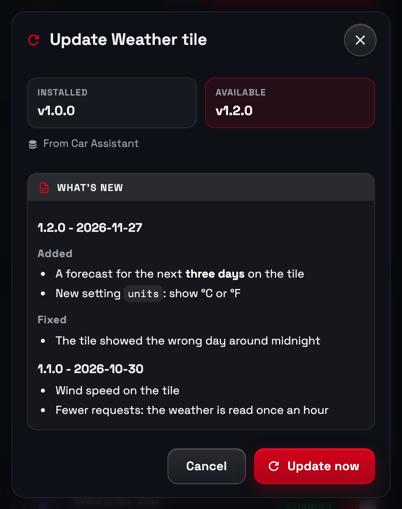

# Sources and packages

🇬🇧 English · [🇩🇪 Deutsch](sources.de.md)

A **source** is a place packages (integrations and plugins) are offered from: a GitHub repository or any https address that serves the same files. The list of sources is **one list for the whole server** (*Integrations / Plugins → Sources*). *Add* and *Manage* work per vehicle.

Nothing is requested from a source on its own - only when you add it, press *Update*, open a package, open the update window of a package (its changelog), install or update it. Only descriptions are read, **nothing from a package is executed** - except the service of a plugin that you approved yourself ([plugins.md](plugins.md#plugins-with-a-service)). Such a package is a readable folder plus a `package.zip`, and the index names its `sha256`.

## Folder rule

```
index.json                  (optional, reserved)
integrations/
  index.json                the list of all integrations of this source
  <id>/plugin.json          one folder per integration - the folder name is the id
plugins/
  index.json                the list of all plugins of this source
  <id>/plugin.json          one folder per plugin
```

Integrations and plugins are separated by the first folder. A source may offer any number of packages (an index is read up to 200 entries).

### `index.json` (one per kind)

```json
{
  "packages": [
    { "id": "example-plugin", "name": "Example plugin", "description": "Short text", "version": "1" }
  ]
}
```

- `id` - lower-case letters, digits, `-`, `_` (2-41 characters); **must equal the folder name**.
- `name`, `description`, `version` - shown under *Add*; a higher `version` than the installed one offers an **Update**. `icon` (optional) - a name from the icon set ([icons.md](icons.md)): the icon of the tile, before anything is installed. Give the same `icon` in the package's `plugin.json`.
- Versions are compared by numbers (`1.10` is newer than `1.9`).

### `plugin.json`

The description of one package, see [plugins.md](plugins.md) (id, name, version, description, author, homepage, settings). The folder decides the kind (integration or plugin); `id` must equal the folder name.

## Troubleshooting

- The package does not show up: press *Update list* under *Add* (nothing is read on its own unless you switch on the daily check in *Settings → System → Package updates*). One source is one repository for Integrations and Plugins alike; the repository may have `integrations/`, `plugins/` or both - a missing folder is fine. The kind's `index.json` must list the package.
- Each package lives in a folder named exactly like its `id` (`plugins/<id>/plugin.json`). An id uses lowercase letters, digits, `-` and `_` only (2-41 characters); anything else is left out and the reason is shown on the source.
- A private repository needs a token (read access to contents).
- The index may be `{"packages": [...]}` or a bare list. A root `index.json` with `{"name": "..."}` gives the source its name.

## Flow

1. **Sources** - add the address of a repository; a private repository needs an *access key* (a read-only token) which stays on the server.
2. **Add** (per vehicle) - the packages of all sources, tap one to read its description, then *Install*.
3. **Manage** (per vehicle) - settings, *Check for updates* (reads the sources and marks tiles that have a newer version) and *Update* on such a tile (it opens [the update window](#updating-a-package)), *Start / Stop* (plugins only; integrations have no on/off), *Uninstall*.

A package that was installed **without a source** (from a file) shows *no source* on its tile and is marked *Installed · no source* under *Add* - it is not offered a second time. When a source offers a **newer** version of it, it gets an *Update* like any other and is linked to that source from then on (settings, token and state stay). When a source offers **exactly the same** version, the card shows a light button *Link to source*: it only links the package to that source (its next updates come from there) - nothing else changes, no download. A source with an older version changes nothing.

**GitHub and its limit.** A public GitHub source is read from `raw.githubusercontent.com`, which has no such quota. The GitHub **API** allows only 60 anonymous requests an hour per internet address - for everyone behind that address - and is used for a source with an access key (the key lifts the limit to 5000) and by other add-ons and tools on your network. Car Assistant keeps every file it read together with the ETag the server named: asking again costs nothing (the server answers "not modified"), a file read in the last ten minutes is not asked for again, and when the limit is hit or the connection is gone the list shows what was known before and says so (*the source did not answer ... the list is as it was known before*) - the access key is not the problem; try again later.

A source can only be deleted when **no package installed from it** remains.

## Updating a package

A tile whose source offers a newer version says **Update available: v1.2.0**. Tap that line - or the *Update* button - and a window opens, like the update of Home Assistant:



- the **installed** and the **available** version, and the source the update comes from,
- **What's new**: the changelog of the package, scrolling inside the window,
- *Cancel* and *Update now*. Nothing is updated before *Update now*, and nothing on its own.

The changelog is read **when the window opens** (one small text file, kept for ten minutes like every file of a source) - never before and never in the background. A package without a changelog says *No changelog available for this package.* A changelog that has no entry for the new version says so, and when the source cannot be reached the window says that the changelog could not be loaded - the update stays possible. A package with a service says that the approval you gave when installing carries over to the new version; a package that still waits for its first approval is reviewed first (*Review and approve*) and has no update window. The window is the same on the Integrations and on the Plugins page.

**While it updates.** *Update now* does not leave the page: the buttons give way to a **bar** that says how far the update is, with the step it is in - *Reading the new version*, *Loading the package* (with the megabytes that have come, for a package with files or a program), *Checking and unpacking the files*, *Saving*, *Starting the new version* - and then the page is read again, with the message. The bar shows what the update really does, not a timer: it never goes back and reaches 100 % only when the update is done. The window cannot be closed while it works. When an update fails, the bar stops where it was and turns red, and the page says why. Only people who may update can ask how far it is.

## The changelog of a package

Put a `CHANGELOG.md` next to the `plugin.json` of a package; the update window shows it.

```
plugins/my-plugin/
  plugin.json
  CHANGELOG.md          the text (also for every language that has no file of its own)
  CHANGELOG.de.md       optional: one file per language, CHANGELOG.<code>.md - the one of the page's language comes first
```

Write it in sections per version, the newest first:

```markdown
## 1.2.0 - 2026-11-27
### Added
- A forecast for the next **three days** on the tile
### Fixed
- The tile showed the wrong day around midnight

## 1.1.0 - 2026-10-30
- Wind speed on the tile
```

- The window shows only **what is new for the person**: the sections newer than the installed version (numbers are compared as numbers: `1.10` is newer than `1.9`). A heading names its version by its first number - `1.2.0`, `v1.2`, `[1.2.0] - 2026-11-27`, `Version 1.2` -; a section without a version (*Unreleased*) is not shown. A text that is not in sections per version is shown as a whole.
- It is **text**: headings, lists, paragraphs, `code`, **bold** and *italic*. A link or a picture shows only its words and HTML is shown as text, so nothing runs: a changelog comes from a source - somebody else's place - and can bring neither a link nor code onto the page. Very long texts are cut (about 24,000 characters).
- The file is read like every other file of a source (a public GitHub repository: `raw.githubusercontent.com`, no quota). The copy of the standard source that comes with the app carries the changelogs, too; a file the copy does not have is read from the source when the window opens.
- `python tools/check_plugin.py` and `python tools/check_source.py` give hints (no errors) when a package has no changelog, only a file of one language, no sections per version, or no section for its current version.
- A package without a changelog (an older one) simply says so in the window - nothing breaks.

## Keeping a source current

Your own plugins and integrations belong in a **source** of their own - one repository with a folder per package - and **not** in a fork of the app: a fork that carries your packages drifts away from the app with every release and has to be pulled up again by hand. A source stays independent of the app, and the app keeps it in view instead:

- `python tools/check_source.py <folder of the source>` reads every package the way **this** version of the app reads it (the same check as `tools/check_plugin.py`), compares the indexes with the folders (ids, versions, checksums) and looks at the vehicle files. Errors end with exit code 1, hints (a typo in a key, a missing icon or translation) are only printed.
- The reusable workflow `.github/workflows/check-source.yml` of the app repository runs it on a source. Copy [`docs/examples/source-ci.yml`](https://github.com/Matze89x/ha-car-assistant/blob/main/docs/examples/source-ci.yml) to `.github/workflows/check.yml` of your source: on every change **and every Monday** the whole source is checked against the newest app, so you hear about a package that no longer fits without having to look. The check lives in the app, so it is always as new as the app; a private source can use it as well. To check against a fixed version, add `with: {app-ref: v0.5.24}`.
- One source for everything that belongs together (the public one for packages anyone may use, a **private** one for personal and car-specific plugins - never public), one folder per package. A package that grows into a project of its own (its own history, releases and helpers) may move to a repository of its own; the source then only lists it.

## Factory setting

After a fresh start the first source is the project's package repository, [ha-car-assistant-sources](https://github.com/Matze89x/ha-car-assistant-sources) - it also holds the instructions for writing your own packages. It can be deleted (when nothing from it is installed) and restored with *Restore the standard source*.

### The standard source comes with the app

A copy of the standard source - its packages and the two demo cars - comes **with every version of the app** (`carassistant/app/carassistant/stdsource/`, made by `tools/sync_stdsource.py`, in the Developer add-on and in the release alike). Until you press *Update list* on it, the list and the packages are read from there: a fresh start and *Just have a look* need no connection and no quota. *Update list* asks GitHub (an unchanged file costs nothing); what it finds is used from then on. A newer version of the app brings a newer copy, and its list shows that copy again until you update it. If the update fails (limit, no network) the list stays as it was and the source says so.
